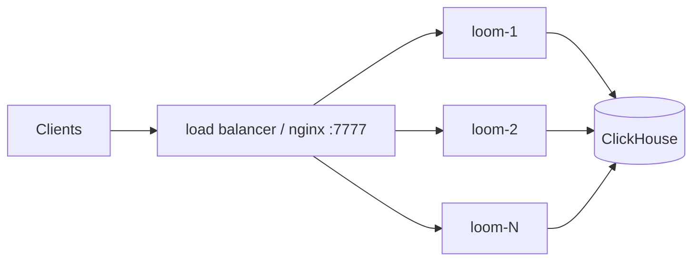
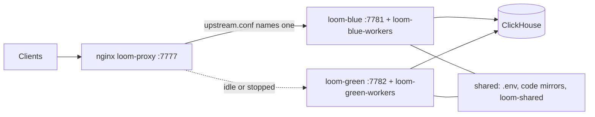

<!-- i18n: source=docs/operations/deployment.md blob=499cdfd2e2f7a23e6940129524e81d1c32c43258 model=claude-sonnet-5-5 -->
> このページは[英語の原文](https://github.com/ClickHouse/loom/blob/main/docs/operations/deployment.md)の機械翻訳です。内容は英語の原文が優先されます。
> Machine-translated from the [English page](https://github.com/ClickHouse/loom/blob/main/docs/operations/deployment.md), which is authoritative.

<a id="deployment"></a>

# デプロイ

Loom は、サーバーイメージ 1 つと ClickHouse（`LOOM_STORAGE_AUTHORITY=postgres` の場合は Postgres も）で構成されます。ドキュメント抽出サービスは別のイメージです（[コンテナイメージ](#container-images)）。サーバーイメージは HTTP、MCP、ダッシュボードを提供し、バックグラウンドワーカーを実行します。コンテナ自体は永続的な状態を持たないため、自由に置き換えたり追加したりできます。Loom のデータは ClickHouse が保持します。アップロードされたドキュメントの原本も含まれますが、原本のバイト列を S3 互換のバケットに保存している場合は除きます（[原本の保存先](https://github.com/ClickHouse/loom/blob/main/docs/features/knowledge.md#where-originals-are-stored)）。[Postgres メモリオーソリティ](../architecture/storage-authority.md#why-two-stores)では、Postgres がライブのメモリとナレッジの状態を保持します。コードインデックスは、ディスク上にベアの git ミラーを保持します。これは ClickHouse が記録しているリモートのキャッシュです。デプロイは、ClickHouse（このオーソリティでは Postgres も）、env 設定、`LOOM_JWT_SECRET`、そして行がバケット内のオブジェクトを参照している間はドキュメントバケットとともに移動します（[デプロイの移行](https://github.com/ClickHouse/loom/blob/main/docs/operations/backup-and-recovery.md#moving-a-deployment)）。`dev/` 配下の compose ファイルが、サポート対象の本番用ファイルです。ここで挙げている設定はすべて、自動生成された[設定リファレンス](https://github.com/ClickHouse/loom/blob/main/docs/reference/configuration.md)に記載されています。

<a id="deployment-ladder"></a>

## デプロイメントラダー

各段階は、前の段階のイメージとスキーマを引き継ぎます。変わるのは、ClickHouse をどこに置くか、およびコンテナをいくつ実行するかです。インストール済みスタックと、クローンから作るローカルスタックでは、Loom の隣でドキュメントエクストラクターが動作します。それより下の段階では動作しないため、`LOOM_DOCUMENT_EXTRACTOR_URL` を、自分で実行しているエクストラクターに向けてください（[コンテナイメージ](#container-images)）。

| 段階                          | 起動方法                                                                                               | ClickHouse                                         | 用途                                      |
| ----------------------------- | ------------------------------------------------------------------------------------------------------ | -------------------------------------------------- | ----------------------------------------- |
| インストール済みスタック      | `install.sh` → `compose.yaml`                                                                          | 同梱コンテナ、自己管理のサーバー、または Cloud     | 評価、単一ホスト                          |
| クローンから作るローカルスタック | `loom up` または `make dev` → `compose.yaml` + `dev/docker-compose.dev.yml`                         | 同梱コンテナ（`loom-ch`）                          | 開発                                      |
| Web とワーカーを分離          | `make dev-cloud` → `dev/docker-compose.cloud.yml`                                                      | 自己管理のサーバーまたは Cloud                     | チーム向け、本番の構成                    |
| N 個の同一レプリカ            | `dev/docker-compose.replicas.yml`：nginx の背後にレプリカを置き、1 つずつ入れ替える                    | 自己管理のサーバーまたは Cloud                     | スケールアウト、ローリング再起動とアップグレード |
| ゼロダウンタイムのペア（任意） | `./redeploy.sh`：`dev/docker-compose.colour.yml` の 2 つのプロジェクトを `dev/docker-compose.proxy.yml` の背後に置く | 自己管理のサーバーまたは Cloud                     | 接続拒否の時間帯が発生しないデプロイ      |

サイジング（Web レプリカ数、uvicorn のプロセス数、ワーカーコンテナ）については、[障害と復旧](https://github.com/ClickHouse/loom/blob/main/docs/architecture/failure-and-recovery.md)を参照してください。判断の基準は[モニタリング](https://github.com/ClickHouse/loom/blob/main/docs/operations/monitoring.md#what-to-alert-on)のメトリクスです。

<a id="choosing-the-clickhouse"></a>

## ClickHouse の選択

`compose.yaml` が同梱されている唯一のスタックです。その `clickhouse` サービスは Compose の `bundled` プロファイルで動くため、`.env` の `COMPOSE_PROFILES` が接続先を決めます。

| ターゲット                  | インストール                                                                                                                          | `.env`                                           |
| --------------------------- | ------------------------------------------------------------------------------------------------------------------------------------- | ------------------------------------------------ |
| 同梱コンテナ（デフォルト）  | `curl -fsSL …/install.sh -o loom-install.sh && sh loom-install.sh && rm loom-install.sh`                                              | `COMPOSE_PROFILES=bundled`、`LOOM_CH_*` なし     |
| セルフマネージドサーバー    | `curl -fsSL …/install.sh -o loom-install.sh && sh loom-install.sh --clickhouse http://loom@ch.example.com:8123 && rm loom-install.sh` | `COMPOSE_PROFILES=` と URL から得た `LOOM_CH_*`  |
| ClickHouse Cloud            | `curl -fsSL …/install.sh -o loom-install.sh && sh loom-install.sh --clickhouse https://loom@<host>:8443 && rm loom-install.sh`        | `COMPOSE_PROFILES=` と URL から得た `LOOM_CH_*`  |

これらはいずれも、自分だけが書き込めるディレクトリで実行してください（[クイックスタート](../getting-started/quickstart.md#fast-path-released-image-no-clone)）。
`curl -fsSL …/install.sh -o loom-install.sh && sh loom-install.sh --bundled && rm loom-install.sh` を実行すると、インストールを同梱コンテナに戻せます。

- **Keeper。** サーバーには Keeper が必要です。ない場合、`loom ch-setup` は停止し、追加方法を表示します。代わりに `--bundled` を使うと、インストールを同梱の ClickHouse に切り替えます。
- **ユーザー。** Cloud の `default` のような管理者ではなく、Loom 専用のユーザー（上の `loom`）を用意してください。管理者を使うと、Loom がサービス上のすべてのデータベースとユーザーを管理できてしまいます。URL にはユーザーを指定する必要があります。
- **URL。** `http://` のデフォルトはポート 8123、`https://` は 8443 と TLS です。ユーザー名またはパスワード中の `@`、`:`、`/`、`%` はパーセントエンコードしてください。空のパスワードは `user:@host` または `LOOM_CH_PASSWORD=` と書きます。`--clickhouse` の代わりに `LOOM_CH_URL` も使えます。Docker ホスト上のサーバーは `host.docker.internal` です。コンテナ内の `localhost` はコンテナ自身を指します。
- **パスワード。** `LOOM_CH_PASSWORD` を設定するか、エコーされないプロンプトに入力してください。URL に含めても動作しますが、`ps` やシェルの履歴から見えてしまいます。パスワードは `.env` にのみ書き込まれ、そのファイルはモード 600 で、`\`、`"`、`$` をエスケープしたダブルクォートで囲まれ、Compose が正確に読み戻せます。この `.env` は Compose 用です。Loom コマンドは `docker compose --project-directory ~/.loom run --rm loom loom …` で実行してください。チェックアウトの `LOOM_ENV_FILE` をこれに向けると、エスケープの解釈が異なるため使えません。
- **セットアップ。** 自前のサーバーを使う場合、インストーラーは Loom を起動する前に `loom ch-setup` を実行します。これは `loom` データベースと読み取り専用の `loom_reader` ユーザー（後述）を作成し、バージョンと権限を確認します。いつでも `docker compose --project-directory ~/.loom run --rm loom loom ch-setup` で再実行できます。すでに存在するものには手を加えません。プロファイルや権限が `ch-setup` の与えるものと異なる `loom_reader` は、まさにその内容（`loom.*` への SELECT のみ、現行の上限）に作り直されます。そのため、管理者がこれに追加したロール、権限、`REVOKE` は再実行すると残りません。インストーラーはインストールとアップグレードのたびに `ch-setup` を再実行します。既存の `loom_reader` が置き換えられるのは、`ch-setup` が与える形（同名の設定プロファイルを持つパスワードユーザー）であり、かつ `LOOM_CH_PASSWORD` でログインできる場合だけです。それ以外の同名のものには手を加えません。
- **管理者権限がない場合。** ユーザーがデータベースを作成できない、マイグレーションが読むシステムテーブルを読めない、マイグレーションに必要な `loom_telemetry` の権限を持たない、またはリーダーやその設定プロファイルを作成できない場合、`ch-setup` は停止し、管理者向けの SQL を表示します（パスワードはプレースホルダーです）。`loom ch-setup --print-sql` は接続せずにそれを表示します。この SQL は、`GRANT CURRENT GRANTS` によって、管理者が `loom.*` と `loom_telemetry.*` に持つすべての権限を Loom ユーザーに付与します（ClickHouse Cloud は `GRANT ALL` を受け付けません）。さらに、Loom が読むシステムテーブルへの `SELECT` と、`clusterAllReplicas` が全レプリカにバージョンを問い合わせるために必要な `READ ON REMOTE` を付与します（セルフマネージドサーバーでは `SHOW GRANTS` に `REMOTE` と表示されます。`remote()` 経由の書き込みは引き続き拒否されます）。リーダーは `OR REPLACE` で作成されるため、同名の別アカウントがないことを確認してください。`ch-setup` 自身が SQL を実行する場合は、Loom のものだと確認できないアカウントは拒否します。
- **他のユーザーのクエリ。** Loom は各リクエストのコストを知るために `system.query_log` を、自身のステートメントがまだ実行中かを確認するために `system.processes` を読みます。そのため Loom ユーザーは、そのサーバー上のすべてのユーザーの過去および実行中のクエリを、リテラルを含めて見られます。Loom を共有するサーバーでは、セルフマネージドの管理者が両方を Loom 自身のものに限定できます。`CREATE ROW POLICY loom_own ON system.query_log, system.processes USING user IN ('loom', 'loom_reader') TO loom`。ClickHouse Cloud ではシステムテーブルに行ポリシーを設定できません。
- **切り替え。** 自前のサーバーに移行するには、`--clickhouse` を付けてインストールコマンドをもう一度実行します（上の表）。Loom はそこにある空の `loom` データベースで起動します。同梱コンテナは、停止するまで古いボリュームのまま動き続けます（インストーラーが停止コマンドを表示します）。データが必要な場合は、先に[バックアップとリストア](https://github.com/ClickHouse/loom/blob/main/docs/operations/backup-and-recovery.md)でコピーしてください。

起動のたびに、接続する前に同じチェック（最も古いレプリカのバージョン、データベース、権限、Keeper）を実行し、対処法を示す 1 行を出して停止します。すべての Loom プロセスは、起動のたびに、`loom.*` に対する `CREATE TABLE`、`CREATE VIEW`、`ALTER TABLE`、`ALTER VIEW`、`DROP TABLE`、`DROP VIEW`、`INSERT`、`SELECT`、`OPTIMIZE`、`TRUNCATE` をチェックされます。これは起動時マイグレーションの有効・無効にかかわらず行われます。マイグレーション以外にも、保持期間の TTL の設定、プロバイダーテーブルのコンパクションと再構築を行うためです。`loom.*` に対する `SYSTEM REFRESH VIEW` がない場合は、警告つきで起動します。削除されたコードは、次にスケジュールされたリフレッシュまでリフレッシュ可能ビューに残ります。管理者による `GRANT CURRENT GRANTS ON loom.*` で、これらすべてがまかなえます。マイグレーションを行うプロセスには、さらに `loom_telemetry.*`（リクエスト SLI ロールアップのデータベース）に対する `CREATE DATABASE`、`CREATE TABLE`、`CREATE VIEW`、`INSERT`、`SELECT` も必要です（`GRANT CURRENT GRANTS ON loom_telemetry.*`）。レプリカバージョンとシステムテーブルの読み取り、およびマイグレーションだけが必要とする `loom_telemetry` の権限は、保留中のマイグレーションがない場合、または起動時マイグレーションが無効の場合に限って緩和されます。マイグレーションを行わないサーバーでも、`loom_telemetry.*` への `SELECT` がないと警告が出ます。その場合、`/v1/admin/schema.status` はロールアップが存在しないと報告し、ビューのリフレッシュゲージからそのリフレッシュが除外され、`loom.sli.rollup_lag_s` と `loom.sli.rollup_missed_rows` は報告されないため、それらに対するアラートは発火しません。`loom doctor` はこれらのチェックを `clickhouse_preflight` として報告します。

<a id="local-stack-from-a-clone"></a>

### クローンからのローカルスタック

`loom up`（または `make dev`）は、`.env.example` から `.env` を作成し（既存のものに extractor トークンがなければ追加し）、テンプレートから `deploy/clickhouse-config/named_collections.xml` を作成してから、次を実行します。

```bash
docker compose --env-file .env -f compose.yaml -f dev/docker-compose.dev.yml --profile bundled up -d --build
```

このオーバーライドは、チェックアウトからイメージをビルドし、Loom を同梱の ClickHouse に固定します。チェックアウトの `.env` はホスト上の `make server` でも使われるためです。Compose は最初の `-f` ファイル（ここではルートのもの）の隣にある `.env` を読みます。`--env-file .env` はそれを明示しているだけです。

| サービス     | コンテナ         | ポート                         | 役割                                                                                                |
| ------------ | ---------------- | ------------------------------ | --------------------------------------------------------------------------------------------------- |
| `clickhouse` | `loom-ch`        | `8123`（HTTP）、`9000`（ネイティブ） | ClickHouse OSS（イメージ固定）、データベース `loom`、ユーザー `loom`、パスワード `loomdev`。       |
| `loom`       | `loom-server`    | `7777`                         | HTTP、MCP、ダッシュボード、バックグラウンドワーカーを 1 プロセスで実行。`Dockerfile` からビルド。  |
| `extractor`  | `loom-extractor` | なし                           | ドキュメント抽出サービス。`extractor/Dockerfile` からビルドし、`loom` だけが共有するネットワーク上で動作。 |

同梱の ClickHouse は、`deploy/clickhouse-config/` のファイルで起動します。

| ファイル                                | 目的                                                                                                                    |
| --------------------------------------- | ----------------------------------------------------------------------------------------------------------------------- |
| `lemmatizers.xml` + `deploy/lemmagen3/` | アドホックな `lemmatize('en', …)` クエリ用の英語レンマタイザー。Loom 自体は Python でレンマ化します。                   |
| `nlp_user_settings.xml`                 | `loom_reader` ユーザーとプロファイル（後述）、テナントごとのクォータ、実験的な NLP と AI SQL のフラグ。                  |
| `keeper.xml`                            | 組み込みの単一ノード Keeper。`KeeperMap` テーブルが動作します。                                                         |
| `named_collections.xml`                 | ClickHouse の `ai*` SQL 関数用の名前付きコレクション。Git 管理外で、同梱時点では何も定義せず、キーは `from_env` で渡します。 |

- **読み取り専用ユーザー。** Loom は、呼び出し元が形を決める読み取り（`code.grep`、パターン付きの `code.search`、`memory.aggregate`、`memory.record.query`）を `LOOM_CH_READER_USER` として実行します。`compose.yaml` とローカルスタックはこれを `loom_reader` に設定します（`dev/docker-compose.cloud.yml` では `.env` で設定してください）。そのため、これらは書き込み、スキーマ変更、権限付与ができません。このユーザーは `loom.*` への SELECT のみを持ち（`system.query_log` は読めません）、読み取り専用プロファイルを持ちます。そのプロファイルの時間、メモリ、読み取り行数の上限には、どのステートメントも超えられない天井と、下回れない下限があり（時間は 0.05 秒で、`code.grep` のステートメント下限）、`SETTINGS` 句でも変更できません。パスワードは `LOOM_CH_PASSWORD` です。同梱サーバーでは `nlp_user_settings.xml` で定義されます。ほかのサーバーでは、`loom ch-setup` が現在の `LOOM_CH_CALLER_SHAPED_*` の値から、同じユーザーとプロファイルを SQL で作成します。同梱サーバーでこれらの設定を引き上げるには、XML のプロファイルも引き上げる必要があります。それ以外では、途中でプロファイルの範囲により読み取りが失敗しないよう、上限を上げるときは `.env` を変更し、`ch-setup` を再実行してから、Loom を再作成します（`up -d --force-recreate loom`）。下げるときは `.env` を変更し、Loom を再作成してから、`ch-setup` を再実行します。リーダーと共有している `LOOM_CH_PASSWORD` を変更した後は、リーダーを削除し（`DROP USER loom_reader; DROP SETTINGS PROFILE loom_reader`）、`ch-setup` を再実行してください。これは、現在のパスワードでログインできるリーダーだけを置き換えます。サーバーは起動時にこのユーザーを検査します。ClickHouse がこれを拒否すると、`/v1/health` と `loom doctor` は `ch_reader_user_failing` を報告します。マイグレーションが `loom.memory` を作成する前は、検査は何も報告せず、`loom doctor` はリーダーユーザーが検査されなかったと表示します。空に設定すると（`.env` の `LOOM_CH_READER_USER=`）、`ch-setup` はリーダーを作成せず、読み取りは `LOOM_CH_USER` として実行されます。
- **ポート。** `8123` または `9000` が使用中の場合は、`.env` で `LOOM_CH_HOST_PORT` または `LOOM_CH_NATIVE_HOST_PORT` を設定してください。これらはホスト側だけの Compose 変数で、コンテナは常に `clickhouse:8123` に接続します。
- **ボリューム。** `loom-ch-data`（ClickHouse）と `loom-code-repos`（git ミラー）です。`make down` はこれらを残し、`make down-all` は削除します。
- **外部システムなし。** ローカルスタックは Langfuse も ClickStack も実行しません。それらの消去手順は、設定するまで何もしません。
- **ソースから。** `make server` は、ClickHouse の `.env` の名前（未設定なら localhost:8123）を使って、`:7777` でリロード付きの uvicorn を実行します。先に `make frontend-build` でダッシュボードをビルドしてください。そうしないとそのページは 503 を返します。コントリビューター向けのセットアップは[ローカル開発](https://github.com/ClickHouse/loom/blob/main/docs/development/local-development.md)にあります。

<a id="web-and-workers-apart"></a>

### Web とワーカーの分離

```bash
cp .env.example .env    # then set LOOM_CH_*, auth and providers (below); COMPOSE_PROFILES=
make dev-cloud
```

`dev/docker-compose.cloud.yml` は、チェックアウトからイメージをビルドし、そのイメージから 2 つのコンテナを、`.env` の ClickHouse に対して実行します（先に一度、それに対して `loom ch-setup` を実行してください）。

| コンテナ       | 役割                                                      | 主な環境変数                                                                      |
| -------------- | --------------------------------------------------------- | --------------------------------------------------------------------------------- |
| `loom-server`  | `:7777` の Web ティア：HTTP、MCP、ダッシュボード          | `LOOM_BACKGROUND_WORKERS=off`                                                     |
| `loom-workers` | バックグラウンドワーカー。内部の `:7778` に `/v1/health` | `LOOM_BACKGROUND_WORKERS=auto`、`LOOM_WEB_WORKERS=1`、`LOOM_SERVES_TRAFFIC=false` |

長時間のワーカー処理はクライアントリクエストとイベントループを共有しないため、リクエストのレイテンシとして現れることはありません。単一のコンテナでも同じ効果が得られます。リースを保持するプロセスが、子プロセスでワーカーを実行するためです（[N 個の同一レプリカ](#n-identical-replicas)）。両方のコンテナは同じ `.env` を読み、同じ `var/code_repos` ディレクトリをマウントするため、同一ホスト上では git ミラーを共有します。ドキュメント、キー、ワーカーのリースは ClickHouse にあるため、別ホストのレプリカがそのディレクトリを共有する必要はありません。各レプリカが自分のミラーを持ち、マウントは再起動をまたいで保持するためだけのものです。`LOOM_SERVES_TRAFFIC=false` により、ワーカーのコンテナは、レート制限の除算に使われるレプリカ数に含まれません。先に起動したほうが、保留中のマイグレーションを適用します（[アップグレード](https://github.com/ClickHouse/loom/blob/main/docs/operations/upgrades.md#how-migrations-run)）。

<a id="how-settings-are-read"></a>

## 設定の読み込み方法

- すべての設定は環境変数 `LOOM_<FIELD>` です。プロバイダーのキーは独自の名前をそのまま使います（`OPENAI_API_KEY`、`ANTHROPIC_API_KEY`、`GEMINI_API_KEY`）。サーバーは起動時に一度だけ環境変数を読み込むため、変更を反映するには再起動が必要です。
- live と記された設定には、デプロイメント全体の上書き（`loom settings set`、ダッシュボード）も使えます。この上書きは環境変数とすべてのファイルより優先され、再起動なしで数秒以内に適用されます（[ランタイム設定](runtime-settings.md)）。
- 作業ディレクトリの `.env` はデフォルトで読み込まれます。`LOOM_ENV_FILE` で別のファイルを指定でき、空の値を指定するとファイルを読み込みません。`.env.example` はコメント付きのテンプレートです。
- シークレットではない設定は、`LOOM_SETTINGS_FILE` が指すパスの YAML 設定ファイルにも記述できます（生成される `loom.example.yaml` はすべての設定をデフォルト値で列挙し、そのスキーマは `schemas/loom-settings.schema.json` です）。環境変数と `.env` が YAML 設定ファイルより優先されます。シークレット、重複して指定されたキー、未対応の `version`、型が誤っている値、または範囲外の値（環境変数で上書きされる値も含む）があると、サーバーは起動時に停止します。どの設定にも存在しない名前はログに記録されて無視されるため、前のビルドのレプリカでも、新しい設定を含むファイルで起動できます。`LOOM_SETTINGS_FILE` は環境変数または `.env` で設定できます。compose ではコンテナー内のパスを指定するため、ファイルをすべての Loom サービスにマウントしてください。マウントしないと、存在しないファイルを指定したことになり、起動を拒否します。`compose.yaml` では、`loom` サービスの `volumes:` に `./loom.yaml:/app/config/loom.yaml:ro` を追加します。`dev/docker-compose.cloud.yml` では、`x-loom-common` の `volumes:` に `../loom.yaml:/app/config/loom.yaml:ro` を追加します（相対パスは `dev/` を基準に解決されます）。このリストは両方のサービスが共有します。一方のサービスに `volumes:` キーを書くと、そのリストに追加されるのではなく置き換えられます。
- compose ファイルの `environment:` は `.env` より優先されます。`dev/docker-compose.dev.yml` は ClickHouse の接続と `LOOM_SELF_SIGNUP=open` を固定しているため、ローカルスタックでは `.env` のこれらの行は効果がありません。`compose.yaml` と `dev/docker-compose.cloud.yml` はこれらを `.env` から取得します。
- 起動のたびに事前に検証してください。次のコマンドは、何も起動せずに JSON 値の設定における引用符の誤りを検出します。

  ```bash
  docker compose --env-file .env -f dev/docker-compose.cloud.yml config >/dev/null
  ```

- `/v1/health` と `loom doctor` は、解決されたプロバイダー、ID モード、およびすべての設定上の問題とその対処方法を報告します。

<a id="required-environment"></a>

## 必須の環境変数

他のユーザーがアクセスできるデプロイメントには、最低限次の設定が必要です。

```bash
LOOM_CH_HOST=...
LOOM_CH_PORT=8443                  # 8123 for plain HTTP to a self-managed server
LOOM_CH_USER=...
LOOM_CH_PASSWORD=...
LOOM_AUTH_REQUIRED=true
LOOM_IDENTITY_PROVIDER=trust-network        # or gateway
LOOM_JWT_SECRET=<32+ random bytes>          # python -c 'import secrets; print(secrets.token_urlsafe(32))'
LOOM_PLATFORM_ADMINS=alice                  # SSO emails, or login handles once their account exists
LOOM_REQUIRE_REAL_PROVIDERS=true            # a fake or keyless provider makes /v1/health degraded
# providers: see below
```

<a id="clickhouse-connection"></a>

### ClickHouse 接続

| 変数               | デフォルト  | 設定する値                                                                           |
| ------------------ | ----------- | ------------------------------------------------------------------------------------ |
| `LOOM_CH_HOST`     | `localhost` | ローカルスタック以外では、使用するサービス。                                         |
| `LOOM_CH_PORT`     | `8123`      | ClickHouse Cloud や HTTPS エンドポイントでは `8443`。                                |
| `LOOM_CH_SECURE`   | 未設定      | `8443` 以外のポートで HTTPS を使う場合は `true`（未設定の場合はポートから TLS を推測します）。 |
| `LOOM_CH_USER`     | `loom`      | Loom のデータベースにテーブルを作成できるユーザー。Cloud のデフォルトユーザーは `default` です。 |
| `LOOM_CH_PASSWORD` | `loomdev`   | 実際のパスワード。デフォルト値は開発用のプレースホルダーです。                       |
| `LOOM_CH_DATABASE` | `loom`      | Loom のスキーマを置くデータベース。最初のマイグレーションの前に設定してください。詳細は後述します。 |

`LOOM_CH_DATABASE` は、すべてのテーブル、ビュー、およびマイグレーション台帳を保持するデータベースの名前です。`LOOM_CH_TELEMETRY_DATABASE`（デフォルトは `loom_telemetry`）は、Loom が自身のテーブルから導出するテレメトリを保持するデータベースの名前です。ステートメントとマイグレーションは `loom.<table>` と `loom_telemetry.<table>` に対して記述されており、Loom は各ステートメントが ClickHouse に届く箇所で、この2つの名前をこれらの設定に対応付けます（`server/core/ch_names.py`）。KeeperMap テーブルの Keeper パスもスキーマに合わせて移動します（`/<database>/task_leases`）。2つのデプロイメントが、それぞれ別のデータベースのペアを使って1つの ClickHouse サービスを共有することもできます。

名前は最初のマイグレーションの前に決めてください。新しい名前を指定すると、Loom は空のスキーマを指すことになります。そのため、`loom` に Loom のスキーマが存在する間は、指定したデータベースが存在しない場合、またはテーブルがあるのに Loom の台帳がない場合、サーバーまたはワーカーのプロセスは（マイグレーションを行うかどうかにかかわらず）起動を拒否します。2つ目のスキーマを意図的に開始するには、先にそのデータベースを空の状態で作成してください。名前を変更したスキーマは、独自の `LOOM_CH_TELEMETRY_DATABASE` を指定します。名前は英字または `_` で始まり、英字、数字、`_`、`-` を含められます。ただし `default`、`system`、`information_schema`、およびスキーマがテーブル名やエイリアスに使う名前（たとえば `memory`）は使えません。これらは、Loom が読み戻す DDL 中でデータベース名と区別できないためです。

<a id="identity-and-authentication"></a>

### ID と認証

| 変数                     | デフォルト                             | 設定する場面                                                                                                            |
| ------------------------ | -------------------------------------- | ----------------------------------------------------------------------------------------------------------------------- |
| `LOOM_AUTH_REQUIRED`     | `true`（標準の `.env` では `false`）   | 他のユーザーがアクセスできる環境では `true` のままにします。                                                            |
| `LOOM_IDENTITY_PROVIDER` | 空（推測）                             | デプロイメントでは常に `trust-network` または `gateway` を指定します。`single-user` は `LOOM_AUTH_REQUIRED` の値にかかわらず認証を無効にします。 |
| `LOOM_SELF_SIGNUP`       | `off`                                  | `open` にするとダッシュボードでブラウザからのサインアップが有効になります。ループバック以外にバインドする場合は `LOOM_IDENTITY_PROVIDER=trust-network` も必要です。 |
| `LOOM_SELF_SIGNUP_ORG`   | `dev`                                  | サインアップしたアカウントを独自の組織に所属させたい場合。                                                              |
| `LOOM_DEFAULT_NAMESPACE` | `local`                                | `single-user` モードが提供する唯一の名前空間の名前を変更する場合。認証が必須のときは無視されます。                      |
| `LOOM_JWT_SECRET`        | リポジトリに含まれる開発用シークレット | 認証を有効にする場合は常に設定します。                                                                                  |
| `LOOM_PLATFORM_ADMINS`   | 空                                     | オペレーターを指定する場合。`platform_admin` になる唯一の経路です。                                                     |
| `LOOM_TRUSTED_CALLERS`   | 空                                     | `gateway` モードで、サブジェクトが `X-Loom-On-Behalf-Of` を送信してエンドユーザーの代理として動作できるようにする場合。 |

- **`LOOM_JWT_SECRET`** はルートシークレットです。kid `default`（HS256）でトークンに署名し、保存されているすべての認証情報と、`loom.signing_keys` 内のすべての署名鍵を封印します。デプロイメントを移行する際に持ち運ぶ必要がある唯一のシークレットです。認証を有効にしたデプロイメント（`LOOM_DEPLOYMENT=1`、compose ファイルが設定します）は、リポジトリに含まれる値のままでは起動を拒否します。この値を使えるのはローカルスタック（`LOOM_INSTANCE_LABEL=deploy:dev`）だけです。他のプロセスは `/v1/health`（`dev_jwt_secret`）と `loom doctor` で警告されます。
- **署名鍵のローテーション。** `loom signing-key rotate [--algorithm HS256|RS256]` は新しい鍵を ClickHouse に書き込みます。すべてのプロセスが鍵を読み込んだ後、`--activate-in` 秒（300）後から署名に使われます。古いトークンは、`loom signing-key retire <kid>` を実行するまで、ヘッダーの `kid` で検証されます。環境変数の変更も再起動も不要です（[トークンと権限付与](https://github.com/ClickHouse/loom/blob/main/docs/guides/tokens-and-grants.md#revoke-and-rotate)）。`LOOM_JWT_SECRET` 自体を置き換えると、すべてが再暗号化の対象になります。それで署名されたトークン（kid `default`）は検証されなくなるため、新しいトークンを発行してください。その下で封印されたキーリングの鍵と保存済みの認証情報（リポジトリトークン、トラッカーソースのパスワード、ドキュメントソースの認証情報、プロバイダーキー）は、古い値を `LOOM_JWT_SECRET_PREVIOUS` に設定している間だけ開けます。この変数はトークンの検証には使われません。手順は次のとおりです。`.env` で新しいルートを `LOOM_JWT_SECRET` に、古いものを `LOOM_JWT_SECRET_PREVIOUS` に設定します。その環境変数を持つコンテナ内で `loom secrets reseal --dry-run && loom signing-key record-root && loom deployment publish --yes` を実行します（ドライランは、古いルートがまだ記録されている間に以前のルートを確認します）。コンテナを再作成します。`loom secrets reseal` を実行します。`loom secrets reseal --check` が 0 で終了したら `LOOM_JWT_SECRET_PREVIOUS` を削除します。古いルートで封印されたままの値は、これがないと開けなくなるためです。キーリングのコマンドと `loom mint-token` は、記録されているもの以外のルートシークレットでは実行を拒否します。別のルートシークレットを持つプロセスは、`/v1/health`（`keyring_root_mismatch`、`signing_keys_unsealable`）と `loom doctor`（`signing_keyring`）で警告されます。
- **`LOOM_PLATFORM_ADMINS`。** トークンと権限付与が名前空間に対して持てるのは `viewer`、`writer`、`admin` のみです。ログインハンドルを指定すると、そのパスワードアカウントが昇格します。メールアドレスを指定した場合は、プロバイダーが検証済みの OIDC サインインだけが昇格します（セルフサインアップのメールアドレスは対象になりません）。`loom set-host <handle-or-email>` はこの変数を `.env` に書き込みます（`--append` でリストに追加します）。対象の人は、ロールを反映するために再度サインインします。セルフサインアップは、リストにあるハンドルを新しい名前として使うことを拒否するため、先にアカウントを作成してから、そのハンドルをリストに追加してください。

<a id="public-url-and-clients"></a>

### 公開 URL とクライアント

| 変数                   | デフォルト       | 設定する場面                                                                                                                                                  |
| ---------------------- | ---------------- | ------------------------------------------------------------------------------------------------------------------------------------------------------------- |
| `LOOM_PUBLIC_BASE_URL` | 空               | ループバック以外では常に設定します。ループバック以外の `LOOM_BIND_HOST` は、これがないと起動を拒否します。空の場合はリクエスト自身の `Host` を使います。       |
| `LOOM_BIND_HOST`       | `127.0.0.1`      | Loom に他のユーザーがアクセスできる必要がある場合。コンテナ内では、ポートを公開するアドレスです。                                                             |
| `LOOM_TRUSTED_PROXIES` | `127.0.0.1`      | プロキシやロードバランサーの背後では必須です。そのアドレスまたは CIDR を指定します。それらのピアの `X-Forwarded-For`/`-Proto` だけが有効になります。          |
| `LOOM_ALLOW_INSECURE`  | `false`          | アクセス可能なポートでは使わないでください。ループバック以外へのバインドで、[プロキシと TLS](#proxy-and-tls) の起動時の拒否を、`LOOM_PUBLIC_BASE_URL` 未設定の場合を除いてスキップします。 |
| `LOOM_OAUTH_ENABLED`   | `false`          | ワンクリックの MCP 接続（トークンを貼り付ける代わりに OAuth 2.1 のブラウザサインインを使う方式）を使いたい場合。                                              |
| `LOOM_OAUTH_ISSUER`    | 空               | OAuth を有効にした場合：ディスカバリーメタデータが示す公開 HTTPS のベース URL。空の場合はリクエストごとに導出します。                                         |
| `LOOM_CORS_ORIGINS`    | 空（CORS 無効）  | 別のオリジンのブラウザアプリケーションが Loom を直接呼び出す場合。そのオリジンだけを列挙してください。`*` は起動を拒否されます。                              |

ID プロバイダー経由のサインイン（ダッシュボード、`loom login`、OAuth）には、`LOOM_OAUTH_LOGIN_PROVIDER=oidc` と `LOOM_OIDC_*` の設定が必要です。手順は[シングルサインオン](sso.md)を参照してください。

<a id="process-and-scale"></a>

### プロセスとスケール

| 変数                             | デフォルト                  | 設定する場面                                                                                                                                                                                                                                                                                                                                                                                                                                        |
| -------------------------------- | --------------------------- | --------------------------------------------------------------------------------------------------------------------------------------------------------------------------------------------------------------------------------------------------------------------------------------------------------------------------------------------------------------------------------------------------------------------------------------------------- |
| `LOOM_BACKGROUND_WORKERS`        | `auto`                      | すべてのレプリカで `auto` のままにします。デプロイメントごとに1つのプロセスが ClickHouse を通じた選出によってワーカーを実行します。`on` は選出をスキップし、リースの行を書き込みません。`auto` のプロセスがリースを保持していない限り、他のプロセスは `workers_lease_absent` を報告します。`off` はワーカーを一切実行しません。                                                                                                                      |
| `LOOM_WORKERS_PROCESS`           | `child`                     | `inline` はワーカーをサービス提供側のイベントループ上で実行します（トラフィックを処理しないコンテナ向け）。                                                                                                                                                                                                                                                                                                                                         |
| `LOOM_SHUTDOWN_READY_DELAY_S`    | `15`                        | `/v1/health/ready` が 503 を返してから、ロードバランサーがレプリカを切り離すのに 15 秒（プローブ間隔 × 失敗しきい値）より長くかかる場合。                                                                                                                                                                                                                                                                                                            |
| `LOOM_READY_REQUIRES_MIRRORS`    | `false`                     | `true` にすると、ミラーのウォームアップがクローンをキューに入れるまで、およびクローンの実行中または待機中は、レプリカが ready になりません（失敗したクローンは保留の対象にならず、doctor がその名前を表示します）。`LOOM_CODE_MIRROR_WARMUP` を有効にする必要があります。無効の場合、起動時には何もクローンされません。                                                                                                                              |
| `LOOM_WEB_WORKERS`               | イメージ：CPU ごとに1つ、最大8 | コンテナごとの uvicorn プロセス数。未設定の場合、イメージはコンテナが使える CPU（cpuset、`--cpus` の割り当てで下げられた値）ごとに1つ、メモリ 1 GiB あたり最大1つ、最大8つを起動します。共有ホストで ClickHouse 用にコアを残したい場合は数値を設定します。ClickHouse がホストを共有するスタンドアロンスタックのデフォルトは2、`dev/docker-compose.cloud.yml` と `dev/docker-compose.colour.yml` の Web ティアのデフォルトは1です（`.env` に数が指定されている場合を除く）。 |
| `LOOM_REPLICA_COUNT`             | `1`                         | レート制限を割る際のレプリカ数の下限（稼働中でサービスを提供している `loom.instances` の行数）であり、それらの行を読み取れない間に使われる数です。                                                                                                                                                                                                                                                                                                  |
| `LOOM_LATENCY_BUDGET_MULTIPLIER` | `1.0`                       | ClickHouse が WAN の先にある場合：約 `20` にしないと、すべての呼び出しでバジェット違反が報告されます。                                                                                                                                                                                                                                                                                                                                              |
| `LOOM_LOG_FORMAT`                | `text`                      | ログパイプラインを使う場合は `json`。                                                                                                                                                                                                                                                                                                                                                                                                               |

compose ファイル以外で起動したプロセス（`make server`、`loom serve`、テストサーバー）は、`LOOM_INSTANCE_LABEL=<who>:<what>:<port>` を設定する必要があります。設定しないと起動を拒否します。compose ファイルは `LOOM_DEPLOYMENT=1` を設定し、サービスに `deploy:web`、`deploy:workers`（ゼロダウンタイムのペアでは `:<colour>` 付き）、または `deploy:dev` というラベルを付けます。そのため、`.env` には `LOOM_DEPLOYMENT` を書かないでください。

<a id="clickhouse-requirements"></a>

## ClickHouse の要件

Loom 自体にサーバー設定は不要です。Loom が依存するテーブル設定は Loom のテーブルに設定されており（`032_table_settings.sql`）、`loom ch-setup` が SQL でデータベースとリーダーユーザーを作成します。

| 要件                      | 理由                                                                                                                                                                                                                                                                       | ClickHouse Cloud                                                                            | セルフマネージド                                                                                                                                                                                        |
| ------------------------- | -------------------------------------------------------------------------------------------------------------------------------------------------------------------------------------------------------------------------------------------------------------------------- | ------------------------------------------------------------------------------------------- | ------------------------------------------------------------------------------------------------------------------------------------------------------------------------------------------------------- |
| バージョン 26.4 以降      | すべてのマイグレーションを適用できる最も古いサーバーです（26.3 では `stem()` がまだ制限されています）。これより古いサーバーでは起動を拒否します                                                                                                                             | サービスのバージョン。最も古いレプリカが基準になります                                      | サーバーをアップグレードしてください。CI は最新リリースのみをテストします（`dev/clickhouse_release.sh`）。リリースバンドルには、ビルド時点で最新だったリリースが指定されています                         |
| 権限                      | `loom.*` と `loom_telemetry.*` に対するすべての権限（`GRANT ALL`、Cloud では `GRANT CURRENT GRANTS`）：マイグレーションはテーブルとビューを作成、変更、削除し、Loom は実行時にテーブルを再構築しビューを更新します。読み取るシステムテーブルへの `SELECT`、および `READ ON REMOTE` | `ch-setup --print-sql` が権限を付与するユーザー                                             | 管理者、または同じ SQL                                                                                                                                                                                  |
| Keeper                    | 必須：すべてのリースとクレームは KeeperMap のキーです（マイグレーションロック、ワーカーのリース、タスクインボックスのリース、サインイン状態、サインアップ、アカウント、権限変更、実行 id のクレーム）。Keeper がないと Loom は起動を拒否します                                | 利用可能                                                                                    | 同梱スタックは組み込み Keeper を実行します（`deploy/clickhouse-config/keeper.xml`）。独自のサーバーでは、そのファイルを `config.d/` に追加（または Keeper を指す `<zookeeper>` セクションを追加）して再起動してください |
| `Quantized` コーデック（26.8+） | コード優先のベクトル検索：`LOOM_EMBEDDING_DIM` が 8 の倍数のとき、新規インストールではベクトル列がコード化されて作成されます                                                                                                                                            | `enable_quantized_codec` を有効にします（[推奨設定](#recommended-clickhouse-settings)）     | 設定は不要です。古いサーバーでは通常のベクトルになり、全精度でスキャンします                                                                                                                            |
| `aiEmbed`（26.7+）        | `loom reembed --in-database` のみ                                                                                                                                                                                                                                          | サービスのバージョンが対応している場合                                                      | 名前付きコレクションが必要です（`named_collections.xml.template`）                                                                                                                                      |

- **より新しいサーバー。** 下限を超える機能は、使用する箇所で検出します：`Quantized` コーデック、`aiEmbed`、軽量 `UPDATE`（無効な場合、Loom はミューテーションにフォールバックします）。26.8 より前では、ベクトルの読み取りによりクエリ条件キャッシュに誤ったエントリが残ることがあるため、古いサーバーでは、すべての Loom セッションが接続時にキャッシュを無効にします。
- **実行 id のクレーム。** クレームキーは `run.begin` の実行中のみ存在します。行を書き込む前に失敗または終了した begin が残したキーは、同じユーザーとセッションがその id を再度 begin して完了するか、その名前空間またはユーザーが消去されるまで残ります。
- **Keeper 障害中の実行 id。** Keeper が失敗している間、絞り込まれたトークンが呼び出し側指定の新しい `run_id` で `run.begin` を行うと、代わりにサーバーが作成した id が返ります。そのため、id を自分で作成するクライアントは返された `run_id` を使う必要があります（Claude Code と Codex のプラグインは、run.begin が応答した時点でそれに切り替わります）。既知の問題：クレームが Keeper エラーになった名前空間全体の呼び出し元と、絞り込まれたユーザーが同じ新しい id のクレームを同時に取得した場合、その id をそのユーザーと共有してしまうことがあります。
- **別の ClickHouse イメージ。** インストール済みのリリースバンドルは、ビルド時点で最新だった ClickHouse リリースを実行し、新しい Loom リリースでそれが更新されます。リポジトリの compose ファイルは CI と同様に `latest` を実行します。別のイメージを使うには、`.env` で `LOOM_CLICKHOUSE_IMAGE` を設定します。リリースタグや、ClickHouse master のビルドである `clickhouse/clickhouse-server:head` などが指定できます。CI は master をテストせず、Loom は master が変更しうる実験的機能を使用します。また、新しいサーバーは古いリリースが読めない形式でデータを書き込むことがあるため、古いリリースに戻すには新しい ClickHouse ボリュームが必要になる場合があります。
- **ClickHouse Cloud。** Loom の DDL は通常の `MergeTree` エンジンを使い、Cloud ではこれが `SharedMergeTree` として実行されるため、レプリケーションと耐久性はサービスに含まれます。実験的な NLP フラグは Cloud では読み取り専用です。ランナーはそれを破棄し、`stem()` はそれなしで動作します。
- **セルフマネージド。** 単一ノードは自身のディスクまでしか耐久性がなく、ポイントインタイムリカバリもありません。高可用性は Keeper アンサンブルと `ReplicatedMergeTree` によるもので、運用者のプロジェクトとなります。

Loom が ClickHouse をどのように使うかは [ClickHouse](https://github.com/ClickHouse/loom/blob/main/docs/architecture/clickhouse.md) を参照してください。

<a id="recommended-clickhouse-settings"></a>

### 推奨される ClickHouse 設定

これらの設定により、Loom はコンパクトなベクトルコードを保存して検索できます。最初の `loom migrate`、または `LOOM_BOOT_MIGRATE` が有効（デフォルト）の状態での最初のサーバー起動より前に、Loom の ClickHouse ユーザーが両方を有効にできることを確認してください。新規インストールでは、その時点でコーデックを有効にできる場合にのみ、ベクトル列がコード化されます。

| 設定                      | 値    | Loom にもたらすもの                                                                                                                         |
| ------------------------- | ----- | ------------------------------------------------------------------------------------------------------------------------------------------- |
| `enable_quantized_codec`  | `1`   | ベクトル列を `Quantized` コーデック（26.8+）で保存します。検索はまずコンパクトなコードをスキャンし、上位の行を全精度で再スコアします。      |
| `allow_suspicious_codecs` | `1`   | `Quantized` が有効な場合、`entity_vectors` はその後に `LZ4` を保持し、繰り返されるベクトルデータを圧縮します。                              |

Loom のユーザーに何が設定されるかは、次で確認します：

```sql
SELECT name, value, readonly, min, max, disallowed_values
FROM system.settings
WHERE name IN ('enable_quantized_codec', 'allow_suspicious_codecs')
```

設定は、読み取り専用かどうかにかかわらず `value = 1` であれば問題ありません。`value = 0` で、このユーザーが 1 に設定できない場合はブロックされています（ルールは[制限される設定](https://github.com/ClickHouse/loom/blob/main/docs/architecture/clickhouse.md#gated-clickhouse-settings)にあります）。`enable_quantized_codec` の行がない場合、サーバーは 26.8 より古いため、マイグレーションは通常のテーブルを作成し、`vector_codec_rebuild.py` は実行を拒否します。

- **セルフマネージドの ClickHouse 26.8 以降。** どちらの設定もデフォルトでユーザーが設定でき、Loom はそれを必要とする各 `CREATE` で送信するため、新規インストールでは何も必要ありません。設定プロファイルや制約がそれらをブロックしていないか確認してください。
- **ClickHouse Cloud。** サービスでは両方が 0 の読み取り専用になっています。`enable_quantized_codec` は設定プロファイルのオーバーライドでサービスに対して有効にし、`allow_suspicious_codecs` は Loom のユーザーに対して有効にします。Loom 自身はどちらも変更できません。その後クエリをもう一度実行してください。どちらも `value = 1` と表示されるはずです。

これらの設定が有効になる前、またはサーバーが 26.8 になる前に Loom をインストールした場合、そのベクトルテーブルは通常のもの（または `entity_vectors` にチェーンがない状態）です。設定を有効にしたりサーバーをアップグレードしても既存のテーブルは変わりません。変わるのは再構築したときです。ドライランが表示する幅（`dimension <n>`）が 8 の倍数でない場合、テーブルは通常のままで、再構築でもコード化できません。

再構築はメンテナンスウィンドウ中に適用してください。コピーを開始する前に、すべての Loom サーバー、ワーカー、テーブルへの直接書き込みを行うものを停止し、進行中のすべての書き込み、消去、ClickHouse のミューテーションを完了させる必要があります。再構築、読み取り専用のチェック、ロールバック、クリーンアップが終わるまで停止したままにしてください。コピーは消去された行を復元することがあり、消去は再構築とロールバックのコピーを完全にはカバーしません。コピーを開始する前に、次のクエリは行を返さないはずです（ここと以下のすべての文の `loom` は、お使いの `LOOM_CH_DATABASE` です）：

```sql
SELECT table, mutation_id, command FROM system.mutations
WHERE database = 'loom' AND NOT is_done
```

以前の実行が残した `<table>_pre_rebuild` コピーは、そのテーブルの再構築をブロックします。現在のウィンドウで作成されたコピーは、手順 3 のように、そのテーブルの行と `mode="--drop-pre-rebuild --yes"` で削除します。コピーの作成後に書き込みが実行された場合、`--drop-pre-rebuild` はそのコピーを拒否します。ライブテーブルにはコピーにない変更（新しい行、消去のトゥームストーン、再埋め込みの削除）が含まれているためです。そのようなコピーは、[スワップ後のチェックで見つかるもの](https://github.com/ClickHouse/loom/blob/main/docs/operations/maintenance.md#what-the-checks-after-a-swap-find)にある読み取りで確認してから、`DROP TABLE loom.<table>_pre_rebuild SYNC` を手動で実行して削除します。コピーの開始後にコピーに対して行われたミューテーションは、ツールがマージを停止している間は完了せず、ミューテーションがある間は、`--drop-pre-rebuild` は拒否して `--rollback` を示します。新しいレイアウトを維持するには、[スワップ後のチェックで見つかるもの](https://github.com/ClickHouse/loom/blob/main/docs/operations/maintenance.md#what-the-checks-after-a-swap-find)にある読み取りを実行し、ライブテーブルがそのミューテーションの効果をすでに含んでいることを `system.mutations` で確認してから、コピーを手動で削除します。コピーだけが持つ変更を維持するには、`--rollback --yes` を実行します。

1. 再構築を始める前に、Loom の ClickHouse ユーザーが上記の設定を取得できることを確認します。
2. `scripts/ops/vector_codec_rebuild.py` で、コード化する各テーブルを再構築します。このツールはイメージに含まれていません。デプロイしたバージョンのリポジトリのクローンから、`uv sync --locked` の後に、デプロイの `LOOM_*` 環境（その `.env`）で実行し、`LOOM_CH_*` と `LOOM_EMBEDDING_DIM` が実行中の Loom と一致するようにします。ブロックは bash で実行してください。`mode` にはアクションを指定します。まず `mode=--dry-run` でブロックを実行して各プランを確認し、次に `mode=--yes` でもう一度実行して再構築します。`cluster` にはクラスターの名前を設定します。このサーバーだけを確認する場合は `''` にします：

   ```bash
   mode=--dry-run
   cluster=default
   rebuild() {
     uv run python -P -m scripts.ops.vector_codec_rebuild "$@" --cluster "$cluster" $mode
   }
   rebuild --table memory_embeddings --columns embedding,memory_key_embedding
   rebuild --table memory_chunks --columns embedding
   rebuild --table code_chunks --columns embedding
   rebuild --table entity_vectors --columns entity_embedding --chain LZ4
   rebuild --table session_summaries --columns summary_embedding
   rebuild --table conversation_embeddings --columns embedding
   rebuild --table chunks --columns embedding
   rebuild --table entity_summaries --columns summary_embedding
   rebuild --table code_answers --columns question_embedding
   rebuild --table categories --columns embedding
   rebuild --table code_summaries --columns embedding \
     --index-granularity 256 --gate-fetch-multiplier 10
   rebuild --table qa_item_embeddings --columns embedding --gate-fetch-multiplier 10
   ```

   実行する前に、このリストを `CODED_TABLES`（`server/core/schema/vector_codec_ddl.py`）と照合してください。そこにはコード化されるすべてのテーブルとそのベクトル列が記載されています。`--gate-fetch-multiplier` の値は、検索処理が使うデフォルト値です。デプロイで値が設定されている場合（その環境、`.env`、設定ファイル、または `LOOM_MEMORY_SEARCH_FACT_CODES_FETCH_MULTIPLIER` のライブオーバーライド）は、その値を該当する行に渡してください：`memory_embeddings` には `LOOM_MEMORY_SEARCH_FACT_CODES_FETCH_MULTIPLIER`、`code_summaries` には `LOOM_CODE_SEARCH_CARDS_FETCH_MULTIPLIER`、`qa_item_embeddings` には `LOOM_TRACKER_EMBED_FETCH_MULTIPLIER`、それ以外には `LOOM_VECTOR_SEARCH_QUANTIZED_FETCH_MULTIPLIER` を使います。`allow_suspicious_codecs` を有効にできない場合、ツールは `--chain` を拒否します。`entity_vectors` の行をスキップすると、そのテーブルは現状のまま（通常、またはチェーンなしでコード化）です。通常のテーブルであれば、`--chain` なしで再構築し、追加の `LZ4` 圧縮なしで量子化を維持することもできます。

   空のテーブルも再構築されます。行はあるが実際のベクトルがない（埋め込みのない行のゼロのプレースホルダーのみの）テーブルは、リコールゲートに失敗し（終了コード 5）、レイアウトはそのままです。次のクエリは、その行の最初の列とドライランの `dimension <n>` を使って、ゲートが調べられる実際のベクトルの数を数えます（`chunks` では `FINAL` を除きます）：`SELECT countIf(length(<column>) = <n> AND arrayExists(x -> x != 0, <column>)) FROM loom.<table> FINAL`。行があるテーブルでこのクエリが 0 を返す間は、そのテーブルの行をスキップしてください。実際のベクトルと並んでいるプレースホルダーは、ゲートに影響しません。通常の指定列に、コード化する幅である `LOOM_EMBEDDING_DIM` とは異なる幅の実際のベクトルがある間は、ツールは `--dry-run` を含めて拒否します（終了コード 3）。この拒否を解消する再埋め込みについては、[メンテナンスガイド](https://github.com/ClickHouse/loom/blob/main/docs/operations/maintenance.md#compaction-and-optimize)を参照してください。

   ブロックを停止するには、実行しているシェルでエクスポートされた `$LOOM_REBUILD_DIR` に `ABORT_REBUILD` を作成します（ツールは `.env` からは読み取りません。デフォルトは実行しているディレクトリです）。実行中の行はコピーまたはスワップの前に停止し、以降の各 rebuild 行は開始前に停止します。`--drop-pre-rebuild` と `--rollback` の行はこれを読み取りません。Ctrl-C は実行中の行だけを停止し、bash は次の行に進みます。次の実行の前にファイルを削除してください。

   停止した実行（ゲートの失敗、中止ファイル、割り込み、セッションの喪失）は、テーブルの行のコピーである `loom.<table>_rebuild` を残すことがあります。消去はこれを完全にはカバーしません（名前空間の消去が削除するのは `code_*` のコピーだけです）。交換とリネームの間で停止した実行は、古いテーブルをその名前のまま残します。そのテーブルの行を `mode=--dry-run` で実行し、表示される `next` に従ってください。後述のクリーンアップに記載のとおり、`next` が `not swapped` で始まる場合にのみ `loom.<table>_rebuild` を手動で削除するか、その行を再度実行するときに `--restart --yes` を渡します。

3. ツールのチェックが通ったら、読み取り専用の ClickHouse クエリでテーブルを確認し、古いコピーを削除します。再構築したテーブルの行を、`mode="--drop-pre-rebuild --yes"` を指定してもう一度実行します。それまでは、再構築した各テーブルが古いコピーを `loom.<table>_pre_rebuild` として保持します。これは完全な 2 つ目のコピーで、そのマージはツールによって停止されています。代わりに元に戻す場合は、そのテーブルの行を `mode="--rollback --yes"` で実行します。このとき、コード化されたコピーが `loom.<table>_pre_rebuild` に残るので、同じ方法で削除します。`--rollback` は最初に 2 つのテーブルを比較し、稼働中のテーブルに失われてしまう変更がある場合は、何も入れ替えずに拒否します。テーブルの再構築時に指定したフラグを繰り返し指定してください。ツールは自身が構築したレイアウトを確認するため、`entity_vectors` で `--chain LZ4` が必要になるのは、再構築時にそれを指定した場合のみです。

   `--drop-pre-rebuild` は、コピーを削除する前に 2 つのテーブルを比較します。これが拒否した場合（終了コード 3）、または再構築が入れ替え後のチェックに失敗した場合（終了コード 7）は、ライターと消去を停止したままにして、実行結果が表示する手順（サマリー行の `next`）に従ってください。詳細は [入れ替え後のチェックで分かること](https://github.com/ClickHouse/loom/blob/main/docs/operations/maintenance.md#what-the-checks-after-a-swap-find) を参照してください。`_pre_rebuild` コピーを手動で削除するのは、そのセクションが示す読み取りを行った後だけにしてください。

Loom を再起動する前、またはトラフィックを再開する前に、処理したテーブルについて、残っている `<table>_rebuild` と `<table>_pre_rebuild` のコピーをすべて削除してください。中断した実行やロールバックで残ったコピーも含みます。次のクエリで一覧を取得できます（`_rebuild` サフィックスは `_pre_rebuild` にも一致します）。

```sql
SELECT name FROM system.tables
WHERE database = 'loom' AND endsWith(name, '_rebuild')
```

`<table>_pre_rebuild` コピーは、手順 3 と同様に `--drop-pre-rebuild --yes` で削除します。`<table>_rebuild` の複製を削除する前に、そのテーブルの行を `mode=--dry-run` で実行し、表示される `next` に従ってください。以前の実行が `next` を表示する前に停止した可能性もあります。`next` が `RENAME TABLE loom.<table>_rebuild TO loom.<table>_pre_rebuild` を示す場合は、入れ替えは実行されたもののリネームが行われておらず、`<table>_rebuild` が古いテーブル、つまりロールバック用のコピーです。削除ではなく、この手順を実行してください。この状態では、そのテーブルの行の実行はすべて終了コード 3 で拒否されます。`--yes`、`--reuse`、`--restart` を付けた同じ行も、どのレイアウトや列を指定しても同様で、`--drop-pre-rebuild` も同じです。`next` が `<table>` と `<table>_rebuild` の比較を求める場合は、両方ともコード化されており、どちらが古いテーブルでもあり得ます。どちらかを削除する前に、それぞれの行を比較してください。`next` が `scripts.ops.table_rebuild` を示す場合は、複製のソートキーまたはパーティションキーが異なり、そのツールの古いテーブルである可能性があります。その `--dry-run` を実行してレポートに従い、削除は決して行わないでください。`next` が、入れ替えられなかった残りの複製であると示す場合は、入れ替えは実行されていません。`--restart --yes` を付けて再実行するか、削除してください。ツールは、複製の UUID によって残りの複製を判別します。この UUID は `$LOOM_REBUILD_DIR` に記録されるため、すべての行を同じディレクトリから実行してください。`next` が `not swapped` で始まる場合は、`DROP TABLE IF EXISTS loom.<table>_rebuild SYNC` で複製を削除します。それ以外の場合は、何も削除せず、両方のテーブルを手動で確認してください。

クリーンアップ後に Loom を再び起動してください。各プロセスは、起動時にコーデック設定を読み込みます。

<a id="providers"></a>

## プロバイダー

すぐに使える設定例と、エージェントのサブスクリプションとサーバーの API キーの違いについては、まず [モデルと API キーの設定](https://github.com/ClickHouse/loom/blob/main/docs/getting-started/models-and-keys.md)を参照してください。

エンベッダーはテキストをベクトルに変換します。LLM は事実の抽出、エンティティのタグ付け、競合の判定、`memory.ask` の回答の作成を行います。どちらもデフォルトはネットワークを必要としないフェイクです。

| Embedder (`LOOM_EMBEDDING_MODEL`) | 次元数 (`LOOM_EMBEDDING_DIM`) | 必要なもの                                             |
| --------------------------------- | ---------------------------- | ------------------------------------------------------ |
| `fake-ngram-3072`                 | 3072                         | 不要。文字 n-gram で、テストと配線の確認専用           |
| `local` / `local:bge-small`       | 384                          | `local-embedder` extra（fastembed、CPU）。下記を参照   |
| `local:bge-base`                  | 768                          | 同上                                                   |
| `local:minilm`                    | 384                          | 同上                                                   |
| `text-embedding-3-small`          | 1536                         | `OPENAI_API_KEY`                                       |
| `text-embedding-3-large`          | 3072                         | `OPENAI_API_KEY`                                       |
| `gemini-embedding-001`            | 3072                         | `GEMINI_API_KEY`（または `GOOGLE_API_KEY`）            |

| LLM (`LOOM_LLM_PROVIDER`) | 必要なもの                                                     | デフォルトの `LOOM_LLM_MODEL` |
| ------------------------- | -------------------------------------------------------------- | ------------------------ |
| `fake`                    | 不要。抽出は何も生成しない                                     | `fake-echo-1`            |
| `openai`                  | `OPENAI_API_KEY`                                               | `gpt-6-luna`             |
| `anthropic`               | `ANTHROPIC_API_KEY`                                            | `claude-haiku-4-5`       |
| `local`                   | `LOOM_LOCAL_LLM_BASE_URL` の chat-completions サーバー。キーは不要 | `qwen2.5:3b`             |

- **次元数。** `LOOM_EMBEDDING_DIM` はモデルの次元数と一致させる必要があります。テーブルの作成時に固定されます。サーバーは起動時にエンベッダーを検査し、不一致の場合は `embedding_dim_mismatch` の問題として表示されます。
- **ローカルエンベッダー。** イメージにはこれとデフォルトモデル（`bge-small`）のファイルが含まれており、1 つのリビジョンに固定され、ビルド時とロード時に sha256 で検証されるため、ネットワークのないサーバーでも埋め込みができます。イメージはこれらを `/app/models` に置きます。これは、Helm チャートがキャッシュボリュームをその上にマウントする `/app/var` の外にあります。スタックの `env.example` はこれで埋め込みを行います。固定値と一致しないファイルは拒否されます。
- **その他のローカルエイリアス。** `local:bge-base` と `local:minilm` は、最初の埋め込み時に固定されたリビジョンで `LOOM_LOCAL_EMBEDDING_MODEL_DIR` に取得されるため、ネットワークが必要です。イメージ内ではそのディレクトリはコンテナ自身のレイヤーにあるため、コンテナを再作成すると再び取得します。チャートでは `env` に `LOOM_LOCAL_EMBEDDING_MODEL_DIR: /app/var/models` を設定してください。この変数はイメージ側で設定されるため、`settingsFile` のキーは適用されません。キャッシュボリュームをスナップショットから開始しない限り（`cache.ephemeral.dataSourceRef`）、新しい Pod ごとに再び取得します。この変数はすべてのエイリアスを移動させるため、`bge-small` も対象になり、このように設定した Pod はイメージに含まれるコピーを使わず `bge-small` を取得します。ネットワークなしで `bge-small` による埋め込みを行うには、`/app/models` のままにしてください。ファイルは `huggingface.co` から直接取得され、ミラーの設定はありません。
- **推論。** `LOOM_LLM_PROVIDER` が空の場合、ロード時に一度だけ推論されます。まずモデル名から（`gpt*`、`o1*`、`o3*`、`o4*`、`chatgpt*` → openai、`claude*` → anthropic、`fake*` → fake）、次に存在するキーから（`OPENAI_API_KEY`、続いて `ANTHROPIC_API_KEY`）、どちらもなければ fake になります。明示的な値は上書きされません。起動ログと `loom doctor`（`llm_provider`）に、何が選ばれたか、およびその理由が表示されます。
- **キーの欠落。** 設定されたプロバイダーのキーがない場合、フェイククライアントにフォールバックし、`embedder_key_missing` または `llm_key_missing` を報告します。`LOOM_REQUIRE_REAL_PROVIDERS=true` の場合、これらはエラーになり、`/v1/health` は `status: degraded` を返します。
- **フォールバック。** `LOOM_LLM_FALLBACK_MODEL` は、プライマリがリトライ後も失敗し続けるときに応答する 2 つ目のモデル（任意のプロバイダー）を指定します。
- **デフォルトの変更。** モデルやエンベッダーを変更する前に `make bench-quick` を実行してください（[ベンチマーク](https://github.com/ClickHouse/loom/blob/main/docs/benchmarks/running.md)）。新しいエンベッダーは新しいベクトル空間です。その後 `loom reembed` を実行してください（[メンテナンス](https://github.com/ClickHouse/loom/blob/main/docs/operations/maintenance.md#re-embed-and-re-extract)）。

<a id="models-per-job"></a>

### ジョブごとのモデル

モデルを指定するすべての設定は、[`server/settings/catalog.py`](https://github.com/ClickHouse/loom/blob/main/server/settings/catalog.py) の `Models` セクションにあり、ジョブごとに 1 つあります。いずれかを `.env` に設定すると、そのジョブを別のモデルに移せます。プロバイダーは名前から決まるため、両方のキーが設定されていれば、あるジョブを Claude で、他を GPT で実行できます。`LOOM_LLM_MODEL` 自体を指定するジョブや、プロバイダーのプレフィックスがない名前のジョブは、`LOOM_LLM_PROVIDER` で実行されます。空の値は `LOOM_LLM_MODEL` を使います。

| ジョブ                                | 設定                                    | デフォルト        |
| ------------------------------------- | --------------------------------------- | ----------------- |
| 抽出、リランク、エンティティ          | `LOOM_LLM_MODEL`                        | プロバイダーのデフォルト |
| 競合リゾルバー                        | `LOOM_CONFLICT_RESOLVER_MODEL`          | `gpt-6.1-sol`     |
| プライマリが失敗し続けるときの回答    | `LOOM_LLM_FALLBACK_MODEL`               | オフ              |
| 埋め込み                              | `LOOM_EMBEDDING_MODEL`                  | `fake-ngram-3072` |
| `memory.ask` の合成（強力ティア）     | `LOOM_MEMORY_ASK_SYNTH_MODEL`           | `LOOM_LLM_MODEL`  |
| `memory.ask` の低コストティア         | `LOOM_MEMORY_ASK_SYNTH_MODEL_CHEAP`     | オフ              |
| `memory.ask` の中間ティア             | `LOOM_MEMORY_ASK_MID_MODEL`             | オフ              |
| コーディングキャプチャの永続性チェック | `LOOM_MEMORY_EXTRACT_VERIFY_MODELS`     | `claude-opus-5-5` |
| プロファイルの畳み込み                | `LOOM_PROFILE_CONSOLIDATION_MODEL`      | `LOOM_LLM_MODEL`  |
| 構造化プロファイル                    | `LOOM_STRUCTURED_PROFILE_MODEL`         | `LOOM_LLM_MODEL`  |
| リフレクションの蒸留                  | `LOOM_REFLECTION_DISTILL_MODEL`         | `LOOM_LLM_MODEL`  |
| セッションブリーフ                    | `LOOM_SESSION_BRIEF_LLM_MODEL`          | `gpt-6-luna`      |
| `code.ask` の合成                     | `LOOM_CODE_ASK_LLM_MODEL`               | `LOOM_LLM_MODEL`  |
| `code.search` の HyDE パッセージ      | `LOOM_CODE_SEARCH_HYDE_MODEL`           | オフ              |
| `code.search` のコンセプト拡張        | `LOOM_CODE_SEARCH_CONCEPT_EXPAND_MODEL` | オフ              |
| `code.bisect_candidates` のリランク   | `LOOM_CODE_BISECT_LLM_RERANK_MODEL`     | `gpt-6-luna`      |
| ファイルとモジュールのサマリーカード  | `LOOM_CODE_SUMMARY_MODEL`               | `LOOM_LLM_MODEL`  |
| 重複チェックのリランク                | `LOOM_TRACKER_DUPCHECK_RERANK_MODEL`    | `gpt-6-luna`      |
| 重複チェックの判定                    | `LOOM_TRACKER_DUPCHECK_JUDGE_MODEL`     | `LOOM_LLM_MODEL`  |
| サンプリングされた検索の判定          | `LOOM_RETRIEVAL_JUDGE_MODEL`            | `gpt-6.1-sol`     |

たとえば、両方のキーを設定したデプロイメントでは、`LOOM_LLM_MODEL` と、`memory.ask` の低コストティアおよび HyDE に `gpt-6-luna`、`memory.ask` の強力な合成に `claude-opus-5-5`、`code.ask` に `gpt-6.1-sol` を使えます。

プロバイダーの内部（リトライ、フォールバック、キャッシュ）は [LLM アーキテクチャ](https://github.com/ClickHouse/loom/blob/main/docs/architecture/llm-architecture.md)にあります。

<a id="memory-behaviour"></a>

### メモリの動作

これらのデフォルトは、ユーザーが最初に目にするもの、つまり書き込みにフラグが付くかどうか、検索が回答を控えるかどうかを決めます。

| 変数                                          | デフォルト                                                                | 効果                                                                                                                                                                                                                                                                                                                          |
| --------------------------------------------- | ------------------------------------------------------------------------- | ----------------------------------------------------------------------------------------------------------------------------------------------------------------------------------------------------------------------------------------------------------------------------------------------------------------------------- |
| `LOOM_ADAPTIVE_THRESHOLDS`                    | `true`                                                                    | 起動時にエンベッダーのコサイン分布から、検索と競合のゲートを導出します。オンのままにしてください。                                                                                                                                                                                                                           |
| `LOOM_CONFLICT_THRESHOLD`                     | `0.85`                                                                    | 書き込みに `conflicted` フラグを付けるフォールバックのコサイン値（この値以上）。`1.0` で無効になります。名前空間で上書きできます。                                                                                                                                                                                            |
| `LOOM_MEMORY_CONFLICT_RESOLVER_ENABLED`       | LLM プロバイダーまたはリゾルバーモデルのプロバイダーが `fake` でない限り `true` | リーダーの競合リゾルバーは、同じタイプでコサイン 0.60 以上の有効な近傍を持つ書き込み、または `conflicted` フラグの付いた書き込みを、書き込まれたバージョンごとに一度判定します。`gpt-6.1-sol` で判定 1 行あたり約 $0.005 で、名前空間の 1 日のコスト上限の 4 分の 1 以内です（`LOOM_MEMORY_CONFLICT_RESOLVER_CAP_SHARE`）。`false` でオフになります。 |
| `LOOM_MEMORY_SEARCH_MIN_SIMILARITY`           | `0.22`                                                                    | ヒットを除外するフォールバックのコサイン下限。                                                                                                                                                                                                                                                                                |
| `LOOM_MEMORY_SEARCH_ABSTAIN_THRESHOLD`        | `0.3`                                                                     | 最上位ヒットの類似度がフォールバックのしきい値（0.3）を下回る場合に、検索が回答を控えます。                                                                                                                                                                                                                                   |
| `LOOM_MEMORY_SEARCH_TRUST_WEIGHT`             | `0.0`                                                                     | ランキングにおける来歴（`source_class`、`verified`）の重み。`0` でオフ。                                                                                                                                                                                                                                                      |
| `LOOM_MEMORY_ASK_EXCLUDE_UNVERIFIED_EXTERNAL` | `true`                                                                    | 証明されていない `external` の行を `memory.ask` の合成から除外します。ヒットとしては引き続き表示されます。                                                                                                                                                                                                                    |
| `LOOM_ENTITY_EXTRACT_ENABLED`                 | `true`                                                                    | バックグラウンドでの LLM によるエンティティのタグ付け。利用の少ないインスタンスで LLM の支出を抑えるにはオフにします。                                                                                                                                                                                                        |
| `LOOM_DEFAULT_DAILY_COST_CAP_USD`             | `1.0`                                                                     | 名前空間ごとの直近 24 時間の LLM 支出上限。`0` で無効になります。名前空間は `daily_cost_cap_usd` で上書きします。                                                                                                                                                                                                             |

フォールバックのゲートは、適応型しきい値がオフの場合、またはエンベッダーがフェイクの場合に適用されます。`LOOM_ADAPTIVE_THRESHOLDS=false` に固定する場合は、エンベッダーを変更するたびに再ベンチマークしてください。コスト上限を超えると、LLM を使うワーカーはその名前空間をスキップし、`memory.ask` と `knowledge.synthesize` は `budget_capped` で回答を控え、`code.search` のクエリ拡張と `code.ask` の合成はスキップされます。通常の読み取りと書き込みがコストを理由に拒否されることはありません（[コストと使用量](https://github.com/ClickHouse/loom/blob/main/docs/features/observability/cost-and-usage.md)）。

<a id="turning-on-an-llm-backed-worker"></a>

### LLM を使うワーカーの有効化

いくつかのワーカーは LLM に支出するため、デフォルトでオフです（[ワーカーのリファレンス](https://github.com/ClickHouse/loom/blob/main/docs/reference/workers.md)）。

1. 実際の LLM プロバイダーを設定します。
2. 唯一のワーカーコンテナに、そのワーカーの `LOOM_*_ENABLED` フラグを設定し、コンテナを再作成します。
3. 名前空間ごとのワーカーでは、名前空間をオプトインします（`namespace.register` または名前空間の設定）。`profile_consolidation` と `entity_communities` には `consolidation_enabled` を使います。

任意の数の Loom が 1 つの URL の背後で 1 つの ClickHouse サービスを共有できます。すべてが同じデータと op を提供し、同じトークンを受け付ける完全なレプリカであり、デプロイメントごとに 1 回だけ行う処理は ClickHouse のリースに従います（[N 個のレプリカの実行](replicas.md)）。

**デプロイメントごとに 1 つのワーカープロセス。** `auto` モードでは、すべてのホストのプロセスが ClickHouse 内の 1 つのスーパーバイザーリース（キー `workers_supervisor`）を奪い合うため、ワーカーを実行するのはちょうど 1 つです。このキーを奪い合うのは `LOOM_DEPLOYMENT=1` のプロセスだけです。デプロイメントの外（同じ ClickHouse 上の iso またはブランチのサーバー）では `auto` はワーカーを実行せず、起動ログにその旨が出ます。`on` はそこでもワーカーを実行し、デプロイメントのものと並ぶ 2 つ目のコピーになりますが、リーダーの処理（保持期間の ALTER、トラッカーの名前空間の行、公開された設定）は行いません。設定がデプロイメントの公開された設定と異なるレプリカは ready にならず、奪い合いにも参加しません。保持者は `LOOM_SUPERVISOR_LEASE_TTL_S / 6` ごとにリースを更新し、更新なしで TTL の半分が経過するとワーカーを停止します。保持者が停止すると、`LOOM_SUPERVISOR_LEASE_TTL_S`（デフォルトは 30 秒。タイミングは[障害と復旧](https://github.com/ClickHouse/loom/blob/main/docs/architecture/failure-and-recovery.md#background-workers)にあります）の後に別の `auto` プロセスが引き継ぎます。`LOOM_BACKGROUND_WORKERS=on` は選出をスキップします。2 つ目の `on` プロセスは、LLM ワーカーのスキャンとその支出を倍にします。

<a id="optional-planes-and-integrations"></a>

### オプションのプレーンと統合

それぞれ設定するまでオフです。`.env.example` に、それぞれのコメントアウトされたブロックがあります。

| 領域                     | 最初に                                                                                                             | 参照                                                                                                        |
| ------------------------ | ------------------------------------------------------------------------------------------------------------------ | ----------------------------------------------------------------------------------------------------------- |
| コードインデックス | `LOOM_CODE_REPO` または `LOOM_CODE_REPOS_JSON`、`LOOM_CODE_INGEST_ENABLED`、`LOOM_MCP_CODE_TOOLS` | [リポジトリ](../features/code-index/repositories.md)、[コードインデックスの運用](code-index-operations.md) |
| トラッカーレコード | `LOOM_TRACKER_ORG`、`LOOM_TRACKER_SOURCES_JSON`、`LOOM_TRACKER_CREDENTIALS_JSON` | [トラッカー](https://github.com/ClickHouse/loom/blob/main/docs/features/tracker/overview.md) |
| テレメトリ | `LOOM_OTEL_EXPORTER`：`ch`（`otel_*` テーブル）、`otlp`（コレクター）。空の場合、エンドポイントが設定されていれば `otlp` が選ばれる | [テレメトリ](../features/observability/telemetry.md) |
| 他のシステムでの消去 | `LOOM_LANGFUSE_URL`、`LOOM_CLICKSTACK_DATABASE` とそれぞれの認証情報 | [保持と消去](https://github.com/ClickHouse/loom/blob/main/docs/features/memory/retention-and-erasure.md) |

<a id="memory-and-documents-only"></a>

### メモリとドキュメントのみ

コードプレーンの op は、リポジトリが設定されていなくても、デフォルトで提供されます（`LOOM_CODE_INTEL_ENABLED=true`）。メモリ、ドキュメント、会話のみを提供し、コードインデックスを使わないデプロイでは、`LOOM_CODE_INTEL_ENABLED=false` で無効にします。これによる変更点と変更されない点は次のとおりです。

- 起動時には、引き続きすべてのマイグレーションが適用されます。空のテーブルは提供しても負荷にならず、消去は使用状況にかかわらずすべてのテーブルを対象とします。
- `code.repo.remove` を除くすべての `code.*` オペレーションは、前提条件エラーを返します。スイッチをオフにする前に、コードインデックスを廃止してください。廃止、消去、ディスクに残るものについては、[コードインデックスの運用](code-index-operations.md#rollout-and-shutdown)を参照してください。ダッシュボードのコードページには、この前提条件エラーが表示されます。
- サーバーのデフォルトの MCP ツール一覧（`LOOM_MCP_TOOLSET=core`、`LOOM_MCP_CODE_TOOLS` はオフ）にはコードツールが含まれませんが、ツールセットに `coding`、`tracker`（`code.bisect_candidates`、`code.pr_check`、`code.impact`）、`assistant`（`code.search`、`code.symbol`）を含むクライアントのエントリでは、拒否されるコードツールが一覧に表示されます。プラグイン、Claude Code、Codex、Cursor 向けの `loom install`、`loom up` と `loom init` が出力する行、およびダッシュボードの Claude Code、Codex、Cursor 用スニペットは、`coding` を要求します。これらのエントリを `core` に変更してください（エージェントがタスクの受信トレイを使う場合は `tasks` も追加します）。方法は、Claude Code プラグインの `toolset` オプション（[オプション](https://github.com/ClickHouse/loom/blob/main/docs/features/integrations/claude-code.md#install)）、`loom install --toolset core`、または Codex プラグインの場合は `~/.codex/config.toml` の `[mcp_servers.loom]` オーバーライドです。このオーバーライドはエントリ全体を置き換えるため、プラグインの `http_headers_helper` の行は残してください（[サーバー](https://github.com/ClickHouse/loom/blob/main/docs/features/integrations/codex.md#the-server)）。
- プラグインのフックは、セッションのリポジトリを `code.repos` で検索しますが、これは拒否されるため、約 1 分ごとに再度問い合わせます。その結果、セッション開始時のプライマーには、エージェントを `loom_code_*` ツールへ誘導するコードインデックスの行が追加されます。これを省くには、エージェントがフックを実行する環境で `LOOM_CODE_MAP=false` を設定してください。
- このスイッチは、カバレッジワーカー（カバレッジウォッチを配信する `code_coverage_notify` と `code_coverage_import`）も停止します。それ以外のコードおよびトラッカーのワーカーには、それぞれ専用の `LOOM_*_ENABLED` 設定があり、このスイッチでは変わりません。リポジトリもトラッカーソースも設定されていなければ、それらのワーカーは処理対象を見つけられず、各パスで数行を読み取って終了します。git ミラーのウォームアップとホストループは実行されず、起動時にリポジトリジョブのサンドボックスを検査するのは、`LOOM_CODE_INGEST_ENABLED` または `LOOM_CODE_SANDBOX_REQUIRED` がオンの場合のみです。`LOOM_CODE_SELF_SERVICE_ENABLED` がオンの間はリポジトリレジストリを、`LOOM_TRACKER_SELF_SERVICE_ENABLED` がオンの間はトラッカーソースを、すべてのプロセスが引き続き再読み込みします。読み取りは間隔ごとに小規模なものが 1 回です（`LOOM_CODE_REPOS_REFRESH_SECONDS`、`LOOM_TRACKER_SOURCES_REFRESH_SECONDS`）。
- `memory.*`、`knowledge.*`、`conversation.*`、`context.pack`、`search.query`（MCP 経由では `loom_search`）は、他のデプロイと同様に提供されます。`search.query` に追加されるコードやトラッカーの結果はありません。

<a id="identity-modes"></a>

## アイデンティティモード

**OSS はシングルユーザーとマルチユーザーの両方のデプロイに対応しています。** 標準の Docker インストーラーは `single-user` を選択し、`127.0.0.1` にバインドします。ログインなしの 1 人のユーザーで、複数のエージェントがローカルのコンテキストを共有します。共有のチームサーバーでは、`LOOM_AUTH_REQUIRED=true`、名前空間のグラント、[TLS](#proxy-and-tls) とあわせて `trust-network` または `gateway` を選択します。エージェント数とユーザー数は独立しており、複数のエージェントを使うためにマルチユーザーモードは必要ありません。

モードは `LOOM_IDENTITY_PROVIDER` で選択します。空の場合は、認証がオフなら `single-user`、認証がオンで `LOOM_SELF_SIGNUP=open` なら `trust-network`、認証がオンでそれ以外なら `gateway` になります。明示的に `single-user` を指定すると、`LOOM_AUTH_REQUIRED=true` であっても認証は無効になります。チームアクセスを有効にするときは、両方の設定を変更してください。モデルの説明は[アイデンティティと名前空間](https://github.com/ClickHouse/loom/blob/main/docs/concepts/identities-and-namespaces.md#identity-modes)に、クレームとグラントの説明は[トークンとグラント](https://github.com/ClickHouse/loom/blob/main/docs/guides/tokens-and-grants.md)にあります。

| モード | 利用者を認証するもの | トークンの発行元 | アカウントのライフサイクル | 用途 |
| --------------- | ------------------------------------------------- | ------------------------------------------ | ----------------------------------- | ------------------------------ |
| `single-user`   | なし | なし。すべての呼び出しがデフォルトのアイデンティティになる | 該当なし | 1 台のマシンを使う 1 人 |
| `trust-network` | Loom（ダッシュボードでのメールアドレスと argon2id パスワード） | サインイン（365 日有効のトークン）、`loom mint-token` | 最初の申請者が優先。オペレーターが解放 | メンバーを信頼するチーム |
| `gateway`       | 組織のアイデンティティ層 | 組織のトークン発行元（共有シークレットで署名） | 組織が管理 | SSO を使う組織 |

<a id="trust-network-self-signup"></a>

### Trust-network：セルフサインアップ

```bash
LOOM_AUTH_REQUIRED=true
LOOM_IDENTITY_PROVIDER=trust-network
LOOM_SELF_SIGNUP=open
LOOM_JWT_SECRET=<...>
```

インストール済みのローカルスタックを切り替えるときは、`~/.loom/.env`（またはチェックアウトした場所の `.env`）を編集し、既存のランダムな `LOOM_JWT_SECRET` はそのまま残してください。置き換えると、トークンと封印済みの認証情報が無効になります。変更を読み込むには、[クイックスタート](../getting-started/quickstart.md#2-open-the-dashboard)に示す手順で Loom コンテナーを再作成します。データボリュームは保持してください。サインアップしても、新しいアカウントが既存のローカルメモリにアクセスできるようにはなりません。適切な名前空間のグラントは、オペレーターを通じて設定します。

ポートに到達できる人は誰でもサインアップでき、自分専用の名前空間に対する writer トークンを取得できます。そのため、ネットワークがアクセス境界になります。`LOOM_BIND_HOST` がループバック以外の場合、サインアップが開放されていて `LOOM_IDENTITY_PROVIDER` が `trust-network` でなければ、サーバーは起動を拒否します。また、どちらの場合でも、`loom doctor` と `/v1/health` は開放されたサインアップを一覧に表示します。

サインアップはダッシュボードで行います。名前空間名を最初に申請した人が、その管理者になります。すでに使用されている名前は、登録済みかどうかにかかわらずサインアップで拒否され、応答は登録済みの名前の場合と同じです（[新しい名前が申請できるもの](https://github.com/ClickHouse/loom/blob/main/docs/architecture/security.md#what-a-new-name-may-claim)）。エージェントは `loom init --agent <name>` で自分自身をサインアップします。このコマンドは申請コードを返し、後で人が `/oauth/agent-claim` で自分のパスワードとともに一度入力して所有権を取得します。パスワードがコードの単純なハッシュで、申請タグを持たないエージェントアカウントは、その人がそのコードでサインインしていても未申請の状態です。コードを持って最初に申請した人が優先されるため、所有者は同じコードを使ってすぐにそのページで申請できます。申請が完了すると、それ以前にそのアカウントで発行されたすべてのトークンは無効になるため、再度発行してください。[エージェントの申請](https://github.com/ClickHouse/loom/blob/main/docs/architecture/security.md#identity-modes)を参照してください。

メール確認はなく、セルフサービスのパスワードリセットもありません。アカウントを失った場合、オペレーターは `loom claim-release --org <org> --namespace <ns>` を実行します。これによりグラントが取り消され、所有者がクリアされ、名前空間が無効化されます。メモリと名前は残るため、新しいサインアップがその名前を取得して古いデータの管理者になることはできません。スコープ `namespace` の `erasure.request` はデータを削除しますが、レジストリの行は残します。アカウントのライフサイクル全体を管理するには、`gateway` を使用してください。

<a id="single-user-laptop-no-auth"></a>

### Single-user：ラップトップ、認証なし

```bash
LOOM_AUTH_REQUIRED=false
LOOM_IDENTITY_PROVIDER=single-user
LOOM_DEFAULT_NAMESPACE=local   # optional
```

名前空間を指定しない呼び出しは、組織 `LOOM_SELF_SIGNUP_ORG`（デフォルトは `dev`）の `LOOM_DEFAULT_NAMESPACE` に解決されます。MCP では `code.*` 以外のすべての op が対象です。HTTP ではトークンなしの呼び出しについて、組織は `code.*` と `tracker.*` 以外のすべての op で、名前空間は日常的なメモリ op と検索 op で解決されます（[対象の op](https://github.com/ClickHouse/loom/blob/main/docs/reference/http-api.md#request)）。サーバーは起動時にこれを、管理者グラント付きの実際の名前空間としてプロビジョニングするため、後で認証をオンにしても管理可能なままです。設定を変更すると、以前の名前空間のメモリはそのまま残りますが、見えなくなります（起動ログに該当する名前が表示されます）。

> **警告。** `single-user` モードをネットワークに公開しないでください。ポートに到達できる人は誰でも、その名前空間の管理者になります。

<a id="gateway-an-upstream-identity-provider"></a>

### Gateway：上流のアイデンティティプロバイダー

```bash
LOOM_AUTH_REQUIRED=true
LOOM_IDENTITY_PROVIDER=gateway
LOOM_JWT_SECRET=<shared with the upstream minter>
LOOM_TRUSTED_CALLERS=oauth2-proxy,my-mcp-gateway
```

認証層（OAuth2 プロキシ、OIDC または SAML プロバイダー、独自のトークン発行元）が利用者を認証し、`sub`、`org`、`namespaces`、`roles`、`exp` を含む短命な HS256 の Loom トークンを発行します。トークンは共有シークレットで署名されます。Loom はすべての呼び出しでこのトークンを検証し、パスワードを目にすることはありません。`LOOM_TRUSTED_CALLERS` に含まれるサブジェクトは、`X-Loom-On-Behalf-Of` を送信して別のプリンシパルの代理として動作できます。実際の呼び出し元は、すべての台帳の行に記録されます。

<a id="proxy-and-tls"></a>

## プロキシと TLS

TLS を終端するプロキシまたはロードバランサーを前段に置いてください。プロキシがクライアントに見える証明書を保持し、以下のチェックはこの構成を前提としています。`LOOM_TLS_CERT_FILE` と `LOOM_TLS_KEY_FILE` で証明書と鍵を指定しない限り、イメージはポートで平文の HTTP を提供します。指定した場合、ポートは HTTPS のみを提供し、プロキシから Loom までの区間が暗号化されます（[Loom ポートでの TLS](#tls-on-the-loom-port)）。

- Loom は `Strict-Transport-Security` を自身で送信します。`max-age` は `LOOM_HSTS_MAX_AGE_SECONDS`（デフォルトは `31536000`、1 年）で決まり、ブラウザーは HTTPS 経由の場合にのみ従います。この設定はすべてのポートにわたってホスト名全体に適用されるため、Loom には専用のホスト名を割り当ててください。平文の HTTP で到達可能なままにする必要があるサービスとホスト名を共有する場合は、`0` に設定します。終端側に独自のヘッダーを送信させる場合も `0` に設定します。ドメインで必要なら `includeSubDomains` や `preload` を付けられます。フレーム拒否と `Referrer-Policy` も Loom が送信します（[レスポンスヘッダー](https://github.com/ClickHouse/loom/blob/main/docs/architecture/security.md#response-headers)）。
- uvicorn が `X-Forwarded-For` と `X-Forwarded-Proto` を受け付けるのは、`LOOM_TRUSTED_PROXIES`（デフォルトは `127.0.0.1`）に含まれるピアからの場合のみです。プロキシのアドレスまたはネットワークを設定してください。`X-Forwarded-Host` は読み取られません。クライアント向け URL は `LOOM_PUBLIC_BASE_URL` から生成されます。
- ロードバランサーの背後（1 つの URL の背後に複数のレプリカ）では `LOOM_TRUSTED_PROXIES` が必須です。ロードバランサーのアドレスまたは CIDR を設定してください。デフォルトのままだと、すべてのリクエストがロードバランサーのアドレスから届くことになり、全クライアントが 1 つのサインアップ／サインイン制限を共有し（`signup.agent` はデプロイ全体で 1 時間に 5 回まで）、ある呼び出し元のサインイン失敗が全員をロックアウトします。設定がデフォルトのままで、1 日分のサインインとサインアップの試行がすべて 1 つの非ループバックアドレスから来ている場合、`loom doctor` は警告（`trusted_proxies`）を出します。
- `compose.yaml` または `dev/docker-compose.cloud.yml` を使い、ホスト上にプロキシがある場合、プロキシは公開ポート経由で Loom に到達するため、Loom から見たピアは `127.0.0.1` ではなく Docker ネットワークのゲートウェイになります。`LOOM_TRUSTED_PROXIES` にそのゲートウェイを設定してください。ゲートウェイは `docker network inspect <project>_default -f '{{range .IPAM.Config}}{{.Gateway}}{{end}}'` で表示できます。デフォルトのままだと、転送ヘッダーは破棄され、URL は `http://` になり、すべてのクライアントがレート制限とサインインロックアウトでプロキシのアドレスを共有します。ホスト上のすべてのプロセスもこのゲートウェイから到達するため、管理下にあるホストでのみ信頼してください。
- 非ループバックの `LOOM_BIND_HOST` は、`LOOM_PUBLIC_BASE_URL` がないと起動を拒否します。さらに `LOOM_ALLOW_INSECURE=1` でない限り、次の場合も起動を拒否します。認証がオフの場合、`LOOM_MCP_AUTH_MODE=open` の場合（すべての MCP ツールがプリンシパルなしで実行されます）、`LOOM_IDENTITY_PROVIDER=trust-network` なしで `LOOM_SELF_SIGNUP=open` の場合（OIDC サインインで閉じられている場合を除く）、開発用の JWT シークレットの場合、最小サイズ未満の鍵の場合（32 バイト未満の HMAC `LOOM_JWT_SECRET`、または 2048 ビット未満の RSA ルート、`LOOM_JWT_PUBLIC_KEYS_JSON`、インラインのエンドユーザー発行者の鍵。検査されるのは長さのみで、`jwks_url` から取得した鍵は検査されません）。認証がオフの場合、`Host` がループバックホストでも公開 URL のホストでもないリクエストは `421` になります（DNS リバインディング対策）。別のオリジンのページからのリクエスト（サーバー自身のものではない `Origin`、または `cross-site` もしくは `same-site` の `Sec-Fetch-Site`）は、`LOOM_CORS_ORIGINS` にそのオリジンが列挙されていない限り `403` になります。対象は、認証オフでのページへのリンクの遷移を除くすべてのリクエストと、認証オンでのすべての非 GET リクエストです。プロキシモードではプロキシ自身がベアラーを付加するためです。`LOOM_PUBLIC_BASE_URL` が設定されている場合、`Origin` はそのスキーム、ホスト、ポートと完全に一致する必要があります。未設定の場合は、リクエストの `Host` と同じホストとポート（スキームは問わない）を持つ `Origin` が許可されます。`Host` を書き換えるプロキシでは、ダッシュボード自身の呼び出しを同一オリジンとして扱うために `LOOM_PUBLIC_BASE_URL` の設定が必要です。
- コンテナー内ではサーバーがすべてのインターフェースでリッスンするため、このチェックはソケットではなく宣言された `LOOM_BIND_HOST` を信頼します。compose ファイルがポートを公開するアドレスと一致している必要があります。
- 多数の接続を保持するものでは、ファイルディスクリプターの上限を引き上げてください。compose ファイルは `nofile` を 65536 に設定しています。
- `/docs`、`/redoc`、`/openapi.json`、`/v1/api/openapi.json` はトークンなしで応答します。これらは API を説明するだけで、データは返しません。無効化する設定はないため、API の構成を見せたくない場合はプロキシでこれらのパスを拒否してください。

`deploy/proxy/nginx.conf` の選択を、ご自身のフロントエンドに引き継いでください。

| 設定                                    | 理由                                                                                                           |
| --------------------------------------- | -------------------------------------------------------------------------------------------------------------- |
| `client_max_body_size 64m`              | `LOOM_MAX_REQUEST_BYTES`（32 MiB）より大きくすることで、サイズ超過のリクエストには Loom 自身の JSON 413 が応答します。 |
| `proxy_read_timeout 600s`               | 強力ティアの `memory.ask` は数分間実行されることがあります。                                                   |
| `proxy_buffering off`                   | Loom が書き込むのに合わせてレスポンスをストリーミングします。                                                  |
| `proxy_next_upstream off`               | POST を別のアップストリームで再送することはありません。                                                       |
| `X-Forwarded-For $remote_addr`          | クライアントが送信したチェーンを置き換えます。この区間では偽造されたチェーンと区別できないためです。         |
| `X-Forwarded-Proto` （終端側から）      | クライアント側のスキームを保持し、Loom がクライアントに `https://` の URL を返せるようにします。               |
| `access_log off`                        | リクエスト台帳（`loom.agent_events`）がアクセスログの役割を果たします。                                        |

<a id="tls-on-the-loom-port"></a>

### Loom ポートでの TLS

- `LOOM_TLS_CERT_FILE` は PEM 形式の証明書チェーン、`LOOM_TLS_KEY_FILE` はその PEM 形式の鍵で、暗号化されていないものです（パスフレーズが必要な鍵は拒否されます）。両方を設定するか、どちらも設定しないでください。両方を設定すると、ポートは TLS のみで応答します。平文の HTTP リクエストには応答がないため、プロキシとすべてのヘルスチェックは `https://` を使います。
- 稼働中のデプロイで TLS を有効化または無効化すると、すべてのクライアントに対してポートの仕様が一度に変わります。再起動したレプリカは新しいスキームのみ、再起動していないものは古いスキームのみで応答します。切り替えのための時間枠を設けるか、TLS を有効にした 2 つ目のデプロイを起動してクライアントをそちらへ移してください。
- `LOOM_TLS_MIN_VERSION` はポートが受け付ける最低の TLS バージョンで、`1.2`（デフォルト）または `1.3` です。ポートのすべてのクライアントが対応している場合は `1.3` を選んでください。
- 各 Web プロセスはハンドシェイクのたびに両方のファイルを確認し、変更があれば再読み込みするため、更新されたペアは再起動なしで提供されます。すでに開いている接続は、開始時の証明書を使い続けます。読み込めないペア（証明書と一致しない鍵、または片方のファイルだけが置き換えられた状態）は警告をログに記録し、ファイルが再び変更されるまで最後に正常だったペアを使い続けます。サーバーがまだ読み取れないファイル（モード、ファイルの欠落）の場合は、ハンドシェイクで読み取れるようになるまでそのまま維持されます。各ファイルは 1 回のリネームで置き換えるか、Kubernetes の Secret マウントのように両方を同時に置き換えてください。ペアが読み込めない状態で起動したサーバーは起動を拒否します。ペアが読み込めない間に、終了したプロセスの代わりに uvicorn が起動した Web プロセスは、それをログに記録し、10 秒待機して終了し、uvicorn が再び起動します。他の Web プロセスは最後のペアで提供を続けます。
- ホスト上のすべてのユーザーが読み取れる鍵ファイルは、起動時に警告をログに記録します。
- ペアは Web プロセスの起動前に一度読み込まれるため、読み込めない場合は起動が止まります。`scripts/serve.sh`（イメージ）と `loom serve` が TLS で提供します。それ以外の方法（`uvicorn server.main:app`、`make server`）で起動したサーバーは、設定がある状態で平文の HTTP を提供せず、起動を拒否します。
- サーバーのユーザーが両方のファイルを読み取れる必要があります（イメージでは `loom`、uid 999）。
- イメージのヘルスチェックは、`https://` を選ぶためにコンテナーの環境から `LOOM_TLS_CERT_FILE` を読み取り、自身のループバックポートの証明書は検証しません。ペアは設定ファイルだけでなく環境にも設定してください。そうしないとチェックが失敗します。
- compose ファイルは平文の HTTP を提供します。イメージのものを置き換える compose のヘルスチェックと `loom up` は `http://` を使います。
- プロキシは、接続先の名前で、Loom の証明書を発行した CA に対して検証します。nginx では、`proxy_ssl_verify on`、`proxy_ssl_trusted_certificate`、`proxy_ssl_name`、`proxy_ssl_server_name on` を使います。
- セルプローブリスナー（`LOOM_CELL_PROBE_PORT`）は平文の HTTP を提供し、`loom router serve` は設定がある状態では起動を拒否します。

<a id="container-images"></a>

## コンテナイメージ

リポジトリの [`Dockerfile`](https://github.com/ClickHouse/loom/blob/main/Dockerfile) は、すべての段階で使うサーバイメージをビルドします。

| ステージ               | 生成物                                                                                                                                                                              |
| ------------------ | ----------------------------------------------------------------------------------------------------------------------------------------------------------------------------------- |
| `py-builder`       | `aws`、`code`、`lemma`、`local-embedder` の各 extra を含むサーバ                                                                                                              |
| `local-models`     | `bge-small` の固定されたファイル。sha256 で取得・検証されます（`python -m server.embedding.local_models fetch bge-small`）                                                               |
| `frontend-builder` | `frontend/dist/` のダッシュボードバンドル（これがないと、そのページは 503 を返します。`/v1/admin/*` は引き続き応答します）                                                                             |
| `go-builder`       | Go コンパイラティア用の、バージョンを固定しチェックサムを検証した Go ツールチェーンと scip-go                                                                                                       |
| `node-builder`     | TypeScript コンパイラティア用の、固定された Node、scip-typescript、pnpm。Python ティア用の scip-python                                                                             |
| runtime            | Python 3.12、非 root ユーザー `loom`（uid/gid 999）、`git`、`dev/` のオペレータ用ツール、マイグレーション、`code.calibrate` 用の `bench/fixtures`、`/app/models` 内の `local-models` のファイル |

runtime は 7777 を公開し、組み込みの `/v1/health/ready` ヘルスチェック（間隔 10 秒。環境に `LOOM_TLS_CERT_FILE` がある場合は HTTPS 経由）を持ち、`scripts/serve.sh` を実行します。このスクリプトは `python -m server.core.web_server`（TLS のペアも扱います）経由で uvicorn を起動し、`LOOM_WEB_WORKERS` 個のプロセスを立てます（未設定の場合：コンテナが使える CPU 1 つにつき 1 プロセス、ただしメモリ 1 GiB につき最大 1 プロセス、最大 8）。`LOOM_UVICORN_LOOP`（`asyncio`、`auto`、`uvloop`）と `LOOM_GRACEFUL_SHUTDOWN_S`（デフォルト 10）は、このスクリプトが読み取ります。未設定の場合、ループは `asyncio` で、`loom serve` と `make server` でも同じです。ワーカーと code op は git を spawn しますが、uvloop は spawn のたびにプロセス全体を fork するため、ヒープが数 GB になるとイベントループが数十ミリ秒止まります。`LOOM_BUILD_COMMIT` はビルド時に埋め込まれ、`/v1/health` が `build_commit` として報告する値です。

Web プロセスは、小さなファイル（レート制限テーブル、ランタイムのオーバーライド、グラフのマーク）を `/run/loom` で共有します。compose ファイルはこれを、イメージのユーザーが所有する tmpfs としてマウントします。素の `docker run` でも同じようにマウントしてください：`--tmpfs /run/loom:uid=999,gid=999,mode=0700`。オプションなしの `--tmpfs /run/loom` は root 所有で全員に開かれているため、サーバはこれを使わず、コンテナの書き込み可能レイヤー内の `/tmp/loom-<uid>` を使います。この場合、tmpfs がない場合と同様に、ファイルは書き込み可能レイヤーに残り、再起動したコンテナは以前のコンテナのファイルを削除しません。再起動せず、コンテナを削除してください（`docker run --rm`）。読み取り専用のルートファイルシステムで tmpfs もない場合、複数の Web プロセスが共有できる場所がありません。`LOOM_WEB_WORKERS` が未設定なら `scripts/serve.sh` は 1 プロセスだけ起動してその旨を表示し、1 より大きい値を設定した場合や、`LOOM_RUNTIME_DIR` が使えないディレクトリに固定されている場合は、理由を表示して停止します。tmpfs をマウントするか、`LOOM_RUNTIME_DIR` を、サーバのユーザーだけが入れる書き込み可能なディレクトリに固定してください（モード 0700。これより緩いものは変更されず、拒否されます）。

リリースごとに、マルチアーキテクチャのイメージ（linux/amd64 と linux/arm64）が `ghcr.io/clickhouse/loom` に公開されます。タグは `X.Y.Z`、`X.Y` で、安定版リリースには `latest` も付きます。両方のイメージ（`loom` と、後述の `loom-extractor`）にはビルドの来歴（provenance）と SBOM が含まれ、リリースワークフローによるキーレス署名が付きます（ワークフローが署名するようになる前に公開されたリリースには署名がありません）。cosign 3 以降で確認します。

```bash
cosign verify ghcr.io/clickhouse/loom:X.Y.Z \
  --certificate-identity https://github.com/ClickHouse/loom/.github/workflows/release.yml@refs/tags/vX.Y.Z \
  --certificate-oidc-issuer https://token.actions.githubusercontent.com
```

署名は各イメージのマルチアーキテクチャインデックスに付いているため、特定のアーキテクチャのものではなく、タグかインデックスのダイジェスト（`docker buildx imagetools inspect ghcr.io/clickhouse/loom:X.Y.Z` の `Digest:` 行）を検証してください。ワンライナーのインストーラは、生成する `.env` に `X.Y.Z` を固定します。本番環境では `latest` を追従せず、不変のバージョン（またはそのインデックスのダイジェスト）を固定してください（[リリースプロセス](https://github.com/ClickHouse/loom/blob/main/docs/development/release-process.md)）。

ドキュメント抽出サービス（サーバとは別のパーサ群：[ドキュメント抽出](https://github.com/ClickHouse/loom/blob/main/docs/architecture/document-extraction.md)）は独立したイメージで、`extractor/uv.lock` から [`extractor/Dockerfile`](https://github.com/ClickHouse/loom/blob/main/extractor/Dockerfile) でビルドされ、同じタグで `ghcr.io/clickhouse/loom-extractor` として公開されます。uid 10001 で動作し、この uid はイメージ内の何も所有しません。8790 で待ち受け、`/healthz` のヘルスチェックを持ちます。`compose.yaml` はこれを `extractor` サービスとして、サーバと同じ `LOOM_VERSION` で実行します。専用の内部ネットワーク（外部へのルートなし）上で動作し、このネットワークを共有するのは `loom` サービスだけです。公開ポートはなく、ルートファイルシステムは読み取り専用で、すべての capability を削除し、`no-new-privileges` とメモリ・CPU・プロセス数の上限を設定しています。このネットワークにより、サービスのプロセスは `loom` に到達できます。一方、各抽出のプロセスはソケットをまったく作れないため、compose スタックのように抽出を 1 つずつ実行している間は、悪意あるファイルに乗っ取られうるプロセスは `loom` にも他のどこにも到達できません（[ドキュメント抽出](https://github.com/ClickHouse/loom/blob/main/docs/architecture/document-extraction.md#the-service-boundary)）。サービスに渡す変数はトークンの 1 つだけです。サーバは `.env` から `LOOM_DOCUMENT_EXTRACTOR_URL`（`http://extractor:8790`）と `LOOM_DOCUMENT_EXTRACTOR_TOKEN` を読み取ります。これらはインストーラが書き込み（インストールごとに新しいトークン）、このサービスが追加される前のインストールにも追加します（すでに URL がある場合はそのまま残します）。`LOOM_EXTRACTOR_IMAGE_REPOSITORY` は、`LOOM_IMAGE_REPOSITORY` がサーバ用に行うのと同様に、別のイメージを指定します。開発スタック（`make dev`）はチェックアウトからこれをビルドします。独自の ClickHouse を持ち込むスタック（`dev/docker-compose.cloud.yml`、`dev/docker-compose.replicas.yml`、blue/green の各カラー）は抽出サービスを実行しません。自分で運用する extractor に `LOOM_DOCUMENT_EXTRACTOR_URL` と `LOOM_DOCUMENT_EXTRACTOR_TOKEN` を向けてください。そうしないと、サーバはすべての形式を利用不可と報告します。

対応する GitHub Release には、`loom-stack.tar.gz`、その SHA-256 ファイル、`install.sh` が含まれます。このバンドルは、ソース不要でサポートされるラップトップ向けデプロイで、Compose と、スタックに必要な ClickHouse の設定・ディクショナリを含み、UI とサーバはイメージ内にあります。各リリースの `install.sh` はそのリリースをインストールします。インストールコマンドを再度実行しても、`.env` とボリュームは保持されます（固定された `LOOM_VERSION` が進むこと、extractor トークンのない `.env` にトークンが追加されること、独自の extractor URL を指定していない場合に extractor URL が追加されることを除きます）。新しいインストールに対して古いリリースの `install.sh` を実行すると拒否されます。意図的にダウングレードする場合は、[インストーラによるインストールのダウングレード](https://github.com/ClickHouse/loom/blob/main/docs/operations/upgrades.md#downgrading-an-installer-install)に従ってください。

<a id="release-files"></a>

## リリースファイル

GitHub Release の各ファイルには、リリースワークフローによるキーレス署名が付いており、隣に `<file>.sigstore.json` という名前の Sigstore バンドルとして置かれています（ワークフローがファイルに署名するようになる前に公開されたリリースには、バンドルがありません）。ワークフローがリリースを再び公開している間は、置き換えられたファイルは新しいバンドルが添付された時点で検証できるようになります。リリースの実行が終了した後も検証できないファイルは、[SECURITY.md](https://github.com/ClickHouse/loom/blob/main/SECURITY.md) に記載されているとおりに報告されます。ファイルをバンドルとともにダウンロードし、cosign 3 以降で検証してください。

```bash
url=https://github.com/ClickHouse/loom/releases/download/vX.Y.Z
curl -fsSLO "$url/loom-stack.tar.gz" -O "$url/loom-stack.tar.gz.sigstore.json"
cosign verify-blob loom-stack.tar.gz --bundle loom-stack.tar.gz.sigstore.json \
  --certificate-identity https://github.com/ClickHouse/loom/.github/workflows/release.yml@refs/tags/vX.Y.Z \
  --certificate-oidc-issuer https://token.actions.githubusercontent.com
```

<a id="n-identical-replicas"></a>

## N 個の同一レプリカ

すべてのレプリカは同じイメージと同じ環境で、`LOOM_BACKGROUND_WORKERS=auto` を指定して動作し、他のレプリカが必要とするものをディスク上に一切保持しません。ドキュメント、キー、設定、ワーカーのリースは ClickHouse にあり、各レプリカは自身の git ミラーをクローンします。ロードバランサーはどのリクエストも任意のレプリカに送ります。セッションの固定（スティッキー）はありません。



`workers_supervisor` のリースを保持するレプリカは、バックグラウンドワーカーを子プロセスで実行するため、他のレプリカと同じ速さでリクエストに応答します。そのレプリカが停止すると、別のレプリカがリースを引き継ぎます。

`dev/docker-compose.replicas.yml` がリファレンスです。nginx（`deploy/proxy/replicas.conf`）の背後に 2 つのレプリカを置き、ClickHouse は `.env` から読み込み、共有ボリュームはありません。この nginx は readiness によるゲートを行いません。オープンソース版の nginx にはパッシブチェックしかないため、接続が拒否されたレプリカは除外しますが、起動していても準備ができていない（キーが未ロード、設定のずれ、ウォームアップ中）レプリカや、ドレイン中のレプリカにはリクエストを送り続けます。本番環境では、`/v1/health/ready` をプローブするバランサーの背後にレプリカを置いてください。Kubernetes の readiness probe、HAProxy、Envoy、クラウドロードバランサーのターゲットグループ、nginx Plus などが該当します。

| プローブ | パス | 設定 |
| --------- | ------------------ | ------------------------------------------------------------------------------------------------- |
| Startup   | `/v1/health/ready` | 900 秒を許可します。起動時に、他のレプリカのマイグレーションリースを最大でこの時間待つことがあるためです。 |
| Liveness  | `/v1/health/live`  | startup の完了後のみ使用します。ClickHouse を呼び出さないため、ClickHouse の障害で正常なレプリカが再起動されることはありません。 |
| Readiness | `/v1/health/ready` | 5 秒ごと。503 は失敗したチェックを一覧表示し、`/v1/health` も同じ一覧を `readiness` の下に示します。 |

Kubernetes（コンテナのプローブ。[Helm チャート](https://github.com/ClickHouse/loom/blob/main/docs/operations/kubernetes.md)がこれらを設定します）：

```yaml
startupProbe:
  httpGet: { path: /v1/health/ready, port: 7777 }
  periodSeconds: 10
  failureThreshold: 90 # 900 s
livenessProbe:
  httpGet: { path: /v1/health/live, port: 7777 }
  periodSeconds: 10
  failureThreshold: 3
readinessProbe:
  httpGet: { path: /v1/health/ready, port: 7777 }
  periodSeconds: 5
  failureThreshold: 2
```

HAProxy：

```text
backend loom
  option httpchk GET /v1/health/ready
  http-check expect status 200
  default-server inter 5s fall 2 rise 1
  server loom-1 loom-1:7777 check
  server loom-2 loom-2:7777 check
```

Envoy（クラスター上）：

```yaml
health_checks:
  - timeout: 3s
    interval: 5s
    unhealthy_threshold: 2
    healthy_threshold: 1
    http_health_check: { path: /v1/health/ready }
```

間隔が 5 秒で 2 回失敗とすると、ドレイン中のレプリカは約 10 秒でローテーションから外れ、15 秒の `LOOM_SHUTDOWN_READY_DELAY_S` の範囲内に収まります。

停止はドレインとして扱われます。SIGTERM を受けると、レプリカは `/v1/health/ready` で 503 を返し、`LOOM_SHUTDOWN_READY_DELAY_S`（15 秒）の間は処理を続け、各 keep-alive 接続をレスポンス後に閉じます。その後 uvicorn がポートを閉じ、処理中のリクエストを最大 `LOOM_GRACEFUL_SHUTDOWN_S`（10 秒）待ちます。lifespan のドレインには最大 40 秒が与えられ、プロセスは最後にプロバイダーの participant 行を退避させます。コンテナには 75 秒を与えてください（`stop_grace_period: 75s`、Kubernetes では `terminationGracePeriodSeconds: 75`）。

ロードバランサーの背後に置く場合は、`LOOM_TRUSTED_PROXIES` にそのアドレスを設定してください。設定しないと、サインイン制限において、すべてのクライアントがバランサーとして扱われます。

<a id="zero-downtime-pair"></a>

## ゼロダウンタイムのペア

`redeploy.sh` はスタックのコピー（「カラー」）を 2 つ動かし、プロキシでトラフィックを切り替えます。デプロイ対象は `origin/main` の先頭です。リリースを固定しているインストールでは、手順 1 を読み替えてください。



- `dev/docker-compose.colour.yml` はカラーごとに独立した compose プロジェクトとして 1 回ずつ起動されます（`LOOM_COLOUR=blue|green`、`LOOM_COLOUR_PORT=7781|7782`）。各カラーには、Web コンテナ（`loom-<colour>`、ワーカーは `off`）とワーカーコンテナ（`loom-<colour>-workers`、ワーカーは `auto`、公開ポートなし）が用意されます。2 つのカラーは `.env`、コードミラー、およびレート制限テーブルを持つ `loom-shared` ボリュームを共有します。スーパーバイザーのリースは ClickHouse にあります。
- `dev/docker-compose.proxy.yml` は、`deploy/proxy/nginx.conf` を使って nginx（`loom-proxy`）をホストの `:7777` で動かします。転送先は `var/proxy/upstream.conf` に書かれたカラーです（テンプレートは `deploy/proxy/upstream.conf.example`）。切り替えはファイルの書き込みと `nginx -s reload` だけで、ポートの再バインドはありません。nginx はカラーの名前を Docker の DNS で再解決するため、新しいアドレスで再起動したカラーのコンテナにも、復帰後およそ 30 秒以内に再び到達できます（その間 nginx は 502 を返します）。

ホストごとに 1 回、最初の再デプロイの前に、カラーがリポジトリジョブのサンドボックスを実行する際に使う AppArmor プロファイルをロードします。続いて、これからデプロイするチェックアウトからビルドした使い捨てコンテナで確認します（両方のコマンドは[リポジトリジョブのサンドボックス](code-index-operations.md#repository-job-sandbox)にあります）。

```bash
sudo install -m644 deploy/apparmor/loom-repo-sandbox /etc/apparmor.d/loom-repo-sandbox
sudo apparmor_parser -r -W /etc/apparmor.d/loom-repo-sandbox
```

[`redeploy.sh`](https://github.com/ClickHouse/loom/blob/main/redeploy.sh) は、デプロイ用のチェックアウトから実行し、次の順に処理します。

1. `origin/main` を取得してリベースします。遅れている未コミット変更のあるツリーは拒否し、マイグレーション、compose ファイル、プロキシ、`Dockerfile`、`.env.example`、依存関係のマニフェスト、またはこのスクリプト自体への変更を反映する場合は、先に確認を求めます。
2. [`dev/apparmor_check.sh`](https://github.com/ClickHouse/loom/blob/main/dev/apparmor_check.sh) を実行します。カラーの compose は AppArmor プロファイル `loom-repo-sandbox` を指定しているため、ホストで AppArmor が動作しプロファイルがロードされている必要があります。そうでないと Docker がカラーの起動を拒否します。
3. [`dev/redeploy_preflight.sh`](https://github.com/ClickHouse/loom/blob/main/dev/redeploy_preflight.sh) を実行します。稼働中の `build_commit` とターゲットの比較（終了コード 3 はデプロイするものがないことを示します）、ポートの保持者の確認、`loom migrate --dry-run --strict` を行います。
4. アクティブなカラーが処理を続けている間に、アイドル側のカラーをビルドして起動します。
5. `LOOM_REDEPLOY_READY_TIMEOUT_S`（デフォルト 180 秒）の範囲内で、`/v1/health` が `status: ok` を返し `schema.pending` が空になること、およびワーカーコンテナが healthy になることを待ちます。
6. [`dev/sandbox_probe.sh`](https://github.com/ClickHouse/loom/blob/main/dev/sandbox_probe.sh) を実行し、新しい 2 つのコンテナでリポジトリジョブのサンドボックスをプローブします。サンドボックスがプロファイルの下で動作しない場合、またはコンテナを検査できない場合は、新しいカラーのコンテナを削除して終了し、古いカラーが処理を続けます（それまでの間は `LOOM_CODE_SANDBOX_REQUIRED` により、新しいワーカーがサンドボックスなしでリポジトリジョブを実行することはありません）。
7. `upstream.conf` を書き換え、nginx をリロードします。
8. 古いカラーのイメージに `loom:prev` のタグを付け、古いカラーを停止します（未準備状態で 15 秒、uvicorn が最大 10 秒ドレインし、その後ライフスパン処理、`docker stop -t 75`）。古いコンテナは**停止されるだけで、削除されません**。
9. `:7777` 経由でヘルスをチェックし、デプロイを `var/deployed.json` に記録します。

| コマンド                   | 動作                                                                                     |
| -------------------------- | ---------------------------------------------------------------------------------------- |
| `./redeploy.sh`            | 上記の手順を実行します。すでに `origin/main` に追従している場合は、何も変更せずに終了します |
| `./redeploy.sh --force`    | 新しいコミットがなくても、再ビルドして切り替えます                                       |
| `./redeploy.sh --rollback` | 停止している前のカラーを起動し、ヘルスチェックを行い、プロキシを元に戻します（スキーマの手順はありません） |
| `./redeploy.sh --status`   | どのカラーが処理しているか、各カラーのビルド、コンテナの状態、ワーカーのリースを表示します |
| `loom deploy-delta`        | 約 30 分後に、切り替えの前後それぞれについて、台帳と ClickHouse のステートメントの形を表示します |

`LOOM_PREFLIGHT_STRICT=0` を設定すると、台帳にしかない行とチェックサムのずれは、停止ではなくレポートになります。`LOOM_PUBLIC_HEALTH_URL` が設定されている場合は、最後にそれをプローブします。

すべてのマイグレーションは追加のみなので、ロールバックにスキーマの手順は不要です（[アップグレード](https://github.com/ClickHouse/loom/blob/main/docs/operations/upgrades.md#rollback)）。停止したカラーがそのままロールバック先になるため、ホストで `docker container prune` を決して実行しないでください（[バックアップとリカバリ](https://github.com/ClickHouse/loom/blob/main/docs/operations/backup-and-recovery.md#the-rollback-colour)）。新しいカラーのワーカーは、古いカラーが停止してから数秒以内にスーパーバイザーのリースを取得します。

単一コンテナからこのペアに移行する場合：`loom-server` が `:7777` を保持している間、`redeploy.sh` は起動を拒否します。`loom-blue` を起動し、`loom-server` を停止してから、プロキシを起動してください（`docker compose -p loom-proxy -f dev/docker-compose.proxy.yml up -d`）。

<a id="production-checklist"></a>

## 本番チェックリスト

| 手順 | 内容 |
| --------------- | ---------------------------------------------------------------------------------------------------------------------------------------------------------------------------------------------------------------------------------------------------------------------------------------------------- |
| ClickHouse | Cloud、または Keeper を備えたセルフマネージドのサーバー（26.4 以降）。`loom ch-setup` で準備します（[要件](#clickhouse-requirements)）。`LOOM_CH_*` を設定し、TLS を有効にします。WAN 越しの場合は `LOOM_LATENCY_BUDGET_MULTIPLIER≈20` にします。 |
| プロバイダー | キーを設定した実際のエンベッダーと LLM を使い、`LOOM_REQUIRE_REAL_PROVIDERS=true` にします。エンベッダーは一度だけ選びます。必要な LLM ワーカーだけを有効にし、コスト上限を確認します。 |
| ID | `LOOM_AUTH_REQUIRED=true` にし、`LOOM_IDENTITY_PROVIDER` を明示的に設定します。プラットフォーム管理者は `loom set-host` で指定します。必要になる前に `loom claim-release` を理解しておきます。 |
| キーとトークン | 生成した `LOOM_JWT_SECRET` を、デプロイを移しても取得できる場所に保管します。ローテーション計画（`loom signing-key rotate`）を用意します。サービストークンは `--ttl-days` を付けて発行し、再発行のスケジュールを決めます。`exp` のないトークンを失効させる手段は `loom revoke-token` だけです。 |
| プロキシ | 前段に TLS ターミネーターを置きます。コンテナのポートには直接到達できないようにします。前述の nginx の選択を守ります。CORS は無効にするか、許可するオリジンを列挙します。`LOOM_TRUSTED_PROXIES` にプロキシまたはロードバランサーを設定します。 |
| レプリカ | `LOOM_BACKGROUND_WORKERS=auto` を指定した同一のレプリカを使います。起動、liveness、readiness の各プローブは [N 個の同一レプリカ](#n-identical-replicas)のとおりに設定し、停止の猶予は 75 秒にします。`.env` は `docker compose … config` で検証します。 |
| デプロイ | イメージまたはコミットを固定します。ペア構成では、停止した側の色を残しておきます。最初の切り替えの前に、[アップグレード手順](https://github.com/ClickHouse/loom/blob/main/docs/operations/upgrades.md#upgrade-procedure)を一度読みます。 |
| ホスト | ペア構成では、`deploy/apparmor/loom-repo-sandbox` を読み込んだ AppArmor ホストを用意し、使い捨てコンテナによる確認に合格させます（[リポジトリジョブのサンドボックス](code-index-operations.md#repository-job-sandbox)）。 |
| バックアップ | Cloud のネイティブバックアップ、または OSS では `BACKUP DATABASE` やバックアップツールを使います（[バックアップ方法の選択](https://github.com/ClickHouse/loom/blob/main/docs/operations/backup-and-recovery.md#choosing-a-backup)）。`./scripts/ops/backup_drill.sh` で演習を行い、リストア後は `python dev/verify_audit_chain.py` を実行します。 |
| 監視 | `/v1/health/ready` でルーティングし、`/v1/health` でアラートを出します。設定を変更するたびに `loom doctor` を実行します。[アラート](https://github.com/ClickHouse/loom/blob/main/docs/operations/monitoring.md#what-to-alert-on)を設定し、`LOOM_OTEL_EXPORTER` と `LOOM_LOG_FORMAT=json` を設定します。 |
| サイズ | Web レプリカと `LOOM_WEB_WORKERS` は指標に応じて増減します。レート制限の分割数には、稼働中の `loom.instances` の行数が使われます。`LOOM_REPLICA_COUNT` はその下限にすぎません（[障害と復旧](https://github.com/ClickHouse/loom/blob/main/docs/architecture/failure-and-recovery.md)、[パフォーマンスチューニング](https://github.com/ClickHouse/loom/blob/main/docs/guides/performance-tuning.md)）。 |

<a id="related"></a>

## 関連情報

- [モニタリング](https://github.com/ClickHouse/loom/blob/main/docs/operations/monitoring.md)、[アップグレード](https://github.com/ClickHouse/loom/blob/main/docs/operations/upgrades.md)、[バックアップとリカバリ](https://github.com/ClickHouse/loom/blob/main/docs/operations/backup-and-recovery.md)、[トラブルシューティング](troubleshooting.md)
- [セキュリティ](https://github.com/ClickHouse/loom/blob/main/docs/architecture/security.md)：脅威モデル
- [設定リファレンス](https://github.com/ClickHouse/loom/blob/main/docs/reference/configuration.md)：すべての設定項目
