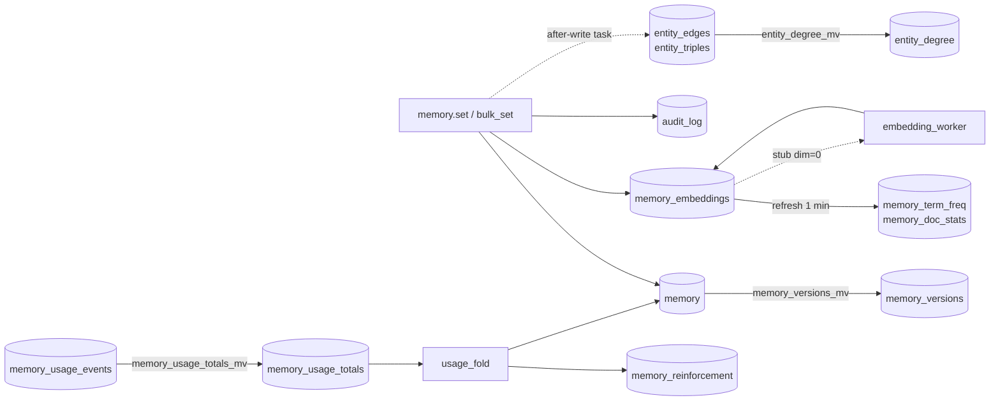

<!-- i18n: source=docs/architecture/clickhouse.md blob=60c6c8456feb6c09e511f2b2c546f32c8ee0cdf0 model=claude-sonnet-5-5 -->
> 本页由机器从[英文原文](https://github.com/ClickHouse/loom/blob/main/docs/architecture/clickhouse.md)翻译，内容以英文原文为准。
> Machine-translated from the [English page](https://github.com/ClickHouse/loom/blob/main/docs/architecture/clickhouse.md), which is authoritative.

<a id="clickhouse"></a>

# ClickHouse

Loom 的持久状态存放在 ClickHouse 中，但文档字节（可选，存放在兼容 S3 的存储桶中）以及在 Postgres 记忆权威模式下的 Postgres 表除外：这些表保存实时记忆、知识状态以及与之相关的记录。使用 `LOOM_DOCUMENT_OBJECT_STORE=s3` 时才会用到该存储桶。ClickHouse 保存的是 Postgres 所持有的实时记忆和知识状态的投影；[存储权威](https://github.com/ClickHouse/loom/blob/main/docs/architecture/storage-authority.md#the-tables)列出了每一张 Postgres 表。Loom 的 ClickHouse 数据库为 `loom` 和 `loom_telemetry`。规范的 ClickHouse schema 是 [`schemas/schema.sql`](https://github.com/ClickHouse/loom/blob/main/schemas/schema.sql)，由已应用全部迁移的服务器导出；Postgres schema 则是 `schemas/pg_migrations/` 中的日志。生成的 [schema 参考](https://github.com/ClickHouse/loom/blob/main/docs/reference/schema.md)列出了每张 ClickHouse 表的引擎、键、TTL 和索引。本页介绍表的分组、Loom 如何使用引擎、索引和视图，以及迁移如何运行。

<a id="goals-and-non-goals"></a>

## 目标与非目标

| 目标                                                         | 非目标                                                       |
| ------------------------------------------------------------ | ------------------------------------------------------------ |
| 所有平面使用同一个引擎（以 ClickHouse 为权威），因此读取不会跨存储做 join。 | 跨表事务。主行先写入，派生行随后写入。                       |
| 每一行都标明其租户、写入者（`actor`）和内容（`content_sha256`）。 | 为每张表保留事务时间历史。版本镜像仅覆盖 `loom.memory`。     |
| 可变状态以仅追加的版本保存：写入是一次 INSERT，读取结果是确定的。 | 在请求路径上原地更新。更新采用新版本或批量的后台合并。       |
| 除非写入者或运维人员要求，否则任何存放记忆内容的数据都不会过期。 | 对事实、文档、对话或图谱设置默认保留期。                     |
| 每张表都已划分擦除类别。                                     | 合规保证。                                                   |

<a id="table-families"></a>

## 表族

“写入方”列出插入行的代码或[工作进程](https://github.com/ClickHouse/loom/blob/main/docs/reference/workers.md)。
保留策略见 [分区与 TTL](#partitioning-and-ttl)。

| 表族                  | 主要表                                                                                                                                                                                                                                                                                                 | 写入方                                                                                                                 |
| ---------------------------- | ------------------------------------------------------------------------------------------------------------------------------------------------------------------------------------------------------------------------------------------------------------------------------------------------------ | ---------------------------------------------------------------------------------------------------------------------- |
| 记忆事实                 | `memory`, `memory_versions`, `shared`, `working_memory`                                                                                                                                                                                                                                                | `memory.set`, `memory.bulk_set`, lifecycle ops, `working_memory.*`; `memory_versions_mv` 负责填充历史             |
| 记忆嵌入            | `memory_embeddings`, `memory_reinforcement`, `memory_term_freq`, `memory_doc_stats`                                                                                                                                                                                                                    | 相同的写入路径（`build_embedding_row`）；`embedding_worker` 填充占位行；`usage_fold`；用于 BM25 的可刷新视图 |
| 证据与分块          | `memory_evidence`, `memory_chunks`, `memory_chunk_sources`, `memory_belief_sources`, `session_summaries`, `derived_facts`                                                                                                                                                                              | `set_from_messages` 投影，整合                                                                         |
| 记录与分类体系         | `memory_records`, `memory_record_versions`, `memory_record_fields`, `memory_record_conflicts`, `memory_schemas`, `memory_schema_fields`, `categories`, `memory_categories`                                                                                                                             | `memory.record.*`, `namespace.*`，类别分配                                                                  |
| 写入路径状态             | `memory_extraction_queue`, `memory_projection_failures`, `memory_drops`, `blacklist`, `blacklist_version`, `conflict_allowlist`, `learnings_queue`, `consolidation_runs`, `memory_ask_precedents`                                                                                                      | 延迟提取，fail-open 投影，`blacklist.*`, `conflicts.resolve`, `memory.consolidate`, `memory.ask`     |
| 知识                    | `documents`, `document_blobs`（上传的原始文件）, `chunks`, `chunk_supersessions`, `chunk_term_freq`                                                                                                                                                                                                 | `knowledge.add`; `chunk_term_freq_mv`, `chunk_context_term_freq_mv`                                                    |
| 对话                | `conversations`, `conversation_threads`, `conversation_embeddings`                                                                                                                                                                                                                                     | `conversation.*`; `conversation_titler`                                                                                |
| 实体图                 | `entity_edges`, `entity_degree`, `entity_triples`, `entity_edge_memories`, `entity_edge_rows`, `entity_triple_memories`, `entity_triple_rows`, `entity_vectors`, `entity_summaries`, `entity_canonical_map`, `entity_communities`, `operator_edges`                                                    | `memory.set` 写入后投影，`entity_extractor`, `entity_communities`; `entity_degree_mv`                  |
| 代码索引                   | `code_files`, `code_chunks`, `code_symbols`, `code_edges`, `code_pr_history` 以及其他 `code_*` 表                                                                                                                                                                                             | `code_ingest`, `code_scip_*` 工作进程, `code_pr_history`, `code_embed_recovery`, `code_summary`, `code_graph_stats` |
| 跟踪器                      | `qa_sources`, `qa_item_embeddings`, `qa_link_candidates`, `qa_test_daily`, `qa_rollup_days`, `qa_fail_hours`                                                                                                                                                                                           | `tracker.source.add`, `tracker_embed`, `tracker_links`, `tracker_test_daily`                                           |
| 运行、任务、简报          | `agent_runs`, `agent_turn_usage`, `session_outcomes_by_user`, `procedure_runs`, `tasks`, `task_events`, `task_leases`, `agent_run_claims`, `task_inboxes`, `session_briefs`, `context_blobs` 及相关表                                                                                            | `run.*`, `task.*` / `inbox.*`, `session.brief_*`, `context.offload`, `reflection_distill`                              |
| 命名空间、认证、治理 | `namespaces`, `namespace_grants`, `namespace_policies`, `namespace_types`, `namespace_snapshots`, `namespace_calibration_*`, `service_accounts`, `user_state`, `revoked_tokens`, `signing_keys`, `auth_attempts`, `runtime_overrides`, `oauth_state`, `idempotency`, `policy_decisions` 及相关表 | `namespace.*`, `grants.*`，注册与认领流程，`recalibration`，幂等缓存                             |
| 遥测、审计、成本       | `events`, `agent_events`, `agent_cost_rollup_daily`, `audit_log`, `audit_checkpoints`, `search_trace_log`, `memory_exposures`, `memory_usage_events`, `memory_usage_totals`, `memory_served_daily`, `code_search_trace`, `worker_status` 及相关表                                                | 事件流，op 账本，`observability/audit.py`, `audit_verifier`，supervisor                           |
| 服务水平               | `loom_telemetry.sli_minute`（独立的数据库：Loom 从自身表派生的遥测数据放在 `loom` 之外）                                                                                                                                                                                            | `sli_minute_refresh`，每分钟一次，处理带有 SLO 类别的 `agent_events` 请求行                             |
| 擦除                      | `erasure_requests`, `erasure_reversals`                                                                                                                                                                                                                                                                | `erasure.request`, `erasure_recovery`, `memory.restore`                                                                |
| 提供方缓存            | `embedding_cache`, `llm_response_cache`                                                                                                                                                                                                                                                                | embedder 与 LLM 客户端包装器                                                                                   |

**为什么 SLI 汇总使用独立的数据库。** `loom` 存放 Loom 对外提供的数据；派生的运维遥测数据放在它之外，因此控制台或告警用户只需获得 `SELECT ON
loom_telemetry.*`，而无需任何对存放记忆的数据库的授权；并且该汇总可以被暂停（对其刷新使用 `SYSTEM STOP VIEW` / `SYSTEM START VIEW`）、清空并重新折叠，或单独设置保留策略，而不影响 `loom`。重新折叠的步骤是：`SYSTEM STOP
VIEW loom_telemetry.sli_minute_refresh`，`TRUNCATE TABLE loom_telemetry.sli_minute`（其哨兵行一并清除），然后 `SYSTEM START VIEW`；先停止很重要，因为在清空之后才提交的刷新会写入新的哨兵行，导致重新折叠无法开始。它只读取账本最近 31 天的数据，每次刷新处理一小时，所以大约需要 12 小时，`loom.sli.rollup_lag_s` 显示其进度；需要更长历史的部署也应备份 `loom_telemetry`。不要删除该视图：迁移 045 已记录为已应用，因此不会有任何东西重新创建它。代价是多一个数据库：安装 SQL 会向迁移用户授予 `CURRENT GRANTS ON loom_telemetry.*`，缺少该授权时 preflight 会指出。

**ClickHouse 之外的状态。** 在 Postgres 记忆权威模式下，Postgres 保存[存储权威](https://github.com/ClickHouse/loom/blob/main/docs/architecture/storage-authority.md#the-tables)中列出的表。上传的文档原件是 `document_blobs` 的行，按命名空间以 SHA-256 寻址（`server/knowledge/store/blobs.py`）；设置 `LOOM_DOCUMENT_OBJECT_STORE=s3` 时，每一行是兼容 S3 的存储桶中某个对象的目录条目，字节内容保存在该存储桶中（[知识](https://github.com/ClickHouse/loom/blob/main/docs/features/knowledge.md#where-originals-are-stored)）。令牌签名密钥（`signing_keys`）、管理员对速率限制、延迟预算和实时设置的运行时覆盖（`runtime_overrides`）、登录尝试计数（`auth_attempts`）、图遍历标记（`graph_projections`：进行中的投影以及每个命名空间最近一次图写入）、每个命名空间最近一次写入（`namespace_write_keys`）以及 supervisor 租约也都在 ClickHouse 中，因此指向该 ClickHouse（在 Postgres 记忆权威模式下还包括其 Postgres）以及文档存储桶（只要行中仍引用其中的对象）的新 Loom 可以恢复所有功能。在文件系统上：代码平面位于 `var/code_repos` 下的 git 镜像，是 ClickHouse 所记录远程仓库的缓存，没有这些镜像的主机会重新克隆。根密钥 `LOOM_JWT_SECRET` 用于加密签名密钥和已存储的凭据，保存在环境变量中。进程缓存和文件锁列在[系统概览](https://github.com/ClickHouse/loom/blob/main/docs/architecture/system-overview.md#deployment-topology)中。

<a id="conventions-every-table-follows"></a>

## 每张表遵循的约定

- **身份前缀。** 租户行的排序键以身份元组开头，每次读取都按它过滤，因此主索引会先裁剪掉其他租户的 granule。按命名空间的擦除、快照或保留期覆盖，只对应一个键范围，而不是一次扫描。

  | 列           | 含义                         | 默认值  |
  | ------------ | ---------------------------- | ------- |
  | `org`        | 租户边界；必填               | —       |
  | `namespace`  | 共享和授权的单位；必填       | —       |
  | `agent`      | 写入的 agent；记忆行必填     | —       |
  | `user_id`    | 该行所涉及的终端用户         | `'-'`   |
  | `session_id` | 该行来源的会话               | `'-'`   |

  `'-'` 表示“不适用”，会被存储；`'*'` 是读取时的通配符，从不存储。不按 agent 划分的表（代码索引、任务、命名空间配置）以 `(org, namespace, …)` 或 `(org, inbox, …)` 作为键。记忆表另外增加 `run_id`。服务器会在记忆写入时填写 `actor` 和 `source_class`（[系统概览](https://github.com/ClickHouse/loom/blob/main/docs/architecture/system-overview.md#the-identity-tuple)）。

- `org`、`namespace`、`agent`、模型名称、状态和事件类型使用 **`LowCardinality(String)`**。
- **先追加，再折叠。** 可变状态使用 `ReplacingMergeTree`；写入方插入版本号更高的新行，读取时使用 `FINAL`。变更操作（mutation）不进入请求路径。
- **等待型插入。** 后续读取所依赖的写入，会以 `wait_for_async_insert = 1` 发送，因此插入返回时数据已经写入：要么是已提交的（`async_insert = 0`，即客户端的会话默认值），要么是批量的（[批量插入](#batched-inserts)）。即发即弃的遥测数据以 `async_insert = 1, wait_for_async_insert = 0` 发送。
- **时间一律为 UTC。** `DateTime` 列本身不带时区，因此服务器客户端和迁移运行器会固定 `session_timezone = 'UTC'`，并以 UTC 绑定带时区的参数：即使服务器的 `<timezone>` 设为其他值，读写的也是同一时刻。
- **重试不会产生重复。** 每次插入都带有一个 `insert_deduplication_token`，由批次和每批次的随机数（`insert_dedup_token`）组成，因此套接字中断后的重试只会让该批次落地一次。异步插入只按该 token 去重，从不按内容去重，所以同一个刷新窗口内的两行相同数据都会落地。调用方若传入自己的 token，则该 token 表示行的身份，于是同一行的两个写入方只会让它落地一次：`conversation.save_message` 就是以这种方式写入新的对话记录行。

<a id="batched-inserts"></a>

### 批量插入

一次已提交的插入会产生一个 part，因此每个请求都写入的表会以请求的速率产生 part，合并随之落后（“too many parts”）。每个请求都写入、或每个进程在短间隔内写入的行属于批量插入，以 `async_insert = 1, wait_for_async_insert = 1` 发送（`server/core/ch_writes.py`）。它们分为两组：

- **由 `ch_batched_inserts` 控制**（`batched_insert_settings`）：`audit_log`；`conversation.append` 产生的 `conversations` 轮次，以及 `conversation.compact` 的摘要轮次；`conversation.save_message` 在去重丢弃了首次写入后重写的轮次；`conversation_embeddings` 行（`conversation.append`、`conversation.save_message`、`conversation.compact`；遵循下文的宽度规则）；`agent_events` 的刷新；`memory_webhook_outbox`、`memory_evidence` 和 `memory_belief_sources`。`memory_webhook_attempts` 仍为已提交写入：一个 worker 每轮连续写入它两次，一次接一次，因此批量处理不会减少 part。
- **无论如何都是等待型异步插入**（`async_insert_settings`）：`auth_attempts`；策略见证（policy witness）写入的 `agent_events` 和 `memory_exposures` 行；`memory_projection_failures`；图的 Undo 标记；`namespace_write_marks` 的刷新；用量事件的刷新；carry 确认的发布与撤回；每一次等待型实体图插入（`memory.set`、`memory.bulk_set`；使用 `wait=True` 的 `graph_insert_settings`）；以及 follow 计划的后继插入（`entity_triple_memories`、`entity_triple_rows`、`entity_triples`）。

ClickHouse 会把同一张表上并发的插入收集起来，每个分区写成一个 part，并在这些 part 写入后逐个应答。返回时，该行的持久性和可见性与已提交插入相同，而且同一调用方的下一次插入会落在更晚的 part 中，因此该调用方的写入顺序得以保持。缓冲区属于 ClickHouse，所以 Loom 进程停止时不会丢失任何已确认的数据。整体失败的刷新会让所有等待它的插入都失败；其中任何一个重试，都会凭自己的 token 只落地一次。每次插入会在 `ch_batched_insert_wait_min_ms`（写入稀疏时）和 `ch_batched_insert_wait_max_ms`（负载下）之间等待其他插入加入，并在等待期间占用其池化连接。插入会发送 `async_insert_use_adaptive_busy_timeout = 1`，因此无论服务器配置如何，这些上下限都成立；关闭它时，每次刷新都会等满最大值。在稳定负载下，每个 ClickHouse 节点上，一张表每秒约产生 1000 / `ch_batched_insert_wait_max_ms` 个 part，按插入形态（ClickHouse 为每组列列表和设置保留一个缓冲区）和所写分区分别计算：缓冲区在等待结束前写满时会更多，写入稀疏时每次插入最多一个。插入还会发送 `async_insert_max_query_number = 10000`，因此在高速率下，决定刷新的是时间窗口，而不是 ClickHouse 默认的 450 条语句。

有两种窗口：用量事件刷新器、关闭时的排空以及 write-mark 刷新，最多等待 `ch_batched_insert_background_wait_max_ms`（200 ms，即 ClickHouse 自己的默认值），因此每个 part 能收集更多行。其他所有批量或等待型异步插入最多等待 `ch_batched_insert_wait_max_ms`（50 ms），包括 `agent_events` 的定时刷新（`flush_now` 会等待进行中的刷新），以及请求因缓冲区已满而触发的用量事件刷新。这两种窗口对应两种插入形态，因此使用各自独立的缓冲区。

ClickHouse 自己的目标是每张表约每秒一次插入、一个 part，每次插入 1,000 行或更多。这些窗口远低于该目标；它们把 part 速率从每次插入一个降到上面给出的速率。批量处理是用延迟换取更少的 part：每次等待型插入最多增加一个窗口的延迟，期间还占用其池化连接。因此，持续每秒 R_request 次请求路径批量插入和 R_background 次后台批量插入，至少会占用 R_request × `ch_batched_insert_wait_max_ms` / 1000 + R_background × `ch_batched_insert_background_wait_max_ms` / 1000 个连接：每秒 100 次 `conversation.append`，每次两个批量插入，至少占用 100 × 2 × 50 / 1000 = 10 个连接。这只是下界：等待中的插入在窗口之后还要经历刷新和 part 写入才释放连接，而这些在负载下会排队并变长。一次 `memory.set` 要等待六个或更多插入：审计行、outbox 行（webhook 命名空间）、`entity_edges` 和 `entity_edge_memories` 插入、`entity_triples` 和 `entity_triple_memories` 插入，带 carry 的写入还有 `carry_acks`；`memory.set_from_messages` 约等待十个。二者的实体图插入都是等待型异步插入，因此 `ch_batched_inserts = false` 时它们仍占用连接：主要处理记忆写入或批量写入的进程，无论如何都要按它们来确定连接池大小，或者调低 `ch_batched_insert_wait_max_ms`。一个进程每秒处理 200 次写入，每次两个批量插入（`bench/write_rate.py --target client`），在 `ch_pool_maxsize = 20`（即公式给出的下界）时，12,000 次写入中有 3,367 次被 503 `OVERLOADED` 拒绝，而在 40 或 64 时没有被拒绝的；这只是一台主机上的一次运行，所以只能当作数量级参考。请把 `ch_pool_maxsize` 设为下界的三倍或更多，再加上该进程其他语句所需的连接：默认值 64 可容纳约每秒 300 次请求路径批量插入的三倍下界，并留下约 20 个连接给其他语句。超过该速率的进程，要么调高 `ch_pool_maxsize`，要么设置 `ch_batched_inserts = false`；调低 `ch_batched_insert_wait_max_ms` 同样能释放连接（[故障排查](https://github.com/ClickHouse/loom/blob/main/docs/operations/troubleshooting.md)）。

`ch_batched_inserts`（实时生效，默认开启）会关闭上述第一组的批量处理：关闭后，这些插入变为已提交插入，每次一个 part。第二组无论如何都按相同的上下限等待，即发即弃的插入不受影响。如果某个进程的写入速率如上所述耗尽了连接池且连接池无法扩大，或者某个部署流量很小、延迟比 part 数量更重要，就关闭它（`LOOM_CH_BATCHED_INSERTS=false`）：写入稀疏到无法共享一个 part 时，每次插入仍要等待 `ch_batched_insert_wait_min_ms`。

ClickHouse 按表、语句形态、设置和用户为异步缓冲区建键，所以一次刷新可能包含来自多个 org 的行，而其中一行失败（向量宽度错误，代码 190）会使其中每个调用方的刷新都失败。只有当编码宽度等于 `embedding_dim` 时，embedding 行才会批量写入；而共享刷新以代码 190 失败的 `conversation_embeddings` 行，会改为以已提交插入重新发送；其他批量表不带编码向量。

下列表保持为已提交插入：

- `memory`、`memory_embeddings`、`shared`、`session_summaries` 和 `entity_summaries` 的 **版本行**：它们带围栏的 `INSERT … SELECT FROM input()`（[滚动升级](https://github.com/ClickHouse/loom/blob/main/docs/architecture/rolling-upgrades.md)）无法被缓冲。在 Postgres 权威模式下，已提交写入的 `memory` 和 `memory_embeddings` 行改由 Loom 自行批量处理：每个进程把自上次刷新以来排队的所有提交，对每张表以一次已提交插入发出，每秒最多 1000 / `pg_publish_interval_ms` 次，其行所跨的每个分区各产生一个 part（[发布](https://github.com/ClickHouse/loom/blob/main/docs/architecture/storage-authority.md#publication)）。
- **`entity_canonical_map`**：它按 `org` 分区，因此共享刷新若跨越超过 `max_partitions_per_insert_block` 个 org，会使所有等待它的插入都失败。
- **带 `Quantized` 编码向量的行**（`entity_vectors`、`memory_chunks`）：写入 part 时，编解码器会拒绝其他宽度的向量（代码 190），因此一行尺寸错误就会让同一次刷新中的其他所有插入失败。
- **可能尺寸错误的 `conversation_embeddings` 行**（`embedding_insert_settings`）：当该列为普通列，或按所服务模型的 `embedding_dim` 编码且向量具有该宽度（空向量会被填充到该宽度）时，该行才会批量写入。如果无法读取该列的信息，或该列编码时的宽度与 `embedding_dim` 不同（模型更换后尚未重建，或本进程尚未读到某次重建），则该行以已提交插入写入。若某个批量行所在的刷新因另一个进程的旧宽度行而失败，则它会以已提交插入重新发送。
- **token 表示行身份的写入**（`conversation.save_message`）：复制表会把已提交插入和已缓冲插入的 token 分开保存，因此同一身份的每个写入方都以同样的方式发送它。

<a id="engines-and-why"></a>

## 引擎及选择原因

| 引擎                                               | 用途                                                                                                                                                                                                                                 | 原因                                                                                  |
| -------------------------------------------------- | ------------------------------------------------------------------------------------------------------------------------------------------------------------------------------------------------------------------------------------ | ------------------------------------------------------------------------------------- |
| `ReplacingMergeTree(version)`                      | 可变行：`memory`、`memory_embeddings`、`shared`、`working_memory`、`code_*` 索引、任务、配置                                                                                                                                         | 更新就是 INSERT 一整行；`FINAL` 为每个键保留最新的一行。无需加锁。                    |
| `ReplacingMergeTree(created_at)` 或 `(updated_at)` | 每个键只写入一次的行：`memory_evidence`、`memory_chunks`、缓存、`idempotency`、`namespaces`                                                                                                                                          | 同样的折叠方式，以行自身的时间戳作为版本。                                            |
| `ReplacingMergeTree`，不带版本                     | `memory_versions`、`code_symbol_ids`、`code_symbol_names`                                                                                                                                                                            | `version` 或完整标识位于排序键中，因此只有完全相同的重复插入才会被折叠。              |
| `MergeTree`                                        | 仅追加的日志：`events`、`agent_events`、`audit_log`、`conversations`、`task_events`、`entity_edges`、trace                                                                                                                           | 每一行都是关于某一时刻的事实。                                                        |
| `SummingMergeTree`                                 | 计数器：`entity_degree`、`memory_usage_totals`、`memory_served_daily`、`code_unit_signal`                                                                                                                                            | 计数器通过 INSERT 一个增量来更新，绝不做读取后修改再写回。                            |
| `AggregatingMergeTree`                             | 不可加的汇总：`memory_term_freq`、`chunk_term_freq`、`code_term_freq`、`agent_cost_rollup_daily`、`memory_exposure_breadth_hourly`、`query_nodes`、`namespace_write_marks`、`subject_last_seen`、`loom_telemetry.sli_minute`          | 保存部分聚合状态（去重计数无法直接求和），再用 `-Merge` 得到最终结果。                |
| `KeeperMap`                                        | `task_leases`、`agent_run_claims`、`oauth_signin_state` 以及迁移锁 `loom._migration_lock`（还有 `workers_supervisor` 租约、claims 和编译器层级的 `scip_entry:*` 键）                                                                  | 跨进程的线性一致 compare-and-swap。                                                   |

**每个部署使用一个 `keeper_map_path_prefix`。** KeeperMap 的路径在迁移中是固定的（`/loom/migration_lock`、`/loom/instances`、`/loom/task_leases`、`/loom/agent_run_claims`、`/loom/graph_projections`、`/loom/namespace_write_keys`），ClickHouse 会把它们放在服务器的 `keeper_map_path_prefix` 之下。如果两个部署的 ClickHouse 服务器共用同一个 Keeper 和前缀，它们就会共享这些键：同一个 workers 租约、同一把迁移锁，以及它们之间的所有 claim。请为每个部署设置各自的前缀。

**为什么可变状态使用 `ReplacingMergeTree`。** `ALTER … UPDATE` 会异步重写整个数据分片，且不保证读取自己的写入。轻量级 `UPDATE` 会写入补丁分片，之后每次读取都必须应用这些补丁，并且会关闭量化编码读取（见[向量存储](#vector-storage)）。一个版本行就是一次 INSERT，下一次 `FINAL` 读取即可看到，其历史保存在镜像中。代价是下文的写入规则以及 `FINAL` 的开销，而标识前缀会把这一开销限制在单个租户的 granule 范围内。

在记忆表上，`version` 是以纳秒为单位的挂钟时间戳（`server/memory/store/rows.py`，`next_version`），因此两个副本的版本可以相互比较，代价是存在有界的时钟偏差。配置表的版本使用 `updated_at`、`created_at` 或 `version`。

<a id="the-final-write-rule"></a>

## FINAL 写入规则

更新、墓碑标记、恢复、touch、锁定或提升，都是插入一行带有更高 `version` 的完整行。**版本行必须包含所有持久化列。** ClickHouse 会用 DDL 默认值填充被省略的列，而在 `FINAL` 下，这个默认值会替换所有读取方看到的真实值。请使用 `server/memory/store/rows.py` 中的构建器：

| 构建器                                                  | 表                                      | 行为                                                                                                                               |
| ------------------------------------------------------- | --------------------------------------- | ---------------------------------------------------------------------------------------------------------------------------------- |
| `build_memory_version_row(existing, **changes)`         | `memory`                                | 复制 `MEMORY_PERSISTED_COLS` 中的每一列，应用变更，保留已存储的 `value` 字节。                                                     |
| `build_revision_row(existing, new)`                     | `memory`                                | 在现有有效行上写入新值：沿用使用情况、谱系、标识、锁和过期时间；重置 `REVISION_RESETS`；保留证明信息。                             |
| `build_first_version_row(new, now=…)`                   | `memory`                                | 用 DDL 默认值（`FIRST_VERSION_DEFAULTS`）补全首次写入，使每个首个版本都能通过插入入口的检查。                                      |
| `insert_memory_versions(rows)`（`inserts.py`）          | `memory`                                | 唯一的 `loom.memory` 插入入口：拒绝缺少持久化列或包含未知列的行，然后以已提交方式插入。                                            |
| `build_embedding_row(**columns)`                        | `memory_embeddings`                     | 根据 `EMBEDDING_PERSISTED_COLS` 的默认值生成完整行；出现未知列会抛出异常；填充 `content_excerpt_lemma` 和新的 `version`。         |
| `build_session_summary_row`、`build_entity_summary_row` | `session_summaries`、`entity_summaries` | 模式相同。                                                                                                                         |

新增列时，要在同一次变更中把它加入构建器的列集合以及所有为其提供数据的投影。`MATERIALIZED` 列（`content_excerpt_lc`、`content_excerpt_stem`、`value_preview`、`value_len`）不得出现在插入中。其他带版本的表（`namespaces`、`code_summaries`）在重新插入前会先读取完整行。

两条查询规则可保证 `FINAL` 的正确性：

- 标识列的过滤条件要放在 `PREWHERE` 中或 `FINAL` 之前；行状态谓词（`tombstoned_at`、`status`、过期、有效性）则放在 `FINAL` 之后的 `WHERE` 中。在合并之前使用状态谓词，会丢掉墓碑行，使其下方的旧版本重新出现。
- 不要用被过滤列的列名给表达式起别名（`SELECT toString(memory_id) AS memory_id … WHERE memory_id IN …`）。`WHERE` 会解析为该别名，并且悄无声息地匹配不到任何行。`tests/unit/test_sql_alias_shadow.py` 会在出现这种写法时使构建失败。

<a id="content-hashes"></a>

## 内容哈希

`loom.memory` 上的 `content_sha256` 是该值规范 JSON 的 SHA-256。它用于：

- **乐观并发控制。** `memory.set` 和 `memory.update_by_id` 接受 `if_match_sha256`；哈希不匹配时返回 409 `PRECONDITION_FAILED`。该哈希会随 `memory.get`、`memory.get_by_id` 和 `memory.set` 的响应一并返回。
- **认证绑定。** `verified_sha256` 记录了某人所认证的字节内容。修订后，`verified_by` 和 `verified_at` 仍会保留，但哈希不再匹配，因此读取方可以根据这一对值推断出"已过期"。
- **审计。** 每次创建或更改记忆的写入，都会留下一行仅含哈希的 `audit_log` 记录（包含 key、id、哈希、操作者、来源类别和裁决结果，不含值本身）。

代码块的 id 是基于其路径、范围和内容哈希生成的 UUIDv5，因此未改动的代码块重新摄取时会得到同一行。

<a id="sort-keys"></a>

## 排序键

在身份前缀之后，排序键服务于该表最主要的读取方式：

| 表                  | `ORDER BY`                                                                         | 服务的读取                                                                                          |
| ------------------- | ---------------------------------------------------------------------------------- | --------------------------------------------------------------------------------------------------- |
| `memory`            | `(org, namespace, agent, user_id, session_id, memory_key)`                         | 按键的点读取；折叠单位是每个身份下的一个键。                                                        |
| `memory_embeddings` | `(org, namespace, agent, user_id, session_id, scope, embedding_model, memory_key)` | 针对一个身份和一个模型的向量检索分支；两个模型的向量是各自独立的行。                                |
| `memory_versions`   | `(org, namespace, agent, user_id, session_id, memory_key, version)`                | 一个键的历史；键中包含 `version`，因此每一行都会保留。                                              |
| `code_chunks`       | `(org, namespace, embedding_model, path, chunk_id)`                                | 一个路径下的所有 chunk，用于重新摄取时的差异比较和文件读取。                                        |
| `code_edges`        | `(org, namespace, tier, to_symbol_id, edge_kind, from_symbol_id, path, line)`      | “谁调用了 X”是一次键范围查询。投影 `by_from` 和 `by_path` 分别服务被调用方和按文件的读取。          |
| `code_symbols`      | `(org, namespace, tier, qualified_name, symbol_id)`                                | 按限定名查找定义；`code_symbol_names_mv` 和 `code_symbol_ids_mv` 对其重新设置键。                   |
| `entity_edges`      | `(org, namespace, entity_a, entity_b)`                                             | 一个实体的邻居。                                                                                    |
| `task_events`       | `(org, inbox, seq)`                                                                | 按顺序读取一个 inbox 的事件。                                                                       |

排序键和分区键只能在 `CREATE` 时指定。更改其中任何一个的迁移，需要在完整的 `CREATE TABLE` 上方声明 `-- loom: rebuild-if-empty <table>`。运行器会将空表替换为其孪生表，而对有数据的表则拒绝执行，并指明 `scripts/ops/table_rebuild.py`（孪生表、复制、`EXCHANGE TABLES`）（`server/core/schema/table_rebuild.py`）。

<a id="partitioning-and-ttl"></a>

## 分区与 TTL

大多数时间序列表使用 `PARTITION BY toYYYYMM(<time column>)`。租户目录表（`namespaces`、`namespace_grants`、`service_accounts`、`user_state` 等）按 `org` 分区；`working_memory` 和 `shared` 按 `(org, namespace)` 分区。整表读取的小表（`code_pr_history`、`code_pr_reviews`）没有分区键。

`code_chunks` 按 `(org, namespace)` 分区，因此每个仓库索引都有各自的 part，文本索引的倒排列表只覆盖一个命名空间，下线的索引通过 `DROP PARTITION` 清除。该分区键在基线的 `CREATE` 中声明。

**默认情况下，没有任何表会删除记忆内容。** 事实、embedding、文档、chunk、对话和图都没有 TTL。它们只会因显式删除、写入方设置的过期时间（`ttl_seconds`，由 `memory_expiry_sweep` 按该行的 `on_expire` 处理）或擦除而消失。带有 schema TTL 的表保存的是遥测数据、缓存或运行器状态：

| 时间窗口 | 表                                                                                                                                         |
| ---------- | ------------------------------------------------------------------------------------------------------------------------------------------ |
| 60 分钟 | `code_search_memo`                                                                                                                         |
| 3 天     | `memory_webhook_outbox`, `memory_webhook_attempts`                                                                                         |
| 7 天     | `llm_response_cache`, `code_scip_parts`                                                                                                    |
| 30 天    | `events`, `embedding_cache`, `memory_drops`, `memory_extraction_queue`, `memory_ask_precedents`, `worker_status`, `code_scip_batches`      |
| 90 天    | `erasure_requests`, `oauth_state`, `policy_decisions`                                                                                      |
| 180 天   | `search_trace_log`, `memory_exposures`, `memory_exposure_breadth_hourly`, `consolidation_runs`, `code_search_trace`, `code_search_outcome` |
| 400 天   | `loom_telemetry.sli_minute`                                                                                                                |
| 5 年    | `erasure_reversals`                                                                                                                        |
| 其他      | `idempotency`（在 `expires_at` 时）、`revoked_tokens`（令牌过期后 10 天）、`context_blobs`（`expires_at` 之后 1 天）                   |

运维人员可以通过 `LOOM_RETENTION_<TABLE>_DAYS` 为 `audit_log`、`agent_events`、`memory`、`memory_embeddings`、`conversations`、`chunks` 和 `documents` 增加保留期，并通过 `LOOM_TIERING_<TABLE>_WARM_DAYS` 加 `LOOM_TIERING_WARM_VOLUME_NAME` 启用分层存储。各命名空间的 `retention_days` 或 `warm_days` 覆盖值会在同一个 TTL 表达式中变成 `multiIf`（`server/storage/retention_overrides.py`）。worker leader 在启动时应用这些设置，`retention_reconcile` 使其保持同步，并跳过未变化的表，因为每次 `MODIFY TTL` 都是一次 mutation。当一张表上的最后一个时间窗口被清除时，同一轮处理会执行 `ALTER TABLE … REMOVE TTL`；这些表都没有 schema TTL。每个时间窗口默认为 0（关闭）。

<a id="merges-and-skip-indexes"></a>

### 合并与跳数索引

part 数量持续上升，几乎总是意味着合并失败。如果合并无法构建某个跳数索引，该表的每次合并都会失败，直到插入时出现 `TOO_MANY_PARTS`。Loom 通过 `exclude_materialize_skip_indexes_on_merge` 让这类索引不参与合并（`chunks` 上的文本索引 `content_text` 和 `context_text`）：新插入的 part 仍会构建该索引，合并后的 part 则不再构建。`ops.health` 的 `clickhouse_parts` 检查（`_clickhouse_parts_check`）会读取 `system.part_log`，查找最近一刻钟内失败的 `MergeParts` 事件，并报告错误码和这一修复方法；异常文本仍保留在 `system.part_log` 中。出于同样的原因，记忆内容表不设行级 TTL。操作手册见[故障排查](https://github.com/ClickHouse/loom/blob/main/docs/operations/troubleshooting.md)。

`memory_embeddings` 也在该设置中指定了 `embedding_hnsw_idx`，而没有任何迁移声明过这个索引。除非运维人员手动添加同名的向量索引，否则该设置不起作用；添加之后，它会阻止合并重建其图，因此没有迁移会重置它。

<a id="the-write--derive-loop"></a>

## 写入 → 派生循环

一次写入只插入其主行然后返回。其余所有内容都在之后派生，通过以下三种机制之一：

1. **插入时物化视图**在源表 INSERT 内部运行：`memory_versions_mv` 把每一行 `memory` 复制到 `memory_versions`，`memory_usage_totals_mv` 和 `entity_degree_mv` 把各自的源行汇总为总计。`memory_served_daily` 不使用视图：agent 读取时直接把计数插入该表，与 `memory_usage_events` 分开，后者的总计由 usage fold 转化为排序依据，因此一次已提供的读取不会改变强化信号。
2. **可刷新物化视图**（`REFRESH EVERY 1 MINUTE APPEND`）追加比其高水位标记更新的行：BM25 统计、每日成本汇总、每小时曝光广度、每个主体的最近出现时间、每分钟的请求 SLI。SLI 汇总的标记是 `agent_events.ingested_at`，即 ClickHouse 接收该行的时间，因此延迟的刷写不会被跳过。
3. **Workers** 轮询需要处理的行并写入新版本：存根 embedding（`embedding_worker`、`code_embed_recovery`）、实体（`entity_extractor`）、usage fold（`usage_fold`）、延迟提取（`extraction_queue`、`observe_extract`）、失败的投影（`projection_repair`）、孤立向量（`orphan_vector_reconcile`）、过期（`memory_expiry_sweep`）和 TTL（`retention_reconcile`）。

这里没有队列服务。队列就是一张表，其行自带状态：`memory_extraction_queue` 的行以版本的形式依次经历 `pending → running → done | failed`（在模型调用保持结束之前为 `held`）；`embedding_dim = 0` 的 embedding 行是等待向量的存根；`memory_projection_failures` 的一行就是一个待重放的投影。读取路径会过滤掉未完成的行。



**为什么要派生。** 如果 `memory.set` 要等待图投影、BM25 更新和审计扇出，就要承担每一次往返的耗时，并且其中任何一步失败都会导致失败。响应路径只保留调用方下一次读取所需的内容：`memory` 行、其 `memory_embeddings` 行、同键取代以及审计回执。投影采用失败放行策略（`memory/app/after_write.py`），同一进程中对同一命名空间的读取会等待图投影完成（`after_write.settle`）。派生表会比其源表滞后数秒；BM25 的各路径自行合并这一滞后。

当某个 embedding 行写入时其版本已超过 5 秒（视图 10 秒滞后的一半），该行可能会落在刷新水位线之下。耗时较长的 embed 或 judge，或者插入缓慢，都会造成这种情况。其所属的写入会在响应之后把这样的行汇入 BM25 表（`after_write.index_late_rows`），因此缓慢的写入不必再额外等待两次插入。

<a id="the-memory_versions-mirror"></a>

## memory_versions 镜像

合并会丢弃被取代的 `memory` 行，因此 RMT 表并不是历史记录。`memory_versions_mv` 会把每一条插入的 `memory` 行复制到 `memory_versions`，由后者保留每个版本。`memory.history`、`memory.redact`、`namespace.rollback` 以及用量折叠（usage fold）都会读取它；擦除 saga 会从中删除数据。新增 `memory` 列时，必须在同一个迁移中把它加入 `memory_versions` 和视图的 `SELECT`；`tests/unit/test_memory_versions_schema.py` 会比较两者的列列表。

<a id="materialized-views"></a>

## 物化视图

| 视图                                                                                                                                       | 类型                            | 来源 → 目标                                           |
| ------------------------------------------------------------------------------------------------------------------------------------------ | ------------------------------- | ----------------------------------------------------- |
| `memory_versions_mv`                                                                                                                       | 插入时                          | `memory` → `memory_versions`                          |
| `memory_record_versions_mv`                                                                                                                | 插入时                          | `memory_records` → `memory_record_versions`           |
| `memory_usage_totals_mv`                                                                                                                   | 插入时                          | `memory_usage_events` → `memory_usage_totals`         |
| `entity_degree_mv`                                                                                                                         | 插入时                          | `entity_edges` → `entity_degree`                      |
| `session_brief_revisions_mv`                                                                                                               | 插入时                          | `session_briefs` → `session_brief_revisions`          |
| `chunk_term_freq_mv`, `chunk_context_term_freq_mv`, `code_term_freq_mv`, `code_doc_stats_mv`, `code_symbol_ids_mv`, `code_symbol_names_mv` | 插入时                          | 分块与代码索引的统计和查找                            |
| `memory_term_freq_refresh`, `memory_doc_stats_refresh`                                                                                     | `REFRESH EVERY 1 MINUTE APPEND` | `memory_embeddings` → BM25 统计                       |
| `agent_cost_rollup_refresh`                                                                                                                | `REFRESH EVERY 1 MINUTE APPEND` | `agent_events` → `agent_cost_rollup_daily`            |
| `memory_exposure_breadth_hourly_refresh`                                                                                                   | `REFRESH EVERY 1 MINUTE APPEND` | `memory_exposures` → `memory_exposure_breadth_hourly` |
| `subject_last_seen_refresh`                                                                                                                | `REFRESH EVERY 1 MINUTE APPEND` | `agent_events` → `subject_last_seen`                  |
| `loom_telemetry.sli_minute_refresh`                                                                                                        | `REFRESH EVERY 1 MINUTE APPEND` | `agent_events` → `loom_telemetry.sli_minute`          |

**插入时视图还是可刷新视图。** 插入时视图对每次来源插入写入一个 part。这适合写入速率低的来源，或在同一请求中回读的目标表（`memory_versions`）。写入速率高的来源使用可刷新视图，每分钟追加一个 part。BM25 汇总把进度标记保存在一个哨兵行中（`org = ''`、`namespace = ''`、`term = ''`），该行带有 `max(version)`，并且只读取至少存在十秒的行。它们比写入滞后约一分钟，而 `memory.search` 会合并较新的来源行（`LOOM_MEMORY_SEARCH_BM25_LIVE_TAIL`，默认开启），因此 BM25 分数是精确的。

**事件流。** `loom.events` 只承载预算违规：`server/observability/events_stream.py` 将其排入队列，每次刷新写入一次已提交的插入。其他所有遥测写入方（审计行、曝光、搜索跟踪、查询节点、代码搜索结果）都直接插入各自的表，没有视图对 `events` 做扇出。操作账本（`agent_events`）以同样方式排队，每次刷新都是一次批量插入（`server/observability/events.py`），因此所有进程的刷新会共享 part。刷新失败不会导致请求失败；进程崩溃会丢失队列。

<a id="vector-storage"></a>

## 向量存储

- `CODED_TABLES` 的向量列为 `Array(BFloat16)`，根据安装情况使用 `Quantized` 编码或不编码（下面的 Quantized 编码一条说明了具体情况）。Loom 的迁移不会为其他向量列编码；在 `LOOM_CODE_VECTOR_TABLES` 中列出的表保持其创建时的布局和维度。`entity_vectors.entity_embedding` 保留 `LZ4`，因为它的向量有重复。编码后，只有在 `allow_suspicious_codecs` 可以开启的情况下，它才会在 `Quantized` 之后保留 `LZ4`；如果该设置被固定为 0（ClickHouse Cloud 服务默认如此），该列不带它存储。如何重新加上这条编码链，参见[推荐设置](https://github.com/ClickHouse/loom/blob/main/docs/operations/deployment.md#recommended-clickhouse-settings)。查询向量以 `Array(Float32)` 绑定。一条记忆最多携带两个向量（value 和 key），因此在 3072 维时向量最多占 12 KiB。
- **没有任何表带有向量相似度（HNSW）索引。** 搜索是对身份谓词过滤后剩余的行执行 `cosineDistance` 扫描：结果精确，或者在适用 codes-first 读取（见下）时先用编码再重新打分。因此一次读取扫描的字节数随命名空间大小增长，而不是随语料库大小增长。[为什么没有向量索引](#why-there-is-no-vector-index)给出了测量结果。
- **Quantized 编码。** 在 ClickHouse 26.8+ 上，全新安装会为 `CODED_TABLES`（`server/core/schema/vector_codec_ddl.py`）的向量列使用 `CODEC(Quantized('rabitq', <dim>, 0))` 创建，前提是 `enable_quantized_codec` 已开启，或者 Loom 的 ClickHouse 用户可以将其开启。运行器会在应用时重写 `CREATE`（[受限的 ClickHouse 设置](#gated-clickhouse-settings)）。在将 `enable_quantized_codec` 固定为 0 的服务器上，全新安装会创建不编码的布局，待该设置开启后，由 `scripts/ops/vector_codec_rebuild.py` 应用编码。ClickHouse Cloud 将该设置以默认值 0 保持只读，直到运营方通过设置配置文件（settings-profile）覆盖为该服务启用它；此后它读为 1，仍然只读，编码表可以正常工作。已有的表使用同一个工具迁移。
- **Codes-first 读取。** 当某列已编码且其表没有补丁部分（patch parts）时，读取会发送 `vector_search_use_quantized_codes = 1`（`LOOM_VECTOR_SEARCH_QUANTIZED_CODES`）：先扫描编码，保留 `LIMIT × LOOM_VECTOR_SEARCH_QUANTIZED_FETCH_MULTIPLIER` 个候选，再用完整精度重新打分。编码状态和补丁部分每隔 `LOOM_VECTOR_CODES_STATE_PROBE_SECONDS` 重新探测一次；探测失败视为“并非没有补丁部分”。如果某个副本拒绝该设置，则去掉该设置并重试读取。记忆事实分支有自己的开关 `LOOM_MEMORY_SEARCH_FACT_CODES_FIRST`。其 `auto` 取值遵循它自己的补丁部分探测（每隔 `LOOM_MEMORY_EMBEDDINGS_PATCH_PARTS_PROBE_SECONDS`）。当 `LOOM_VECTOR_SEARCH_QUANTIZED_CODES` 为 false 或副本不认识该设置时，`on` 和 `auto` 都视为关闭。其过量获取倍数为 `LOOM_MEMORY_SEARCH_FACT_CODES_FETCH_MULTIPLIER`。
- **定长占位符。** 等待嵌入的行存储零向量，且 `embedding_dim = 0`（`server/core/vectors/placeholders.py`）。每个向量分支都会过滤 `embedding_dim > 0`。
- **向量表不做原地更新。** 写入、折叠、拒绝和墓碑路径都写入新版本；强化信息保存在 `memory_reinforcement` 中。对 `memory_embeddings` 执行轻量级 `UPDATE` 会留下补丁部分，而补丁部分探测会让整张表的 codes-first 读取保持关闭，直到这些补丁部分合并。
- **每行一个模型。** `embedding_model` 在排序键中，因此一次搜索只比较其自身模型的向量。`loom reembed` 会在更换模型后重新生成向量（在 26.7+ 上，`--in-database` 使用 `aiEmbed`）。

**查询形态。** 只有当计划为 `Limit → Sorting → Expression → [Filter] → ReadFromMergeTree`，且只有一个升序排序键并且它是单纯的距离调用时，ClickHouse 才会将 top-k 下推到 codes-first 扫描中。`ORDER BY 1 - cosineDistance(…) DESC`、第二个排序键、`LIMIT n BY`、窗口函数或 `JOIN` 都会悄悄退化为全表扫描。向量查询按单纯的距离别名排序，并在 Python 中计算相似度。chunk 分支读取候选时不使用 `FINAL` 或 `JOIN`，然后在 `FINAL` 下按主键查找它们。`tests/unit/test_vector_search_query_shape.py` 守护这一形态。

<a id="why-there-is-no-vector-index"></a>

### 为什么没有向量索引

`vector_similarity` 索引是每个 part 一张 HNSW 图。它不适合 Loom 的读取，原因有四个。除非段落另有说明，下列数据来自 ClickHouse 26.9，使用 1M 个合成的 1536 维向量，表的形态与 `memory_embeddings` 相同（排序键、`ReplacingMergeTree`、`index_granularity = 256`，每个分区一个已合并的 part），索引以 `vector_similarity('hnsw', 'cosineDistance', 1536, 'bf16', 16, 128)` 构建，每种过滤条件执行 30 次查询；命令见 `bench/vector_index_vs_exact.py`。

**租户读取从不使用它。** 只有当主键条件保留了该 part 的每一个 granule 时，ClickHouse 才会搜索图。Loom 的每次向量读取都按 `(org, namespace)` 过滤，这是每张向量表排序键的前缀。除 `code_chunks` 外，每张向量表的一个 part 都包含许多租户（`memory_embeddings` 按月分区），因此读取只取该租户的 granule 并精确排序：不会执行索引搜索（`ProfileEvents['USearchSearchCount'] = 0`），读取成本与普通表相同。
每次查询读取的 MiB 数和 p50，所有读取均在 `FINAL` 下：

| 租户占比 | 行数 | 精确扫描 | 使用索引 | Codes-first，LIMIT 60 |
| -------- | ---- | ----------------- | ----------------- | --------------------- |
| 50%      | 500k | 1,478 MiB，141 ms | 1,478 MiB，140 ms | 134 MiB，55 ms        |
| 10%      | 100k | 295 MiB，491 ms   | 295 MiB，476 ms   | 49 MiB，44 ms         |
| 1%       | 10k  | 30 MiB，57 ms     | 30 MiB，55 ms     | 21 MiB，18 ms         |
| 0.1%     | 1k   | 3.2 MiB，12 ms    | 3.2 MiB，13 ms    | 3.4 MiB，9 ms         |

请比较字节数：两次运行中 10% 租户的读取都比 50% 租户的慢，所以毫秒数并不按规模排序。`vector_search_filter_strategy`、`vector_search_index_fetch_multiplier` 和 `hnsw_candidate_list_size_for_search` 这些设置在这里没有任何作用：索引从未被打开。codes-first 一列读取的是事实分支在编码倍数为 1 时的 60 行（该分支的默认值为 3）；这 60 行相对精确 top 10 的 recall@10 为 0.95-1.00。

**即使它确实运行，选择性强的过滤也会损失召回率。** 当谓词不在排序键中时，先运行图，之后谓词才丢弃其候选。以下是相对于精确答案的 recall@10，按 `vector_search_index_fetch_multiplier` 划分：

| 过滤条件放行的行 | x1    | x10   | x100  |
| ---------------- | ----- | ----- | ----- |
| 全部             | 0.783 | 0.783 | 0.783 |
| 10%              | 0.200 | 0.820 | 0.933 |
| 1%               | 0.080 | 0.163 | 0.723 |

未过滤一行是这张图在这份数据上、`hnsw_candidate_list_size_for_search = 256` 时自身的召回率（1024 时为 0.847）。为每个租户设一个分区会让索引在租户读取时运行：此时 50% 租户在 `FINAL` 下的读取耗时 76 ms，而不是 141 ms，recall@10 为 0.757，10% 和 1% 租户分别为 0.747 和 0.843。`code_chunks` 按 `(org, namespace)` 分区，因此在其上建索引会运行并以这种方式读取；召回率损失和下面的过期版本问题使它被排除。对于 `memory_embeddings`，每个命名空间一个分区的布局无法支撑拥有数千个命名空间的表。

**在 `FINAL` 下它会返回被取代的版本。** 图在 `FINAL` 折叠各版本之前返回所有版本的行，因此某个键的最新版本或墓碑会输给较旧的行。`bench/ann_final_staleness.py`（30k 个键，每个 3 个版本，18 个 part，128 维，5 次查询）在 26.9 上的结果：recall@10 为 0.38，10 行中有 6.2 行是过期的；而不使用索引的 `prefilter` 方案为 1.00，且没有过期行。它的 `reread` 方案从图中取候选键，并在关闭跳数索引的情况下于 `FINAL` 下重新读取，这样可以去掉过期行（召回率 0.90-0.98），但耗时是 `prefilter` 的两倍（37-39 ms 对 20 ms），因此此时索引的成本高于它所替代的扫描。

**它使存储翻倍并拖慢写入。** 图占用 2.27 GiB，表数据为 2.25 GiB。将 1M 行复制到带索引的表耗时 135-166 s（两次运行），而复制到不带索引的编码表耗时 17-51 s。如果用 `exclude_materialize_skip_indexes_on_merge` 指明该索引，合并后的 part 完全不带图；不指明则每次合并都会重建图。图还必须保留在向量相似度索引缓存中，否则读取要从磁盘加载。在这台服务器上（`vector_similarity_index_cache_size` 为 5 GiB，`SLRU`），分区表的图加载完之后，对单 part 图的全部 30 次读取都未命中缓存（`VectorSimilarityIndexCacheMisses`），需要重新加载，耗时 4.8 s，而不是 9 ms。

真正减少大型命名空间扫描量的是 codes-first 读取：在 100k 行及以上时，它在该租户的 granule 内、`FINAL` 之下读取的字节数比精确扫描少 6-11 倍。当 ClickHouse 能在读取所选的主键范围内搜索索引，并在 `FINAL` 下解析版本时，索引才值得重新考虑。

<a id="text-indexes-and-lexical-search"></a>

## 文本索引与词法搜索

| 表            | 索引                         | 被索引的表达式     | 分词器            |
| ------------- | ---------------------------- | ------------------ | ----------------- |
| `chunks`      | `content_text`               | `content_lc`       | `splitByNonAlpha` |
| `chunks`      | `context_text`               | `context_lc`       | `splitByNonAlpha` |
| `code_chunks` | `idx_code_chunks_content_ng` | `lower(content)`   | `ngrams(3)`       |
| `code_chunks` | `idx_code_chunks_lexemes`    | `lexemes`          | `splitByNonAlpha` |

这四个索引都使用 `GRANULARITY 100000000`：每个 part 一个 granule，即每个 part 一份倒排列表（posting list）。

`memory_embeddings` 和 `memory_evidence` 没有文本索引：在键前缀缩小读取范围之后，`hasAnyTokens` 和 `hasAllTokens` 直接在它们的小写列上运行。`memory_embeddings` 还有 `content_excerpt_stem`（`MATERIALIZED`，`stem(…, 'en')`）和 `content_excerpt_lemma`，后者由 `build_embedding_row` 使用查询端的词形还原器填充，因此不需要服务端词典。词法检索分支会匹配小写、词干和词形还原后的形式；`bm25_hybrid` 基于统计表在 SQL 中计算 Okapi BM25。

`code_chunks` 的 3-gram 索引用于支持子串 grep：它先缩小 granule 的范围，再由精确的 `position()` 或 `match()` 谓词做最终判断。查询必须带有 `lower(content) LIKE '%…%'` 保护条件；长度不足三个字符的字面量无法使用该索引。

其余部分由跳数索引（skip index）裁剪：`bloom_filter` 用于 `tags`、`entities`、`files`、`concepts`、`memory_id`、`content_sha256`；`ngrambf_v1` 用于 `memory_key` 和代码符号名；`minmax` 用于 `valid_to`、`invalid_at`、`version`；`set` 用于 `status` 和 `memory_type`。

<a id="deletes-and-mutations"></a>

## 删除与变更

Loom 通过写入一个墓碑版本来删除记忆（设置 `tombstoned_at`，其余每一列原样保留）。该版本对下一次 `FINAL` 读取可见，在 `memory_versions` 中保留之前的版本，并为 `memory.restore` 留出一个恢复窗口。物理删除只用于带 `purge=true` 的擦除、runner 状态，以及由 `knowledge.restore` 移除的取代行。

- **`knowledge.restore`** 对一次删除所写入的行执行轻量级的 `DELETE FROM loom.chunk_supersessions`：这些行由文档的 `source_uri`、其修订版本的摄取记录，以及该删除在其行上打上的 `superseded_at` 确定（`server/knowledge/store/restore.py`）。随后这些 chunk 通过 `LIVE_CHUNK_SQL` 重新被读作有效，在 N-1 和 N 两种构建上都是如此。没有物化视图写入该表，其他退役操作写入的行会保留。当它在可能涵盖该文档的 purge 之下撤回自身时，还会删除它自己写入的那一行 `loom.documents`（按其 `version`），这样 purge 之后不会留下内容的副本。

- **计数器折叠**作用于 `loom.memory`（使用量折叠的 `evidence_count` / `recall_count`），采用分批的轻量级 `UPDATE`：每个目标分块一条语句，逐行的值通过 `transform()` 以并行数组传入（`server/memory/workers/usage_fold.py`）。在 ClickHouse Cloud 上，每条语句对应一个 patch part 和一个 Keeper 条目，因此开销按语句计算。当表中未完成的变更过多时，会跳过本轮处理。只有出现“不支持轻量级更新”的错误时才回退到 `ALTER TABLE … UPDATE`；暂时性错误会在下一轮重试。
- **擦除 purge** 会移除行。对于 `erasure/store/mutations.py::LIGHTWEIGHT_PURGE_TABLES` 中的表（向量、chunk、摘要和证据表），purge 使用轻量级的 `DELETE FROM`，它只写入行掩码：这些行立即从所有读取中消失，字节在下一次合并时才被清除。窄表仍使用 `ALTER TABLE … DELETE`。saga 通过嵌入的标签轮询每个变更，并由残留普查检查结果。
- **被拒绝的知识写入自身的 chunk**：在 Postgres 权威模式下，若某次写入因其所依据的文档已被擦除而被拒绝，则会删除它已插入的 chunk 行（按来源和版本执行轻量级 `DELETE FROM loom.chunks`，即 `chunks.delete_versions`），使其文本和作者不会在擦除之后继续存在。
- **其余的 `ALTER … UPDATE/DELETE` 调用点**列在 `tests/unit/test_clickhouse_mutation_inventory.py` 中；出现新的调用点时该测试会失败，直到它在其中被归类。
- **私有定义脱敏**会就地清除匹配的 learnings 候选的所有版本，包括状态副本。若改写为替换版本，被脱敏的文本仍会留存在较早的版本中。这与来源的历史脱敏一起运行，处于候选审核租约之下。而失效的模型尝试只通过轻量级 `DELETE FROM` 移除它自己的候选版本，并以认领版本为界，因此不会移除之后的审核决定。
- **提取重试**（`memory.extraction_retry_mine`）以异步方式就地更新失败的队列行。该更新针对所观察到的确切标识和版本，并带有调用方的命名空间、主体和读取范围。若把转录内容复制成新版本，可能在并发擦除之后将其恢复；而此变更不改变任何载荷或版本，也不能创建行。变更被接受时请求即返回，若再次请求重试时其变更在 `system.mutations` 中仍未完成，则不会提交新的变更。
- **提供方锁恢复**在严格模式下通过条件 `UPDATE` 接管一个 `loom._migration_lock` Keeper 键，条件是该键已过期，且前一个所有者的参与方被视为已停止（已退役，或超过其 `stale_after_s` 没有心跳，并且 `system.processes` 中没有带其 id 标签的查询）。`loom provider-lock clear` 以同样的方式删除该键。两者都是 Keeper 操作，而非 MergeTree 内容变更；仅凭 TTL 到期绝不允许接管提供方锁。
- **运行 id 认领**（`loom.agent_run_claims`，KeeperMap）只存在于一次 `run.begin` 之内：认领、读取运行行、写入、释放认领。之后的 begin 若拿到空闲的认领，会读取该行并改用新的 id。`run.complete` 和擦除 saga 的 `agent_runs.delete` 步骤也会释放认领，用于清理在 begin 中途死亡的进程遗留的键。这些都是 Keeper 键的删除，而非 MergeTree 变更。
- **登录状态**（`loom.oauth_signin_state`，KeeperMap）保存每个 code、设备授权、已完成的 IdP 往返以及会话当前的刷新令牌。值只通过严格模式下的比较并设置（compare-and-set）来改变：新键使用 `INSERT`，否则使用以写入方所读取的值为条件的 `ALTER … UPDATE`。键带有其凭据的过期时间，每五分钟的一次清扫用一条 `ALTER … DELETE` 删除已过期的键；这些都是 Keeper 键操作，而非 MergeTree 变更。
- **授权变更与账户认领**是租约（`server.core.leases`）：即 `loom._migration_lock` 的键。授权变更从读取到写入持有该授权的认领，因此对同一授权的并发变更会等待它。其读取是顺序一致的，并在 20 秒后被切断（每条语句 10 秒后），远早于其 60 秒认领可被接管的时间。仓库维护者跨分支的变更（撤销的扇出、同步的镜像）首先持有每个（仓库，主体）一个认领，即 `repo:<owner/name>`，然后按命名空间顺序持有其各分支的认领，并在该范围内用一次插入写入这些分支。可能移除管理员的变更首先持有该命名空间的 admins 认领（不带主体的键），并在其保护下统计管理员数量。改写账户目录行（`loom.namespaces`）的变更，无论来自哪个平面，都以同样方式持有该账户的认领，且先于任何 admins 认领。`task_claims`、`oauth_claims` 和 `grant_claims` 存在于 schema 中，但没有任何代码路径写入或读取它们。
- **图投影与图写入**（`loom.graph_projections`，在服务器有 Keeper 时为 KeeperMap）：投影持有其命名空间 32 个槽位键之一，结束时释放它（begin 的插入若不确定地失败，其槽位会留待过期）；begin 若发现某个槽位已超过 15 秒（其进程已死亡），会先释放该槽位；图写入通过带版本检查的 UPDATE 提升命名空间的写入键，每个进程在每个命名空间中同时只有一个在途。这些都是 Keeper 键操作。在没有 Keeper 的服务器上，该表是 MergeTree，每次 begin、end 和写入都是一行，带有 1 天的 TTL。
- **失效的租约和槽位键。**领导者每小时运行的 `keeper_sweep` worker 会删除过期一小时的 `loom._migration_lock` 键（租约和认领），以及已有一天的 `loom.graph_projections` 槽位键：即持有者在自行删除之前就已死亡的键。每个表一次严格模式的 Keeper 删除；期间若有键被写入，该删除会失败，下一次清扫会重试。
- **Cell 探测 nonce。**`loom cell prepare` 在 `loom._migration_lock` 的 `cell-probe` 键下写入一个 nonce，供路由器通过该 cell 的探测监听器读回，然后在该键仍持有该 nonce 时将其删除，如同释放租约一样：一次严格模式的 Keeper 删除。
- **命名空间写入键**（`loom.namespace_write_keys`，KeeperMap，仅在服务器有 Keeper 时存在）：对记忆平面的写入会在请求尾部覆盖其命名空间的键。一次 Keeper 写入，没有 part，也没有变更。

**擦除的分类。**`server/erasure/store/census.py` 把 `schemas/schema.sql` 中的每个表恰好放入一个列表，`tests/unit/test_every_table_is_classified.py` 会在有表不在任何列表中时失败：

| 列表                | 内容                                                                                                       |
| ------------------- | ---------------------------------------------------------------------------------------------------------- |
| `_CENSUS`           | 每个可能在范围内存放内容的表对应一个 `Substrate(...)`：有效谓词、用户谓词、所属步骤。                      |
| `STEP_ONLY_TABLES`  | saga 步骤会清理、但普查不计数的表，并附原因。                                                              |
| `NO_MEMORY_CONTENT` | 其他所有表，并附其不含记忆内容的原因。                                                                     |

saga 的说明见[记忆架构](https://github.com/ClickHouse/loom/blob/main/docs/architecture/memory-architecture.md#erasure-saga)。

<a id="query-attribution"></a>

## 查询归因

每条语句都带有一个 `log_comment` 设置，用来标明其来源，因此 `system.query_log` 可以按操作分组，并与 Loom 的账本关联。它是一个设置，而不是查询文本，所以执行计划和查询哈希不受影响。

| 来源                | `log_comment`                                         |
| ------------------- | ----------------------------------------------------- |
| HTTP 或 MCP 请求    | `<op> <request_id>`（例如 `memory.search 5f…`）       |
| Worker 处理轮次     | `worker.<name>`                                       |
| `loom` 命令         | `cli.<command>[.<subcommand>]`（不含 `loom serve`）   |
| 其他                | 调用方的 `untagged:<module>.<function>`               |

请求语句还会发送 `query_id = "<request_id>:<n>:<nonce>"`。`n` 是该请求的语句计数，nonce 在每个请求中只生成一次，因此携带相同调用方 id 的两个请求不会发送相同的 `query_id`。被携带的插入语句会在其前面加上 `loom-carry/<process>/` 前缀。`LOOM_CH_LOG_COMMENT_STATEMENT_DIGEST=true` 会追加语句形状哈希和前 200 个字符；如果语句包含密钥，或是以 analyst 身份执行的，则只附加哈希。新的后台循环需调用 `server.core.ch.set_query_tag(...)`；由请求调度的工作沿用该请求的标签。

```sql
-- ClickHouse work per operation over the last hour
SELECT splitByChar(' ', log_comment)[1] AS op,
       count() AS queries,
       sum(read_bytes) AS read_bytes,
       sum(query_duration_ms) AS ms
FROM system.query_log
WHERE event_time > now() - INTERVAL 1 HOUR
  AND type = 'QueryFinish'
  AND current_database = 'loom'
GROUP BY op
ORDER BY read_bytes DESC;
```

在 ClickHouse Cloud 上，请使用 `clusterAllReplicas('default', system.query_log)`。

<a id="statement-classes-deadlines-and-traffic-classes"></a>

## 语句类别、截止时间与流量类别

每条语句的类别由其开头的关键字决定（`server/core/ch.py`，`statement_class`）：

| 类别    | 语句                                                                          | 截止时间设置              | 默认值  |
| ------- | ----------------------------------------------------------------------------- | ------------------------- | ------- |
| `read`  | `SELECT`、`WITH`，以及下面未列出的所有语句                                    | `LOOM_CH_TIMEOUT_READ_S`  | 30 s    |
| `write` | `INSERT`、轻量级 `UPDATE`                                                     | `LOOM_CH_TIMEOUT_WRITE_S` | 60 s    |
| `ddl`   | `ALTER`、`CREATE`、`DROP`、`OPTIMIZE`、`SYSTEM`、`EXCHANGE`、`DELETE FROM`，… | `LOOM_CH_TIMEOUT_DDL_S`   | 300 s   |

截止时间会同时作为 `max_execution_time` 和客户端超时应用，因此即使服务器始终没有响应，连接池中的槽位也会被释放。`statement_timeout(seconds)` 可以在单个代码块内延长该时间。已达到截止时间的语句不会被重新执行；只有瞬时网络错误会获得一次重连重试。若语句在 `LOOM_CH_POOL_WAIT_MS` 内未能获得连接池槽位，则以 503 `OVERLOADED` 失败（每个进程有 `LOOM_CH_POOL_MAXSIZE` 个槽位）。

读取还会带上来自 `LOOM_CH_SETTINGS_BY_TRAFFIC_CLASS` 的各流量类别设置（`production`、`interactive`、`bench`、`background`）：`priority`、`max_threads`，对于后台任务还有绕过文件系统缓存的设置。这些设置只对 `SELECT`/`WITH` 生效，并且不会改变返回的行。

**Schema 保护。** 从某个分支构建的服务器，其迁移版本可能领先于数据库。如果一条语句引用了某个待执行迁移将要创建的表，客户端会以 `SchemaPendingError` 拒绝该语句；账本行会说明该请求缺少哪张表。待执行迁移集合最多每分钟重新读取一次。

<a id="read-your-writes"></a>

## 写后读（Read-your-writes）

在单台自托管服务器上，已提交或批量写入的 insert 对下一次读取可见。在 ClickHouse Cloud 上，副本可能滞后，而且 HTTP 连接池会把请求分散到各个副本，因此 Loom 在需要的地方添加 `select_sequential_consistency = 1`：

- **调用方自己写入之后的点读取**（工作记忆、文档、按键读取的记忆、profile 部分）在 `own_write_reads()` 内运行。
- **最近有写入的命名空间的搜索**（在 `LOOM_CH_READ_YOUR_WRITES_WINDOW_S` 的窗口内，20 s）在 `sequential_reads()` 下运行；如果所有检索分支和命名空间都没有搜索命中（结果为空），则以这种方式重新执行搜索（`LOOM_CH_READ_YOUR_WRITES`）。本进程的写入在进程内即可得知；其他进程的写入则通过 `loom.namespace_write_keys` 得知，每次写入会为每个命名空间设置一个 Keeper 键，由服务器的时钟打上时间戳，之后服务器才会应答。

该作用域是一个上下文变量，因此派生出的任务会继承它。

**顺序一致性覆盖的范围。** 在 SharedMergeTree（ClickHouse Cloud）上，顺序一致的读取能看到在它开始之前已确认的每一次 insert。在自托管的 ReplicatedMergeTree 上，它只会等待使用 `insert_quorum` 和 `insert_quorum_parallel = 0` 写入的 insert，而 ClickHouse 对异步 insert 拒绝这种写法（并且它会使对表的每次 insert 串行化），因此在某个副本上的读取仍可能错过另一个副本刚刚确认的行。建立在它之上的保证包括：登录尝试的重新计数、单个签名密钥的停用、`task.create` 的幂等键（重试会找到第一次调用存下的任务）、单个 `code.coverage.ready` 事件、文档 bucket 的遍历和用户删除、恢复之后知识删除的读取，以及在 Postgres authority 下的另外三项：丢弃 ClickHouse 已不再持有的知识 head 的读取、删除操作随后拒绝的文档 id 的读取（[存储 authority](https://github.com/ClickHouse/loom/blob/main/docs/architecture/storage-authority.md#knowledge-documents)），以及原始文件清理在读取未发布提交之后对 ClickHouse 的读取（[知识](https://github.com/ClickHouse/loom/blob/main/docs/features/knowledge.md#replacing-editing-and-deleting)）。这些保证在 Cloud 和单台服务器上严格成立。自托管的复制集群必须让每个 Loom 进程都连接到同一个副本；当 `loom.auth_attempts`、`loom.signing_keys`、`loom.tasks`、`loom.task_events`、`loom.document_blobs`、`loom.blob_uploads` 或 `loom.documents` 有多个副本时，`loom doctor` 的 `replica_consistency` 行会发出警告。

**Keeper 读取。** 在副本之间传递状态的 Keeper 键（命名空间写入键、图投影和写入、claim 与 lease）通过每个副本自己的 Keeper 会话读取。Keeper 节点从其本地状态应答读取，而本地状态可能暂时落后于 leader，因此某个副本刚写入的键可能在另一个副本的读取中缺失。写入以及 compare-and-swap 的版本检查始终经过 leader。若要在自托管 Keeper 集合中实现跨副本的写后读，请在 `keeper_server` 中设置 `<coordination_settings><quorum_reads>true</quorum_reads></coordination_settings>`：此后每次读取也都经过 leader，每次读取多一次往返。单个 Keeper 节点（如 `deploy/clickhouse-config/keeper.xml` 中那样）无需任何设置。

<a id="migrations"></a>

## 迁移

- 文件为 `schemas/migrations/NNN_<name>.sql`，由 `server/core/schema/migrate.py` 按数字顺序应用。**已合并的迁移不得编辑或删除**：账本会对每个文件计算校验和。
- 账本为 `loom._migrations`（`filename`、SHA-256 `checksum`、`applied_at`、`applied_by`）。已记录的文件会被跳过；哈希变化会被报告为漂移，`--strict` 会使漂移或没有对应文件的账本行以退出码 1 退出。
- 文件头为 `-- loom: baseline covers N` 的文件，会取代编号为 N 或更小、且仓库中已不再保留的所有迁移。全新的数据库会应用该基线文件；已经包含被取代迁移的数据库，则只记录该基线文件而不运行它，不会记录被取代的那些文件。
- 服务器在启动时应用待执行的迁移（`LOOM_BOOT_MIGRATE`）。对于使用共享数据库的分支服务器，请将其设为 `false`。所有进程都会在 KeeperMap 锁 `loom._migration_lock` 上串行化；没有 Keeper 的服务器会被拒绝。
- 在用户可以更改的情况下，每条 `ALTER` 语句都会带上 `alter_sync` 发送，会产生变更的 ALTER 语句还会带上 `mutations_sync`。每个文件执行完后，运行器会轮询 `system.mutations`；变更失败，或在 `LOOM_MIGRATE_MUTATION_WAIT_S` 之后仍在运行，该文件即告失败。
- `-- loom: tolerate-error <code>` 允许只有部分服务器接受的语句以该错误码失败（例如在 OSS `ReplacingMergeTree` 上执行 `MODIFY SETTING index_granularity`，错误码 472）。
- 全新安装时的改写（向量编解码器、`code_chunks` 分区键）在运行器中完成，因此这些文件保持字节级一致。
- `schemas/schema.sql` 由 `scripts/ops/dump_schema.py` 重新生成；CI 会对其进行检查。

```bash
loom migrate                    # apply pending migrations (also: make migrate)
loom migrate --status           # applied and pending, no changes
loom migrate --dry-run          # what would apply, with hashes and drift
loom migrate --dry-run --strict # exit 1 on drift or ledger-only rows
loom migrate --target 008       # apply through one migration only
make schema-dump                # regenerate schemas/schema.sql after a migration change
make schema-check               # verify schema.sql matches the migrations
```

编写迁移的方法见[迁移](https://github.com/ClickHouse/loom/blob/main/docs/development/migrations.md)和[添加表](https://github.com/ClickHouse/loom/blob/main/docs/development/adding-a-table.md)。

<a id="gated-clickhouse-settings"></a>

## 受限的 ClickHouse 设置

部分 DDL 需要 ClickHouse 限制使用的会话设置。runner 只会把每个标志随需要它的语句一起发送，因为有些服务器会拒绝携带该标志的无关语句（`server/core/schema/migrate.py`，`_stmt_experimental_settings`）：

| 设置                                                | 随哪些语句发送                                                                                                                                                       |
| --------------------------------------------------- | -------------------------------------------------------------------------------------------------------------------------------------------------------------------- |
| `allow_experimental_nlp_functions`                  | 调用 `stem(` 或 `lemmatize(` 的语句，以及对 `memory_embeddings` 的任何 `ALTER`。在只读的环境中（如 ClickHouse Cloud，它无需该设置即可运行 `stem()`）则不发送。 |
| `allow_experimental_vector_similarity_index`        | 涉及 `vector_similarity` / HNSW 索引的语句。                                                                                                                         |
| `allow_experimental_statistics`                     | 带有 `STATISTICS` 的语句。                                                                                                                                           |
| `enable_quantized_codec`, `allow_suspicious_codecs` | 在 26.8+ 上带编解码器的 `CREATE`，且用户可以将其设为 1（见下文）；`allow_suspicious_codecs` 仅在 `Quantized` 之后串联了编解码器时发送。                               |

这两个编解码器设置决定向量的布局，因此 runner 在发送任何一个之前，会先从 `system.settings` 读取它们的 `value`、`readonly`、`min`、`max` 和 `disallowed_values`（见 `server/core/schema/vector_codec_ddl.py` 中的 `CodecSettings`）。当该用户不能把某个设置设为 1 时，这个设置就被视为受限：`readonly = 1`（`<readonly/>` 约束），或者 `<max>0</max>` 或 `<disallowed>1</disallowed>` 约束，后两者在 `system.settings` 中显示为 `readonly = 0`。受限的设置不会被发送：值为 1 时无需更改，值为 0 时服务器会拒绝它（错误码 452）。

| `system.settings` 中的状态 | `enable_quantized_codec`                         | `allow_suspicious_codecs`                                                                          |
| -------------------------- | ------------------------------------------------ | -------------------------------------------------------------------------------------------------- |
| 可设置                     | 向量表使用编解码器；随每个带编解码器的 `CREATE` 发送 | `entity_vectors` 保留其 `LZ4` 链；随该 `CREATE` 发送                                               |
| 固定为 1                   | 向量表使用编解码器；不发送                       | `entity_vectors` 保留其 `LZ4` 链；不发送                                                           |
| 固定为 0，或不存在         | 向量表为普通表                                   | `entity_vectors` 仅使用 `Quantized` 编解码器，因为没有该设置时服务器会拒绝这条链（错误码 36）      |

provider 重建的候选表和 `dev/restore_loom.py` 遵循同一张表，但在编解码器无法启用时，它们会拒绝创建带编解码器的表，而不是改为创建普通表：restore 在写入任何内容之前拒绝，provider 重建则在候选表的 `CREATE` 之前拒绝（已存在的、属于自己的过期候选表会先被删除）。在 26.7 上，provider 重建使用 `allow_experimental_codecs` 代替 `enable_quantized_codec`。`scripts/ops/vector_codec_rebuild.py` 在编解码器无法启用时拒绝运行；在 `allow_suspicious_codecs` 无法启用时拒绝 `--chain`；一旦可以启用，请使用 `--chain LZ4` 运行，它会把这条链加回来。

`schemas/schema.sql` 是参考转储，不是安装途径（其文件头说明应使用 `loom migrate` 安装）：如果用 `clickhouse-client --multiquery` 手动执行，需要先在会话中设置这些标志。

<a id="cloud-and-self-hosted-differences"></a>

## Cloud 与自托管的差异

受支持的服务器版本见 [ClickHouse 要求](https://github.com/ClickHouse/loom/blob/main/docs/operations/deployment.md#clickhouse-requirements)。

| 方面                               | 自托管（单节点）                                                                          | ClickHouse Cloud                                                                                                                                                                                                                       |
| ---------------------------------- | ----------------------------------------------------------------------------------------- | -------------------------------------------------------------------------------------------------------------------------------------------------------------------------------------------------------------------------------------- |
| 连接                               | 8123 端口上的 HTTP                                                                        | 8443 端口上的 TLS（`LOOM_CH_PORT=8443` 或 `LOOM_CH_SECURE=true`）。将 `LOOM_CH_KEEPALIVE_TIMEOUT` 保持在负载均衡器的空闲断开时间以下。                                                                                                  |
| 读己之写                           | 等待完成的插入对下一次读取可见。                                                          | 副本可能存在延迟；参见[读己之写](#read-your-writes)。                                                                                                                                                                                  |
| 滚动升级                           | 单一版本。                                                                                | 副本之间可能在一段时间内版本不同；对设置项的支持按副本探测，被拒绝的设置项会被丢弃，并重试读取。                                                                                                                                       |
| NLP 函数                           | `stem()` 可用。                                                                           | `allow_experimental_nlp_functions` 为只读；迁移在没有它的情况下运行。两种环境下，词元（lemma）列都由应用填充。                                                                                                                          |
| 编解码器                           | `Quantized` 需要 26.8+；两个编解码器设置均可写。                                          | 只读：`enable_quantized_codec` 默认为 0，直到运维人员启用（普通安装），之后为 1（已编码）；`allow_suspicious_codecs` 为 0，直到为 Loom 的用户启用（之后在全新安装或重建时使用 LZ4 链）。                                                |
| `MODIFY SETTING index_granularity` | 被开源版 `ReplacingMergeTree` 拒绝（代码 472）；可容忍。                                  | 接受。                                                                                                                                                                                                                                 |
| 轻量级更新                         | 较新版本支持；否则回退到 `ALTER UPDATE`。                                                 | 每条 `UPDATE` 对应一个补丁分区片段加一个 Keeper 条目；语句会被批处理，并在有未完成的 mutation 时退避。                                                                                                                                 |
| `OPTIMIZE … FINAL`                 | 在合并完成后返回。                                                                        | 在合并完成前返回；代码压缩会在每个副本上轮询 `system.merges`。                                                                                                                                                                         |
| 文件系统缓存                       | 对本地磁盘无效果。                                                                        | 客户端在每个会话上发送 `enable_filesystem_cache = 1`。                                                                                                                                                                                 |
| Keeper                             | 必需：自带的堆栈运行一个内嵌的 Keeper（`deploy/clickhouse-config/keeper.xml`）。          | Keeper 可用。                                                                                                                                                                                                                          |
| 持久性                             | 单节点没有复制或备份，除非自行添加。                                                      | 复制和备份由服务托管。                                                                                                                                                                                                                 |

在 26.8 之前，带有 `WHERE` 子句的向量搜索读取可能会在查询条件缓存中记录错误的条目，之后使用相同条件的普通 `SELECT` 可能返回更少的行。只要有任一副本版本较旧，每个 Loom 会话在连接时都会关闭该缓存（`server/core/ch.py`，`condition_cache_unsafe`）。

<a id="invariants"></a>

## 不变量

- 每次租户读取都按排序键的身份前缀过滤；例外是通过全局 id 寻址的行（`erasure_requests`、`oauth_state`），以及没有租户列的表（缓存、`idempotency`、`revoked_tokens`、`worker_status`）。
- `ReplacingMergeTree` 的版本行包含每一个持久化列；行状态谓词在 `FINAL` 之后执行。
- 任何表达式都不能使用其 `WHERE` 所过滤的列名作为别名。
- 向量语句按单一排序键的裸升序距离排序，不使用 `JOIN`、窗口函数或 `LIMIT BY`；每个向量分支都过滤 `embedding_dim > 0`。
- 向量表以新版本的方式写入。
- 每条语句都带有 `log_comment`、类别截止时间和连接池槽位。
- `memory_versions` 接收每一行 `memory`，并且列列表保持一致。
- 保存记忆内容的表都没有 schema TTL。
- 每个 `loom.*` 表都在 `_CENSUS`、`STEP_ONLY_TABLES` 或 `NO_MEMORY_CONTENT` 中。
- 派生行绝不是一次写入的唯一副本：源行先落盘，派生过程可以重放。
- 已合并的迁移文件绝不修改。

<a id="source-entry-points"></a>

## 源码入口

- `server/core/ch.py`：`set_query_tag`、`statement_class`、`statement_settings`、`sequential_reads`、`own_write_reads`；`server/core/ch_writes.py`：`batched_insert_settings`、`async_insert_settings`、`committed_insert_settings`、`dedup_settings`、`insert_dedup_token`；`server/core/ch_schema_guard.py`：`pending_tables`。
- `server/core/schema/journal.py`：以数据形式保存的日志（文件顺序、基线、语句，以及每个文件创建或删除的对象）。
- `server/core/schema/migrate.py`、`server/core/schema/migrate_lease.py`：执行器、账本、锁和受控设置。
- `server/core/schema/vector_codec_ddl.py`、`server/core/schema/table_rebuild.py`：应用时的重写和重建。
- `server/core/vectors/codes_state.py`、`patch_parts.py`：向量读取策略。
- `server/memory/store/rows.py`、`inserts.py`：版本行构建器。
- `server/erasure/store/census.py`：`_CENSUS`、`STEP_ONLY_TABLES`、`NO_MEMORY_CONTENT`；`server/erasure/store/mutations.py`：`LIGHTWEIGHT_PURGE_TABLES`。
- `server/memory/app/after_write.py`：fail-open 投影。
- `server/observability/events_stream.py`、`server/observability/audit.py`：遥测行和审计行。
- `server/storage/retention_overrides.py`：TTL 组合；`server/knowledge/store/blobs.py`：文档原件。
- `server/insights/app/ops.py`（`_clickhouse_parts_check`）：数据分片与合并检查。
- `scripts/ops/dump_schema.py`、`table_rebuild.py`、`vector_codec_rebuild.py`：运维工具。

<a id="related"></a>

## 相关内容

- [Schema 参考](https://github.com/ClickHouse/loom/blob/main/docs/reference/schema.md)：所有数据表，自动生成。
- [记忆架构](https://github.com/ClickHouse/loom/blob/main/docs/architecture/memory-architecture.md)：记忆平面的写入与读取路径。
- [代码索引架构](https://github.com/ClickHouse/loom/blob/main/docs/architecture/code-index-architecture.md)：`code_*` 表。
- [迁移](https://github.com/ClickHouse/loom/blob/main/docs/development/migrations.md)：编写并测试迁移。
- [故障排查](https://github.com/ClickHouse/loom/blob/main/docs/operations/troubleshooting.md)：too many parts、插入缓慢。
- [性能调优](https://github.com/ClickHouse/loom/blob/main/docs/guides/performance-tuning.md)：流量类别、向量参数。
